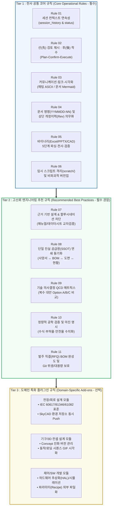

# TeMaat 표준 AI 협업 규칙 및 프로젝트 자동 초기화 가이드 (All-in-One Playbook & Bootstrapper)

* **문서 버전:** `Rev 1.0` (2026-11-10 제정)
* **주관 부서:** TeMaat 기술연구소 (기구/제어/SW 엔지니어링 표준)
* **파일 용도:** **단일 파일 휴대용(Portable) 표준 가이드 & AI 자동 셋업 마스터 시방서**

---

## 📋 문서 개정/수정 이력 (Revision History)

| 버전 (Rev) | 개정/수정 일자 | 작성자 / 부서 | 주요 변경 내역 (Change Description) |
| :---: | :---: | :---: | :--- |
| **Rev 1.0** | 2026-11-10 | TeMaat 기술연구소 | • **K社 박막두께 자동계측 시스템 프로젝트(56개 세션) 실전 검증 AI 협업 규칙 범용화 및 제정**<br/>• **[Tier 1] 전사 공통 코어 규칙(6대 원칙)** + **[Tier 2] 고신뢰 엔지니어링 추천 규칙(6대 Best Practices)** + **[Tier 3] 도메인 특화 규칙(전장/기구/SW)** 통합<br/>• **단일 파일 복사 후 AI 지시만으로 신규 프로젝트 폴더/템플릿(`.agents/AGENTS.md`, `project_status.md`, `session_history.md`, `.gitignore`)을 자동 생성하는 부트스트래퍼(Bootstrapper) 내장 🏆** |

---

## 🚀 다른 프로젝트에서 사용하는 방법 (1분 Quick-Start)

1. **본 파일 복사:** 이 파일(`AI_협업_표준_규칙_및_초기화_가이드.md`) 하나만 **새 프로젝트의 루트 폴더**에 복사합니다.
2. **AI에게 한 줄 명령:** 채팅창에 아래와 같이 요청합니다.
   > **`"루트에 있는 AI_협업_표준_규칙_및_초기화_가이드.md 파일을 읽고, 이 프로젝트에 맞게 표준 AI 협업 환경과 초기 템플릿 파일들을 자동으로 생성해 줘."`**

---

## 🤖 [AI 에이전트 전용 실행 지침] (AI AUTO-BOOTSTRAP INSTRUCTION)

> [!IMPORTANT]
> **AI 에이전트 필독:** 사용자가 본 문서를 읽고 **"프로젝트 초기화 / 템플릿 생성 / 협업 규칙 적용"**을 지시하면, 아래 **4단계 자동 부트스트래핑 절차**를 수행하십시오. (단, 작업 착수 전 생성할 파일 목록과 프로젝트명을 사용자에게 간략히 브리핑하고 컨펌을 받으십시오.)

### Step 1. 프로젝트 기본 정보 파악
* 현재 워크스페이스 폴더명(예: `261110_O社_장비개발`)에서 **작성일자**와 **프로젝트명**을 자동 추출하거나 사용자에게 확인합니다.
* 전장 설계(SkyCAD 등), 기구 설계, S/W 개발 중 해당되는 도메인 규칙(Tier 3) 포함 여부를 확인합니다(기본값: 전체 포함).

### Step 2. 표준 디렉토리 아키텍처 자동 생성
워크스페이스 루트 아래에 다음 기본 폴더가 없으면 생성합니다 (`scratch/` 포함):
```text
Project_Root/
├── .agents/                  # AI 협업 규칙 자동 로드 폴더 (AGENTS.md 위치)
├── 01_요구사항/              # 고객사 RFP, 원본 자료, 시료 데이터, 미팅 자료
├── 02_제작검토/              # 대외 제출용 PDF 보고서, PPTX 프레젠테이션
├── 03_예상재료비/            # 버전별 BOM 엑셀(.xlsx), 견적요청용 엑셀, 업체 견적서
├── 04_전장제어/              # I/O 리스트, 회로도(SkyCAD 등), 주요 부품 매뉴얼 PDF
├── 05_부품발주/              # 시행예산, 발주서, 외주 가공 도면(STEP/DWG)
├── docs/                     # 마크다운 기술검토서 원본(YYMMDD-NN), 현황표, 세션 이력
│   └── images/               # 문서 삽입용 3D 렌더링 이미지, 다이어그램, 애니메이션 GIF
└── scratch/                  # 일회성 Python 파싱/생성/검증 스크립트 (.gitignore 격리)
```

### Step 3. 4대 핵심 템플릿 파일 자동 생성
본 문서 **하단 [부록 A ~ 부록 D]**에 수록된 표준 코드 블록 내용을 기반으로 아래 4개 파일을 생성합니다.
1. **`.agents/AGENTS.md`** : **[부록 A]**의 표준 규칙 원문을 그대로 생성 (필요 시 프로젝트 고유 정보 반영)
2. **`docs/project_status.md`** : **[부록 B]**의 프로젝트 현황 요약 초기 템플릿 생성 (오늘 날짜 및 프로젝트명 기입)
3. **`docs/session_history.md`** : **[부록 C]**의 세션 이력 초기 템플릿 생성 (세션 1: 표준 AI 협업 환경 구축 기록)
4. **`.gitignore`** : **[부록 D]**의 표준 Git 제외 규칙 파일 생성 (기존 파일이 있으면 누락 항목만 병합)

### Step 4. Git 한글 인코딩 설정 점검
* Git 저장소가 초기화된 경우 `git config core.quotepath false`를 실행하여 한글 파일명이 깨지지 않도록 설정합니다.

---

## 1. 표준 AI 협업 규칙 3-Tier 아키텍처 해설

장기간 진행되는 복합 엔지니어링(기구·전장·모션제어·S/W·견적/BOM) 프로젝트에서 AI와 협업할 때 발생할 수 있는 **① 세션 간 컨텍스트 유실, ② 임의 파일 수정으로 인한 혼선, ③ 부품 사양/핀맵 할루시네이션(환각), ④ 문서-BOM-도면 간 사양 불일치, ⑤ 바이너리(Excel/CAD) 파일 파손**을 원천 차단하기 위해 3계층 구조로 설계되었습니다.



---

## 2. 세부 규칙 요약 가이드

### 2.1 [Tier 1] 전사 공통 코어 규칙 (기존 프로젝트 검증 6대 규칙)

| 규칙 번호 | 규칙 명칭 | 핵심 운영 내용 |
| :---: | :--- | :--- |
| **Rule 01** | **세션 컨텍스트 연속성**<br/>(Session Continuity) | • **세션 시작 시:** `docs/session_history.md` 및 `docs/project_status.md`를 가장 먼저 확인하여 이전 맥락과 미결 과제(`Next Action Items`) 파악<br/>• **세션 종료 시:** 작업 일시, 변경 내역, 생성 파일, 다음 과제를 시간순 누적 기록 |
| **Rule 02** | **선제시 후착수 원칙**<br/>(Plan-Confirm-Execute) | • 파일 생성·수정 및 코드 작성 전 **분석 결과와 구체적 작업 방안(초안)을 먼저 제시**<br/>• 사용자의 **명시적 컨펌(승인/피드백) 획득 후 실제 작업 착수** |
| **Rule 03** | **링크 및 다이어그램 이원화**<br/>(Links & Diagrams) | • **문서(`.md`) 내 링크:** 뷰어 줄바꿈/인코딩 깨짐 방지를 위해 **상대 경로(`./`, `../`)** 필수 사용<br/>• **다이어그램:** 채팅 답변은 **유니코드/ASCII 박스(`┌─, │, ─▶`)**, 마크다운 파일은 **`mermaid` 그래픽** 사용 |
| **Rule 04** | **문서 명명 및 개정이력 표**<br/>(Naming & Revision) | • `docs/` 내 개별 문서는 **`YYMMDD-NN_문서제목.md`** 형식으로 작성일과 일련번호 부여<br/>• 모든 문서 첫 페이지 상단에 **[문서 개정/수정 이력(Rev, 일자, 작성자, 변경내역)] 표** 필수 유지 |
| **Rule 05** | **바이너리 5단계 프로세스**<br/>(Binary File Workflow) | • Excel(`.xlsx`), PPTX, CAD 등 수정 시: **① `scratch/` 스크립트로 정밀 파싱 ➔ ② `docs/`에 100% 텍스트 전사명세서 보존 ➔ ③ 변경안 선제시 ➔ ④ 사용자 컨펌 ➔ ⑤ 신규 버전 생성 및 수식/데이터 정합성 검증** |
| **Rule 06** | **로컬 `scratch/` 격리 및<br/>비파괴적 버전업** | • 일회성 파싱·생성·검증 Python 스크립트는 프로젝트 루트 내 **`scratch/`**에만 보관(`.gitignore` 격리)<br/>• 주요 산출물 수정 시 원본 덮어쓰기 금지, 버전 번호(`v1.0` ➔ `v1.1`)를 올려 신규 생성 |

### 2.2 [Tier 2] 고신뢰 엔지니어링 추천 규칙 (신규 표준 편입 6대 규칙 ★)

| 규칙 번호 | 규칙 명칭 | 왜 필요한가? & 어떻게 수행하는가? |
| :---: | :--- | :--- |
| **Rule 07** | **근거 기반 설계 &<br/>할루시네이션 원천 차단**<br/>(Datasheet Fact-Check) | • **이유:** 부품 형번 끝자리 하나, 커넥터 핀 번호 하나를 AI가 추측(환각)하면 오발주나 하드웨어 소손 발생<br/>• **방법:** 정품 Part Number, 핀맵, 정격, 치수는 반드시 **공식 매뉴얼 PDF, 데이터시트, 견적서를 교차 검증**하고 문서 내에 **근거 출처(매뉴얼명 및 페이지 번호)**를 명시 |
| **Rule 08** | **단일 진실 공급원(SSOT)<br/>연쇄 동기화**<br/>(Cascade Sync) | • **이유:** 모터나 센서가 바뀌었는데 검토서만 고치고 BOM이나 I/O 리스트를 안 고치면 설계 불일치 발생<br/>• **방법:** 핵심 사양 변경 시 **연관 산출물(`기술검토서` ↔ `BOM 엑셀/명세서` ↔ `I/O 리스트·도면 가이드` ↔ `project_status.md`) 영향도 리스트를 먼저 도출**하고 일괄 동기화 |
| **Rule 09** | **기술 의사결정<br/>QCD 트레이드오프 매트릭스**<br/>(Decision Matrix) | • **이유:** 아키텍처나 부품 선정의 공학적 근거(ADR)를 명확히 남기기 위함<br/>• **방법:** 단일 안만 제시하지 않고 복수 대안(Option A/B/C)에 대해 **Q(성능/정밀도)·C(원가)·D(납기/조달성)·유지보수성** 비교 표와 **최종 추천안(🏆)**을 함께 제시 |
| **Rule 10** | **정량적 공학 계산 및<br/>설계 마진율 명시**<br/>(Quantitative Margin) | • **이유:** "용량이 충분함", "발열이 적음" 같은 모호한 정성적 표현 배제<br/>• **방법:** 반드시 **공학 수식(LaTeX), 정격 대비 실제 소비 부하율(%), 안전율(Safety Factor), 전력/예산 마진율(%)**을 정량적 수치로 계산하여 제시 |
| **Rule 11** | **발주 직결(RFQ) 완결성**<br/>(Procurement-Ready BOM) | • **이유:** BOM 작성 후 구매팀이나 엔지니어가 다시 모델명과 대리점을 찾는 이중 작업 방지<br/>• **방법:** BOM 작성 시 **[품명 / 제조사 / 정품 Full Part Number / 규격 / 수량 / 실비 단가 / 공식 대리점·구매처 / 연락처·이메일]**을 1:1 매핑 |
| **Rule 12** | **Git 위생 및 대용량 보호**<br/>(Git & Asset Hygiene) | • **이유:** 대용량 설치 파일(100MB 초과) 커밋으로 인한 GitHub Push 실패 및 한글 경로 깨짐 방지<br/>• **방법:** `git config core.quotepath false` 기본 적용, `git add` 전 **50MB 이상 대용량 파일 및 임시 파일(`~$*`) 유무를 사전 스캔**하여 `.gitignore` 격리 |

### 2.3 [Tier 3] 도메인 특화 플러그인 규칙 (전장 / 기구 / 제어 S/W)

* **전장/회로 설계 (IEC & SkyCAD):**
  * **IEC 60617**(심볼), **IEC 81346**(`=위치+기능-기기` 구조화 태그: `=CP`, `=RK`, `=OP`, `=MCH`), **IEC 61082**(문서 규칙) 준수
  * 전원 계통은 **상 ➔ 하 수직 강하(Top-to-Bottom)**, 신호 계통은 **좌 ➔ 우 수평 전개(Left-to-Right)**
  * 4선 십자 교차 분기 금지(3방향 T-junction 필수), OPR 표기는 `/[시트번호].[그리드좌표]` 형식 유지
  * `.SkyCadFile` 커밋/푸시 시 **SkyCAD 표준 환경 저장소(`C:\Workspaces\SkyCAD`)의 카탈로그/심볼 변경분도 동시에 커밋·푸시**
* **기구/컨셉 설계:**
  * 설계 변경 시 기존 안을 덮어쓰지 않고 `Concept 1 ➔ Concept 2 ➔ ... ➔ 최종 확정(🏆)`으로 진화 이력과 개선 근거 보존
  * 구동 및 측정 순서는 단계별 3D 시뮬레이션 이미지/GIF 또는 시퀀스 다이어그램으로 시각화
* **제어 소프트웨어 개발:**
  * 모션 제어기 및 센서 드라이버는 하드웨어 추상화 계층(HAL)으로 분리하여 실물 장비 없이도 동작하는 **시뮬레이션 모드(Dry-Run)** 기본 지원
  * 좌표, 속도, 타이밍, 캘리브레이션 계수는 코드 내 하드코딩을 금지하고 외부 설정(Excel/JSON Recipe)으로 분리

---
---

# 📦 [부록] 자동 생성용 표준 템플릿 원문 (Templates for AI Bootstrapper)

AI 에이전트가 신규 프로젝트 초기화 시 그대로 추출하여 파일을 생성할 수 있도록 구성된 표준 템플릿 원문입니다.

---

## [부록 A] `.agents/AGENTS.md` 표준 템플릿 원문

````markdown
# Antigravity Workspace Rules & Standard Engineering Collaboration Protocol

## 1. 세션 시작 시 필수 수행 절차 (MANDATORY ON NEW SESSION)
* 새로운 세션이 시작되거나 사용자의 첫 요청을 받을 때, **가장 먼저 `docs/session_history.md` 및 `docs/project_status.md` 파일을 확인(`read_file`)**하여 이전 진행 상황과 결정 사항, 향후 수행해야 할 과제(`Next Action Items`)를 파악합니다.
* 사용자가 이전 작업에 대해 묻거나 추가 작업을 지시할 때 이전 세션의 컨텍스트를 완벽히 유지하여 이어서 작업합니다.

## 2. 작업 완료 및 세션 종료 시 문서 업데이트 규칙 (UPDATING DOCS)
* 주요 작업이 완료되거나 사용자의 요청을 마무리할 때, `docs/session_history.md`에 **현재 세션의 날짜, 시간, 세션 번호, 작업 내용, 변경된 파일 목록, 향후 수행해야 할 작업(Next Action Items)**을 시간순으로 누적 기록합니다.
* 시스템 사양, 부품 구성, 예산, 주요 산출물 목록에 변경이 발생한 경우 `docs/project_status.md`도 즉시 최신화합니다.

## 3. 기본 커뮤니케이션, 파일 링크 및 다이어그램 표기 규칙
* **언어 원칙:** 모든 답변, 생각 과정(Thought process), 작업 목록(Task List)은 항상 **한국어**로 작성합니다.
* **마크다운 문서(`.md`) 내부의 파일 링크 작성 원칙:**
  * `docs/` 등 마크다운 문서 내부에서 다른 파일이나 산출물을 링크할 때는 긴 절대경로(`file:///c:/...`) 및 URL 인코딩(`%20` 등)으로 인한 마크다운 뷰어 렌더링 깨짐/줄바꿈 오류를 원천 방지하기 위해 **반드시 깔끔하고 작동 가능한 상대 경로 링크(`[표시이름](../상대경로)` 또는 `[표시이름](./상대경로)`)**를 사용합니다.
* **대화(채팅) 세션 내 파일 링크:**
  * 사용자에게 답변할 때는 클릭 가능한 markdown 링크(`[파일명](file:///c:/경로)`) 또는 상대 경로 형식을 유지합니다.
* **다이어그램 및 시각화 이원화 규칙:**
  * **대화(채팅) 세션 답변:** 대화 세션 뷰어에서는 Mermaid 그래픽이 미지원되므로, **채팅 답변 시에는 가독성이 뛰어난 텍스트 기반 유니코드/ASCII 박스 다이어그램(`┌─`, `│`, `└─`, `─▶` 등) 또는 마크다운 표/리스트**를 사용하여 직관적으로 표현합니다.
  * **마크다운(`.md`) 파일 산출물:** 마크다운 문서 뷰어(VS Code Markdown Preview, GitHub 등)에서는 Mermaid가 정상 작동하므로, **`docs/` 디렉토리 내 마크다운 문서 작성 시에는 표준 Mermaid 코드 블록(```mermaid)을 적극 활용**하여 시스템 아키텍처, 흐름도, 배선도, 시퀀스 등을 직관적인 그래픽 다이어그램으로 시각화합니다.

## 4. 작업 프로세스 규칙 (검토 결과 선제시 및 컨펌 후 작업 착수)
* 문서 작성, 수정 및 코드/데이터 생성 등의 변경 작업을 직접 수행하기 전에, **먼저 분석/검토 결과와 구체적인 작업 방향(초안/방안)을 사용자에게 명확히 제시**합니다.
* 사용자의 **컨펌(승인 및 피드백)을 확인한 후에 실제 파일 생성/수정 작업에 착수**합니다.

## 5. 문서 명명 규칙 (`YYMMDD-NN`) 및 개정이력(Revision History) 관리 규칙
* **파일 명명 규칙:** `docs/` 디렉토리에 개별 세부 기술 검토서, 보고서, 사양서 등을 생성할 때는 파일명 앞에 **`[작성년월일 6자리]-[당일 일련번호 2자리]`** 형식을 필수로 적용합니다.
  * **표준 형식:** `YYMMDD-NN_문서제목.md` (예: `261110-01_시스템_제어_아키텍처_검토서.md`)
* **문서 개정이력 표 관리:** 기존에 작성된 문서를 업데이트(수정/개정)하거나 신규 문서를 작성할 때는 **반드시 문서 첫 페이지 상단(문서 메타정보 바로 아래)에 [문서 개정/수정 이력(Revision History)] 표를 배치하고 최신 버전 행을 누적 갱신**합니다.
  * **필수 항목:** `버전(Rev)` | `개정/수정 일자` | `작성자/부서` | `주요 변경 내역(Change Description)`

## 6. 바이너리(Excel, PPTX, CAD 등) 파일 5단계 관리 및 비파괴적 버전업 규칙
* AI가 직접 텍스트로 열람하기 어려운 바이너리 파일(Excel `.xlsx`, `.pptx`, 도면 등)을 참조하거나 수정/생성할 때는 **반드시 다음 5단계 절차를 준수**합니다.
  1. **정밀 파싱 및 분석:** 프로젝트 내 `scratch/` 디렉토리의 Python 스크립트(`openpyxl`, `python-pptx` 등)를 실행하여 원본 바이너리 파일의 모든 시트/슬라이드 구조, 셀 데이터, 수식 관계, 서식 메타데이터를 완벽하게 추출·분석합니다.
  2. **마크다운 전사 명세서 생성:** 추출한 원본 파일의 내용 및 구조를 `docs/` 디렉토리에 마크다운 문서(`YYMMDD-NN_...전사명세서.md`)로 100% 텍스트화하여 기록·보존합니다.
  3. **변경안 마크다운 선제시:** 신규 버전에서 변경/반영할 내용(부품 교체, 단가/수식 변경, 구매처 등)을 마크다운 문서(`YYMMDD-NN_...개정검토서.md`) 또는 요약 표로 작성하여 사용자에게 상세히 제시합니다.
  4. **사용자 컨펌(승인):** 변경안에 대해 사용자의 검토 및 공식 승인을 획득합니다.
  5. **신규 바이너리 파일 생성 및 정합성 검증:** 기존 원본 파일을 덮어쓰지 않고(비파괴적 버전업: `v1.0` ➔ `v1.1` 등) 신규 버전 파일을 생성한 뒤, 수식 오류 유무 및 합계/데이터 연동 정합성을 최종 검증합니다.

## 7. 임시/작업용 스크립트 저장 위치 규칙 (PROJECT LOCAL SCRATCH)
* 프로젝트 작업 중 필요한 일회성 데이터 파싱, 엑셀/PPT 생성, 정합성 검증 등의 파이썬 스크립트는 **반드시 프로젝트 루트 내의 `scratch/` 디렉토리에 생성·보관**합니다.
* 전역 경로를 사용하지 않으며, 프로젝트 내 `scratch/` 디렉토리는 `.gitignore`에 등록하여 안전하게 격리 관리합니다.

## 8. 근거 기반 엔지니어링 & 할루시네이션 방지 규칙 (FACT-FIRST & DATASHEET VERIFICATION)
* 상용 부품의 **정품 모델명(Full Part Number), 커넥터 규격, 핀맵(Pinout), 정격 사양, 외형 치수, 조달 가능 여부**는 절대로 추측(Hallucination)하지 않으며, 반드시 공식 매뉴얼 PDF, 데이터시트, 카탈로그, 견적서를 교차 검증합니다.
* 기술 검토서 작성 시 핵심 사양과 설계 판단 근거에 **참조 출처(매뉴얼명, 페이지 번호 등)**를 명시하고, 정성적 표현 대신 **정량적 공학 수식, 부하율(%), 안전율/마진율(%)**을 계산하여 제시합니다.
* 아키텍처나 핵심 부품 선정 시 복수 대안(Option A/B/C)에 대한 **Q(품질/성능)·C(원가)·D(납기/조달성) 비교 매트릭스**를 제시하여 최적안을 도출합니다.

## 9. 단일 진실 공급원(SSOT) 연쇄 동기화 및 Git 위생 규칙 (SSOT & GIT HYGIENE)
* **연쇄 동기화:** 핵심 사양(부품 모델, 수량, 단가, 통신/전원 구조 등)이 변경될 경우, 연관된 **`기술검토서` ↔ `BOM 엑셀/명세서` ↔ `I/O 리스트 및 도면 가이드` ↔ `docs/project_status.md`**의 영향도를 먼저 리스트업하고 일괄 동기화합니다.
* **Git 위생 관리:**
  * 한글 파일명 깨짐 방지를 위해 `git config core.quotepath false` 설정을 유지합니다.
  * Git 스테이징(`git add`) 전 50MB~100MB 이상의 대용량 바이너리/설치 패키지와 임시 파일(`~$*`) 유무를 사전 점검하여 `.gitignore`로 격리합니다.

## 10. IEC 표준 전장 도면 설계 및 표기 규칙 (IEC STYLE ELECTRICAL DESIGN RULES)
* **표준 규격 준수:** IEC 60617 (전기 심볼 그래픽 표준), IEC 81346 (플랜트/기기 구조화 식별자 태깅), IEC 61082 (전기 기술문서 작성 규칙)를 도면 전체에 일관되게 적용합니다.
* **구조화 태그 식별자 (IEC 81346 표준):**
  * 접두사 체계: `=Plant+Location-Device` (예: `=CP+SR1`, `=OP+ES1`, `=MCH+SM1`)
  * 기능/위치 접두어: `=CP`(Control Panel), `=RK`(Overhead Rack), `=OP`(Operator Console), `=MCH`(Machine Frame)
  * 기기 분류 코드: `Q`(차단기/개폐기), `K`/`SR`(릴레이/안전릴레이), `S`(조작 스위치/센서), `F`(보호기기/필터/서지), `T`/`PS`/`CV`(전원공급장치/SMPS/컨버터), `X`/`TB`(단자대/커넥터), `U`/`MC`/`SD`(컨트롤러/서보드라이버), `W`(케이블/전선)
* **신호 및 전원 흐름 (Signal & Power Flow):**
  * **전원 계통:** 상단(Top Rail: +24V / L상)에서 하단(Bottom Rail: 0V / N상 / PE)으로 수직 강하(Top-to-Bottom)
  * **제어/신호 계통:** 좌측(Inputs)에서 우측(Outputs)으로 수평 전개(Left-to-Right)
* **심볼 및 블록 단자 배치 (IEC Port Orientation):**
  * 전원/코일 단자: `A1`은 상단(Top), `A2`는 하단(Bottom)
  * 안전 접점: 끝자리 `3-4`는 상시 개방(NO 접점: 13-14, 23-24), `1-2`는 상시 폐로(NC 접점: 11-12, 21-22). 전원 유입측은 상단(13, 23), 부하 인출측은 하단(14, 24) 배치
  * 스위치 및 접점: 수직 배선 시 입력 상단, 출력 하단 배치
* **배선 및 접속 표기:**
  * 배선 분기 시 4선 십자 교차 분기는 엄격히 금지하며, 반드시 3방향 점 분기(T-junction)를 사용합니다.
  * OPR(On-Page Reference / Off-Page Reference) 표기는 `/[시트번호].[그리드좌표]` (예: `/04.A1`, `/08.C2`) 형식을 유지합니다.

## 11. SkyCAD 파일 커밋 및 환경 저장소(`C:\Workspaces\SkyCAD`) 동시 푸시 규칙
* 프로젝트 내 SkyCAD 관련 파일(`.SkyCadFile` 등)이 변경되어 Git 커밋 및 푸시를 수행할 때는 **반드시 `C:\Workspaces\SkyCAD` (SkyCAD Standard Environment 저장소, `git@github.com:ykkim-temaat/SkyCAD_Env.git`)의 변경 상태(`git status`)도 함께 점검하여 동시에 커밋하고 푸시**합니다.
````

---

## [부록 B] `docs/project_status.md` 초기 생성 템플릿

```markdown
# [프로젝트명] 프로젝트 현황 요약

* **최종 업데이트 일자:** YYYY-MM-DD
* **주관 부서:** TeMaat 기술연구소

---

## 📋 문서 개정/수정 이력 (Revision History)

| 버전 (Rev) | 개정/수정 일자 | 작성자 / 부서 | 주요 개정 및 수정 내용 |
| :---: | :---: | :---: | :--- |
| **Rev 1.0** | YYYY-MM-DD | TeMaat 기술연구소 | • 프로젝트 워크스페이스 초기화 및 표준 AI 협업 규칙(`.agents/AGENTS.md`) 구축 완료 |

---

## 1. 프로젝트 개요
* **프로젝트명:** [프로젝트명 기입]
* **영문 프로젝트/저장소명:** `[영문 저장소명 기입]`
* **주관:** TeMaat 기술연구소
* **목적:** [프로젝트 핵심 개발 목표 및 타당성 검토 개요 기입]

---

## 2. 주요 시스템 사양 요약
### (1) 핵심 계측/공정 모듈
* (요구사항 분석 후 업데이트 예정)

### (2) 기구 및 스테이지 구동계
* (요구사항 분석 후 업데이트 예정)

### (3) 제어 시스템 및 전장/소프트웨어
* (요구사항 분석 후 업데이트 예정)

---

## 3. 관련 기술 및 설계 산출물 목록
* [docs/session_history.md](./session_history.md) : 세션별 작업 히스토리 관리 문서
* [AI_협업_표준_규칙_및_초기화_가이드.md](../AI_협업_표준_규칙_및_초기화_가이드.md) : TeMaat 표준 AI 협업 규칙 마스터 가이드

---

## 4. 핵심 검토 및 결정 필요 사항 (Action Items)
1. [ ] **고객 요구사항(RFP) 자료 분석 및 시스템 초기 사양 정의**
2. [ ] **핵심 부품/모듈 선정 및 아키텍처 검토서 작성**
```

---

## [부록 C] `docs/session_history.md` 초기 생성 템플릿

```markdown
# 프로젝트 세션 작업 이력 (Session History)

이 문서는 Antigravity IDE를 통한 각 세션별 작업 내용과 결정 사항, 향후 수행할 작업을 날짜 및 시간순으로 기록하는 문서입니다.  
**새로운 세션이 시작되면 본 문서를 가장 먼저 확인하여 컨텍스트를 파악하고 이어서 작업을 진행합니다.**

---

## 📅 [YYYY-MM-DD] 세션 1 (HH:MM ~ HH:MM)

### 1. 작업 개요
* **프로젝트명:** [프로젝트명]
* **작업자:** TeMaat 기술연구소 & Antigravity AI
* **주요 목표:**
  1. `AI_협업_표준_규칙_및_초기화_가이드.md` 기반 프로젝트 표준 폴더 구조 및 협업 환경 초기화
  2. `.agents/AGENTS.md`, `docs/project_status.md`, `docs/session_history.md`, `.gitignore` 생성

---

### 2. 세부 작업 및 처리 내역
* 표준 디렉토리(`01_요구사항` ~ `05_부품발주`, `docs/images`, `scratch`) 생성 완료
* `.agents/AGENTS.md` 표준 협업 규칙 적용 및 Git 한글 인코딩(`core.quotepath false`) 설정 완료

---

### 3. 주요 산출물 목록
| 파일 경로 | 설명 |
| :--- | :--- |
| `.agents/AGENTS.md` | 세션 시작 시 자동 로드되는 워크스페이스 AI 협업 규칙 |
| [docs/project_status.md](./project_status.md) | 프로젝트 종합 현황 및 사양 명세서 |
| [docs/session_history.md](./session_history.md) | 날짜/시간별 세션 작업 히스토리 (본 문서) |
| `.gitignore` | Git 버전 관리 제외 규칙 정의 파일 |

---

### 4. 다음 세션 시작 시 즉시 착수할 작업 (Next Action Items)
- [ ] **1. `01_요구사항/` 폴더 내 고객사 요구사항 자료 확인 및 초기 제작검토서 작성**
```

---

## [부록 D] `.gitignore` 표준 생성 템플릿

```gitignore
# 프로젝트 로컬 임시 스크립트 및 작업 폴더 격리 (Rule 07)
scratch/

# MS Office / CAD 임시 락 파일 및 백업 파일
~$*.pptx
~$*.xlsx
~$*.docx
*.bak
*.tmp

# Python 캐시 및 가상환경
__pycache__/
*.py[cod]
*$py.class
.venv/
venv/
env/

# OS 및 IDE 메타데이터
.DS_Store
Thumbs.db
Desktop.ini
.vscode/*
!.vscode/settings.json
.idea/

# 민감 정보 및 로컬 환경변수
.env
*.pem
*.key
```

