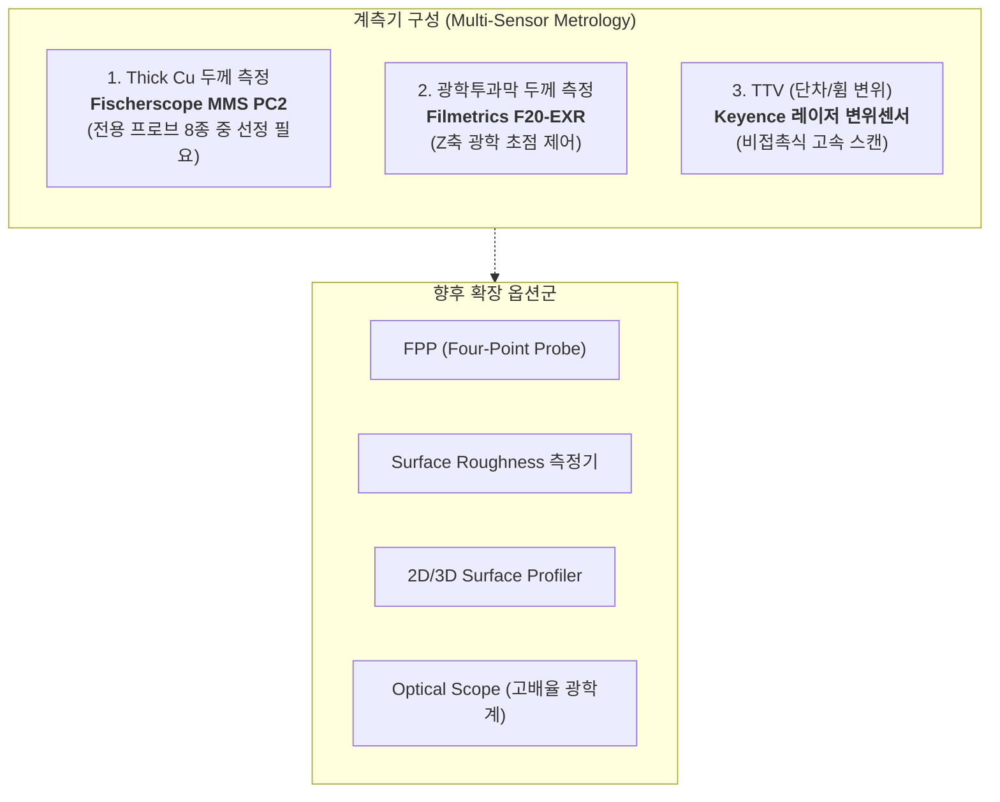
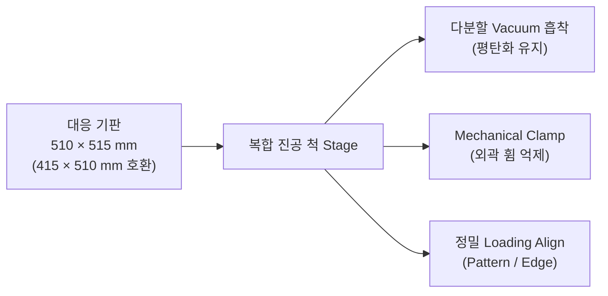
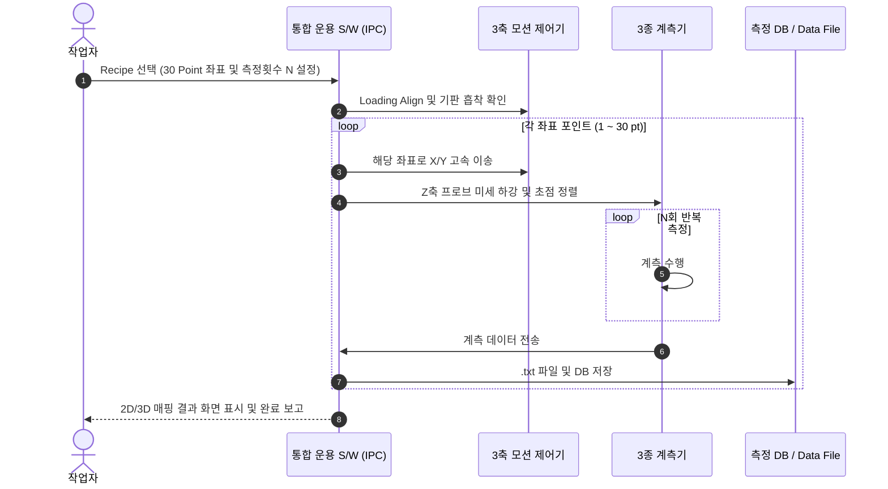

# K社(KCT向) 박막두께 자동계측 시스템 고객 요구사항 분석서

* **문서 번호:** `261110-01`
* **작성 일자:** 2026-11-10
* **주관 부서:** TeMaat 기술연구소
* **참조 원본:** `../01_제작사양 및 설계자료/01-1_K社 박막두께 자동계측 시스템 제작_고객요구사항 요약_260810.pptx`

---

## 📋 문서 개정/수정 이력 (Revision History)

| 버전 (Rev) | 개정/수정 일자 | 작성자 / 부서 | 주요 변경 내역 (Change Description) |
| :---: | :---: | :---: | :--- |
| **Rev 1.0** | 2026-11-10 | TeMaat 기술연구소 | • 고객사(KCT向) 8월 요구사항 PPTX 원본 분석 및 전사 마크다운 문서화 완료 • 다종 계측기 3종 통합 사양, 510×515mm 대형 기판 대응 및 기판 휨(Warpage) 대책 수록 |

---

## 1. 프로젝트 목적 및 배경
* **목적:** K社(KCT向) 대면적 기판 박막두께 자동계측 시스템 견적 제출 및 수주
* **검토 배경:** 기존 수동 또는 단일 측정 한계를 극복하고, Thick Cu, 광학투과막(F20), TTV 등 복합 계측기를 1대의 장비에 통합 탑재하여 대형 패널 기판을 전자동 매핑 계측하는 시스템 개발

---

## 2. 계측기 구성 (Instruments Architecture)

### (1) 기본 탑재 계측기 (고객 사급 3종)
1. **Thick Cu 두께 측정기**:
   * 제조사 / 모델: **Fischerscope MMS PC2**
   * 측정 방식: 전자기/와전류 방식
   * 연동 방식: RS-232C 통신
   * 프로브 검토: 총 8종 프로브 중 기판 Cu 두께 스펙에 최적화된 프로브 선정 협의 필요
2. **광학투과막 두께 측정기**:
   * 제조사 / 모델: **Filmetrics F20-EXR**
   * 측정 방식: 분광 반사율 측정 방식 (Spectrophotometry)
   * 연동 방식: USB 통신 및 Z축 초점 자동 제어
3. **TTV (Total Thickness Variation) 측정기**:
   * 제조사 / 모델: **키엔스(Keyence) Laser 변위센서** (LJ-X / LK 시리즈 등 협의 중)
   * 측정 방식: 삼각측량 또는 레이저 공초점 변위 측정

---

## 3. 기구 및 스테이지 구동계 사양 (Chuck Stage & Mechanics)

### (1) 대응 기판 규격 (Substrate Size)
* **표준 대형 기판:** $510 \times 515\text{ mm}$
* **호환 기판:** $415 \times 510\text{ mm}$ (또는 $512\text{ mm}$)
* 다양한 크기의 기판을 단일 척에서 수용할 수 있는 전용 다분할 진공 홀 패턴 설계

### (2) 기판 휨(Warpage) 극복 대책
* **다분할 Vacuum Chuck:** 기판 크기 및 휨 분포에 따라 흡착 구역을 분할 제어하여 들뜸 방지
* **Mechanical Clamp (외곽 기계식 클램프):** 진공 흡착이 어려운 기판 가장자리 휨을 물리적으로 가압 밀착
* 복합 고정 방식으로 기판 평탄도를 확보한 상태에서 정밀 계측 수행

### (3) 정밀 3축 모션 메커니즘
* **모션 스트로크:** $X: 550\text{ mm} \times Y: 550\text{ mm} \times Z: 100\text{ mm}$
  * $510 \times 515\text{ mm}$ 대형 기판의 전 영역을 사각지대 없이 100% 매핑 가능 ($+35\text{ mm}$ 측정 마진 확보)
* **프레임 베이스 구조:**
  * 외부 환경 진동을 원천 차단하는 **약 650 kg 고강성 화강암 석정반 베이스** 채택
  * 장비 외형 치수: 약 $1,050(W) \times 1,200(D) \times 1,700(H)\text{ mm}$ (하부 맞춤형 워크테이블 결합)

---

## 4. 제어 시스템 및 소프트웨어 요구조건 (Control & S/W)

1. **위치 제어 및 좌표 자동 검사 (Auto Scan):**
   * Recipe 등록: 최대 수십~수백 포인트(예: 30 point) 좌표 등록 및 관리
   * 1개 포인트당 Recipe에서 지정한 횟수만큼 정밀 반복 측정
2. **정렬(Align) 기능:**
   * 기판 안착 후 자재 세팅 오차 보정을 위한 정밀 Loading Align 지원 (패턴 정렬 또는 외곽 엣지 정렬)
3. **데이터 수집 및 내보내기:**
   * 계측된 데이터는 텍스트 파일(`.txt`)로 자동 저장되어 사급 노트북 또는 중앙 시스템으로 전송
   * 시스템 정밀도 유지를 위한 센서 Calibration Mode 지원

---

## 5. 고객 협의 및 확정 필요 사항 (Action Items)

| No | 구분 | 협의 항목 | 검토 내용 및 액션 |
| :---: | :--- | :--- | :--- |
| **1** | 센서 헤드 | 센서 동시 탑재 vs 교체 방식 | 멀티헤드 동시 탑재 방식(기구 스트로크 오프셋 보정) vs 단일센서 체인저 방식 확정 |
| **2** | 기판 얼라인 | 패턴 정렬 vs 엣지 정렬 | 실물 기판 샘플 입수 후 시료 표면 상태에 따른 최적 알고리즘 테스트 후 확정 |
| **3** | 센서 사양 | 키엔스 변위센서 & MMS 프로브 | 키엔스 센서 모델명/컨트롤러 확정 및 MMS PC2 프로브(총 8종 중) 확정 |
| **4** | 소프트웨어 | 통합 제어 S/W 개발 범위 | 센서 제조사 전용 뷰어 사용 여부 또는 당사 올인원 UI 개발 범위 확정 |
| **5** | 유틸리티 | 진공압 및 클램프 사양 | 자재 재질/두께에 따른 최적 진공 공급압 및 기계식 클램프 사양 최종 확정 |

