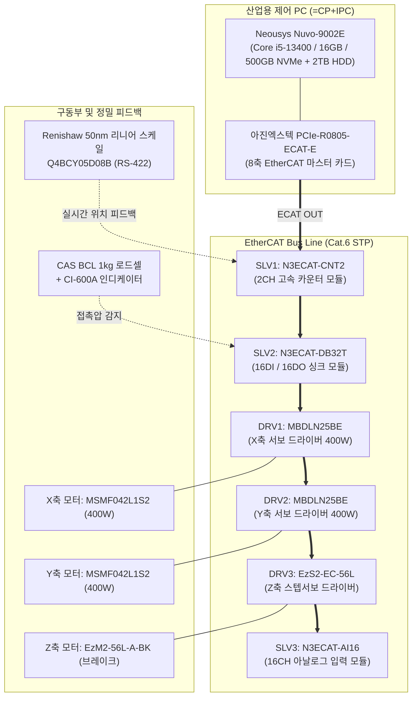
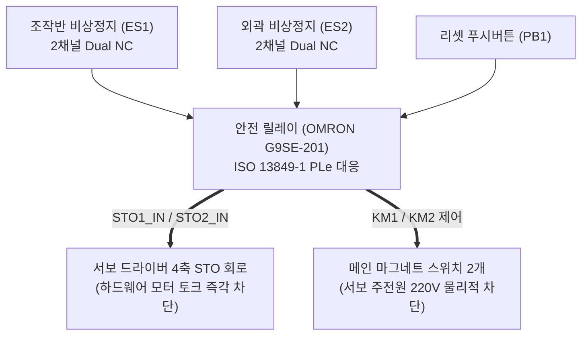

# MultiSensor-Metrology 전장 회로 설계 및 시스템 아키텍처 검토서

* **문서 번호:** `261110-02`
* **작성 일자:** 2026-11-10
* **주관 부서:** TeMaat 기술연구소
* **참조 도면:** `../01_제작사양 및 설계자료/02-2_MultiSensor-Metrology_261109-1.pdf` (TM-DWG-260825 Rev. A)

---

## 📋 문서 개정/수정 이력 (Revision History)

| 버전 (Rev) | 개정/수정 일자 | 작성자 / 부서 | 주요 변경 내역 (Change Description) |
| :---: | :---: | :---: | :--- |
| **Rev 1.0** | 2026-11-10 | TeMaat 기술연구소 | • MultiSensor-Metrology 전장회로도(18개 시트) 전수 정밀 분석 및 시스템 아키텍처 문서화 완료 • EtherCAT 네트워크 토폴로지, 전원 분배, 2중 안전회로(STO), 나노미터급 리니어 스케일 듀얼 피드백 회로 명세화 |

---

## 1. 전장 시스템 전체 아키텍처 개요

본 장비의 전장 제어 아키텍처는 고신뢰성 산업용 IPC(Neousys Nuvo-9002E)에 독립형 EtherCAT 마스터 카드(아진엑스텍 PCIe-R0805-ECAT-E)를 탑재하고, 필드 레벨의 모든 서보 드라이버와 I/O 모듈을 단일 고속 EtherCAT 필드버스로 통합한 구조입니다.

---

## 2. 도면 시트별 구성 및 상세 분석

총 18개 시트로 구성되어 있으며, IEC 60617 / IEC 81346 표준 전장 규격을 준수합니다:

| Sheet | 도면 제목 (Title) | 주요 내용 및 회로적 특징 |
| :---: | :--- | :--- |
| **01** | Cover & Drawing Index | 프로젝트 메타정보, 도면 목차(Index), 티마트 소유권 및 버전 관리 |
| **02** | Overall Layout | 제어반 외형 치수($1,050 \times 1,200 \times 1,700\text{ mm}$), 공간 구획 및 전장 배치도 |
| **03** | Door Layout | 도어 조작반(27인치 QHD 모니터 암, 타워램프, 리셋버튼, E-Stop 스위치) |
| **04** | Backplate Layout | 제어반 내부 속판(DIN-Rail, MCCB, SMPS, EtherCAT 모듈, 서보 드라이버) 실장 레이아웃 |
| **05** | TOP Layout | 상부 덕트 인입, 케이블 글랜드 및 전원/통신선 분리 인입 경로 |
| **06** | Main AC Power Circuit | 단상 AC 220V 20A 인입, MCCB, WoonYoung 노이즈필터 및 서지보호기(SPD), MCB 분기 |
| **07** | Control DC Power Distribution | MEAN WELL 24V 20A SMPS, 회로보호기(CP 4채널 분기), 5V DC/DC 변환 |
| **08** | Safety Circuit & STO | OMRON G9SE-201 안전 릴레이, 2중 E-Stop 직렬 감시, 서보 4축 하드웨어 STO 연동 |
| **09** | IPC & EtherCAT Network | Nuvo-9002E IPC 및 PCIe-R0805-ECAT-E 마스터 카드 기반 슬레이브 통신 결선 |
| **10** | X & Y Axis Servo Motor | Panasonic MINAS A6B (MBDLN25BE / MSMF042L1S2 400W) 2축 주전원 및 신호 결선 |
| **11** | Z Axis Servo & Scale | FASTECH EzS2-EC-56L 드라이버 및 Renishaw 50nm 광학 리니어 스케일 결선 |
| **12** | Servo Sensor Limit Circuit | X/Y/Z축 원점(Origin) 및 +/- 오버트래블(Limit) 센서 신호 인터페이스 |
| **13** | Digital I/O Circuit | N3ECAT-DB32T(XTB-40H) 기반 솔레노이드 밸브, 조작 스위치, 타워램프 결선 |
| **14** | Analog Input Circuit | N3ECAT-AI16 기반 아날로그 전압/전류 신호 계측 회로 |
| **15** | Instruments Interface | 사급 3종 계측기(Fischer MMS PC2, Filmetrics F20, CAS 로드셀) 전원 및 통신 |
| **16** | Pneumatics & Vacuum Control | SMC 2-Zone 진공 밸브, 디지털 압력스위치(PS1), 4-Edge 기계식 클램프 배관/제어 |
| **17** | Bill of Materials (BOM) | 전장 부품 정품 모델명, 규격, 수량, 제조사 명세서 |
| **18** | Terminal Strip Layout | DIN 레일 단자대 (TB1 ~ TB4) 배치도 및 심선 번호/핀맵 정의 |

---

## 3. 핵심 회로 계통별 기술 검토

### (1) 주전원 및 DC 분배 계통 (Sheet 06 ~ 07)
* **AC 220V 인입 회로**:
  * 메인 차단기: `MCCB1` (LS일렉트릭 ABS32C, 2P 30AF / 20A)
  * 서지 및 노이즈 차단: `SPD1` (WoonYoung WYPA2040T220, 220V 40kA) + `FLT1` (WoonYoung WYFS20T1B, 20A 노이즈 필터)
  * 분기 보호: `MCB1`(5A, 서보 주전원), `MCB2`(10A, 계측기 전원), `MCB3`(5A, 보조 소켓), `MCB4`(10A, 24V SMPS)
* **DC 전원 4계통 완전 분리 (Noise Isolation)**:
  * 주 SMPS: `PSU1` (MEAN WELL NDR-480-24, DC 24V / 20A / 480W)
  * 전자식/열동식 회로보호기(`CP1 ~ CP4`, 각 5A)로 부하별 상호 간섭 차단:
    * `P24_IPC` : 산업용 IPC 전원
    * `P24_IO` : N3ECAT-DB32T, 솔레노이드 밸브, 센서 전원
    * `P24_SFT` : OMRON 안전릴레이 및 비상정지 회로 전원
    * `P24_SVO` : 서보 드라이버 제어 전원
  * 보조 전원: `PSU2` (MEAN WELL DDR-15G-5, DC 24V ➔ 5V 15W 변환) - Renishaw 리니어 스케일 판독헤드 전용 노이즈 프리 5V 공급

### (2) 안전 회로 및 하드웨어 STO 인터록 (Sheet 08)

* **안전 컨트롤러:** OMRON `G9SE-201` 안전 릴레이 모듈 (ISO 13849-1 PLe / SIL3 준수)
* **2중 하드웨어 차단 메커니즘:**
  1. 비상정지 시 `KM1`, `KM2` 마그네트 스위치가 즉각 오프되어 서보 인버터 주전원(AC 220V)을 물리적으로 차단
  2. 동시에 서보 드라이버의 `STO1`, `STO2` 하드웨어 입력 채널을 개방하여, S/W 오류나 CPU 다운과 무관하게 모터 구동 인버터 PWM을 즉시 강제 락(Lock)

### (3) Z축 듀얼 위치 피드백 및 프로브 보호 인터록 (Sheet 11)
* **초정밀 Z축 승강**: FASTECH `EzM2-56L-A-BK` (모터 일체형 무여자 전자 브레이크 내장) + `EzS2-EC-56L-A` 드라이버
* **나노미터급 풀 클로즈드 루프 (Full Closed-Loop)**:
  * 서보 모터 자체 엔코더는 드라이버의 서보 락 및 속도 제어에 사용
  * **Renishaw `Q4BCY05D08B` 리니어 엔코더($0.05\,\mu\text{m} / 50\text{ nm}$)** 판독헤드가 Z축 프로브의 실제 물리적 변위를 직접 측정
  * 아진엑스텍 `N3ECAT-CNT2` 2CH 고속 카운터 모듈(`CON1`)로 직결되어 마스터 제어기에서 $50\text{ nm}$ 단위의 실시간 오차 보정 수행
* **로드셀(Load Cell) 프로브 가압 감지 인터록**:
  * CAS `BCL 1kg` 싱글포인트 로드셀 및 `CI-600A` 인디케이터 연동
  * Thick Cu 및 박막 측정 프로브가 기판 표면에 접촉할 때 발생하는 접촉 하중(g 단위)을 실시간 감시하여, 과하중 발생 시 Z축 하강을 즉각 비상 정지시킴으로써 고가의 프로브 및 기판 손상을 완벽 방지

### (4) 진공 척 및 공압 클램프 제어 (Sheet 16)
* SMC 직동식 고진공 밸브(`VX2120-02`) 및 진공 파괴 릴리즈 밸브(`VXEZ2230-03`) 채택
* 2개 구역(Zone 1, Zone 2) 독립 제어로 기판 크기($510 \times 515\text{ mm}$ vs $415 \times 510\text{ mm}$)에 맞춘 흡착 면적 자동 전환
* 고정밀 2색 디지털 압력 스위치(SMC `ZSE30A-01-N-L`)로 규정 진공도 도달 여부를 확인한 후 스테이지 이송을 허용하는 하드웨어/소프트웨어 인터록 구현

---

## 4. 제어 소프트웨어 개발 연계 포인트

1. **아진엑스텍 AXL(EzSoftwareUC) 라이브러리 연동**:
   * EtherCAT 통신 마스터(`PCIe-R0805-ECAT-E`) 초기화 및 슬레이브(서보 3축, DIO 32점, AIN 16점, CNT 2채널) 자동 스캔
2. **On-the-Fly 위치 동기 트리거 (Position Compare Trigger)**:
   * `N3ECAT-CNT2` 카운터 모듈의 고속 트리거 출력을 활용하여, X/Y 스테이지가 일정 속도로 이동하는 도중 지정된 좌표에서 센서 계측을 즉시 트리거하는 고속 온더플라이(On-the-Fly) 매핑 구현 가능
3. **Dry-Run 시뮬레이션 모드 지원**:
   * 실제 하드웨어 연결 없이도 모션 궤적 및 계측 시퀀스를 테스트할 수 있도록 소프트웨어 추상화 계층(HAL) 구축 필수

