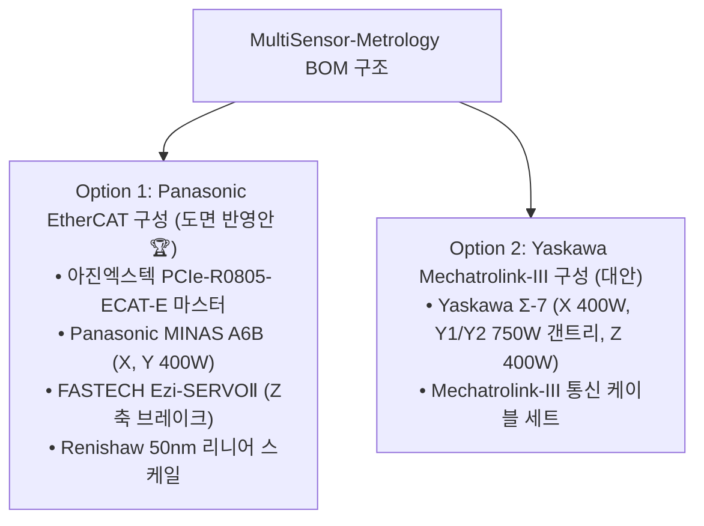
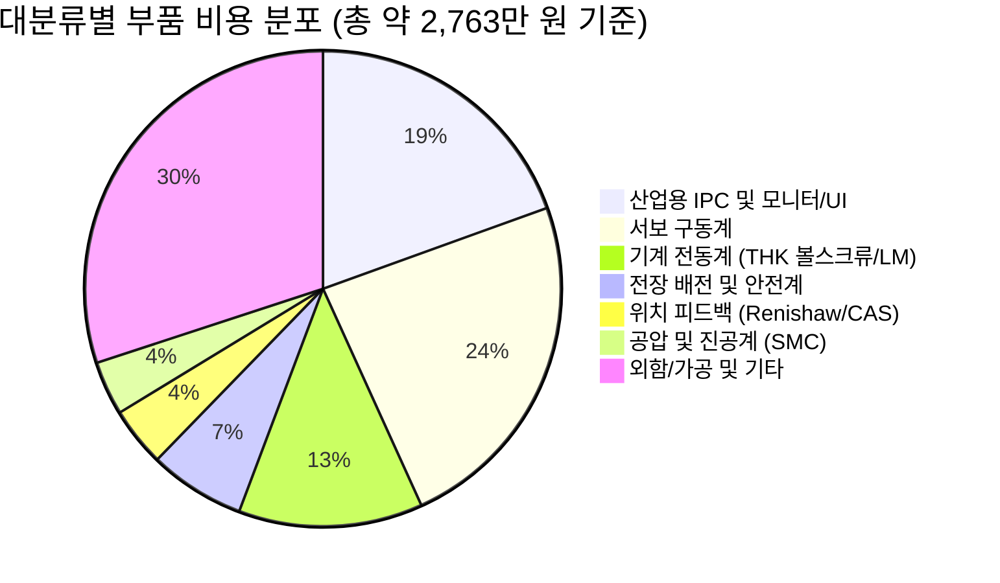

# MultiSensor-Metrology 부품 발주 검토 및 BOM 전사 명세서

* **문서 번호:** `261110-03`
* **작성 일자:** 2026-11-10
* **주관 부서:** TeMaat 기술연구소
* **참조 엑셀:** `../01_제작사양 및 설계자료/02-3_부품발주 검토_261109.xlsx` (Rev. 261109)

---

## 📋 문서 개정/수정 이력 (Revision History)

| 버전 (Rev) | 개정/수정 일자 | 작성자 / 부서 | 주요 변경 내역 (Change Description) |
| :---: | :---: | :---: | :--- |
| **Rev 1.0** | 2026-11-10 | TeMaat 기술연구소 | • `02-3_부품발주 검토_261109.xlsx` 엑셀 원본 2개 시트 전수 파싱 및 마크다운 텍스트 전사 완료 • [Sheet 1] Panasonic EtherCAT 구성(전장도면 매핑안) 및 [Sheet 2] Yaskawa M-III 대안/기구BOM 비용 분석 수록 |

---

## 1. 개요 및 구성 방안 비교

본 부품 발주 검토서는 MultiSensor-Metrology 장비 제작에 필요한 서보 구동계, 초정밀 피드백계, 제어기 및 IPC, 전장/안전 배전계, 기계 전동계, 공압/진공계의 자재 명세 및 구매 견적을 분석한 문서입니다.

---

## 2. Option 1: Panasonic EtherCAT 부품 명세서 (도면 반영안 🏆)

전장회로도([`02-2_MultiSensor-Metrology_261109-1.pdf`](./261110-02_MultiSensor-Metrology_전장회로설계_및_시스템아키텍처_검토서.md))와 1:1 매핑되는 기준 발주 목록입니다:

| No | 대분류 | 품목명 | 제조사 | 정품 규격 및 세부 모델명 | 수량 | 단위 | 단가 (KRW) | 공급금액 (KRW) | 비고 및 주요 기능 |
| :---: | :--- | :--- | :---: | :--- | :---: | :---: | :---: | :---: | :--- |
| **1** | 서보 구동계 | X, Y축 AC 서보모터 | Panasonic | `MSMF042L1S2` (400W, MINAS A6, 23bit 앱솔루트, no-Brake) | 2 | 대 | 276,340 | 552,680 | X, Y축 정밀 구동 모터 |
| **2** | 서보 구동계 | X, Y축 서보 드라이버 | Panasonic | `MBDLN25BE` (400W, MINAS A6B, EtherCAT 대응) | 2 | 대 | 564,320 | 1,128,640 | EtherCAT 통신형 서보 드라이버 |
| **3** | 서보 구동계 | Z축 스텝서보 모터 | FASTECH | `EzM2-56L-A-BK` (Ezi-SERVOⅡ 브레이크 일체형) | 1 | 식 | 639,922 | 639,922 | Z축 수직 낙하 방지 모터 |
| **4** | 서보 구동계 | Z축 스텝서보 드라이버 | FASTECH | `EzS2-EC-56L-A` (Ezi-SERVOⅡ EtherCAT 대응) | 1 | 대 | (세트포함) | - | 모터 세트 포함 |
| **5** | 위치 피드백 | Z축 로드셀 | CAS | `BCL 1kg` (Single Point Load Cell) | 1 | 개 | 150,000 | 150,000 | 프로브 접촉 하중 감시 |
| **6** | 위치 피드백 | Z축 로드셀 인디케이터 | CAS | `CI-600A` (RS-232C Weighing Controller) | 1 | 개 | 280,000 | 280,000 | 접촉압 디지털 변환 |
| **7** | 위치 피드백 | Z축 리니어스케일 판독헤드 | Renishaw | `Q4BCY05D08B` (분해능 50nm/0.1um, D-Sub15) | 1 | 개 | 400,000 | 400,000 | 나노미터급 실시간 계측 |
| **8** | 위치 피드백 | Z축 리니어스케일 테이프 | Renishaw | `RTLF20-S` (200mm SUS Scale Tape) | 1 | 개 | 100,000 | 100,000 | 정밀 테이프 스케일 |
| **9** | 위치 피드백 | EtherCAT 고속 카운터 모듈 | 아진엑스텍 | `N3ECAT-CNT2` (ECAT Slave 2CH Counter Module) | 1 | 개 | 300,000 | 300,000 | 스케일 펄스 수신 및 On-the-Fly |
| **10** | 위치 피드백 | 리니어 엔코더 전원 컨버터 | Mean Well | `DDR-15G-5` (DC/DC 24V to 5V 15W DIN Rail) | 1 | 개 | 32,500 | 32,500 | 엔코더 노이즈 차단 전원 |
| **11** | 산업용 IPC | 산업용 고성능 IPC | Neousys | `Nuvo-9002E-BMI5` (i5-13400, 16GB, 500G NVMe, 2T HDD) | 1 | 대 | 3,300,000 | 3,300,000 | 메인 제어 및 3D 매핑 IPC |
| **12** | 산업용 IPC | EtherCAT 마스터 카드 | 아진엑스텍 | `PCIe-R0805-ECAT-E` (PCIe x1, 8축, 독립형 마스터) | 1 | 장 | 1,000,000 | 1,000,000 | 모션 및 필드버스 마스터 |
| **13** | 산업용 IPC | EtherCAT DIO 모듈 | 아진엑스텍 | `N3ECAT-DB32T` (16 DI / 16 DO TR 싱크, DIN Rail) | 1 | 대 | 250,000 | 250,000 | 밸브/스위치/램프 입출력 |
| **14** | 산업용 IPC | EtherCAT AIN 모듈 | 아진엑스텍 | `N3ECAT-AI16` (16ch 0~10V / 4~20mA, DIN Rail) | 1 | 대 | 250,000 | 250,000 | 아날로그 센서 입력 |
| **15** | 산업용 UI | 27인치 QHD 고해상도 모니터 | Dell | `UltraSharp U2724D` (27" QHD IPS Black, 120Hz) | 1 | 대 | 529,000 | 529,000 | 고정밀 매핑 모니터링 |
| **16** | 산업용 UI | 산업용 고하중 모니터 암 | Ergotron | `LX Desk Mount LCD Arm` (45-241-224, 11.3kg 지지) | 1 | 세트 | 305,470 | 305,470 | VESA 100 고강성 암 |
| **17** | 전장/안전 | 안전 제어 유닛 | OMRON | `G9SE-201` (슬림형 안전 릴레이 모듈 DC 24V) | 1 | 식 | 267,007 | 267,007 | ISO 13849-1 비상정지 회로 |
| **18** | 전장/안전 | 비상정지 스위치 & 부자재 | KGAUTO | `KGE-H4R2R` (2개) + 보호가드(`KG-EMS-22` 등) | 2 | 세트 | 40,849 | 40,849 | 조작반 및 판넬 비상정지 |
| **19** | 전장/안전 | 3색 LED 시그널 타워 | Q-Light | `ST56EL-BZ-3-24-RAG` (적/황/녹 LED + 가변 부저) | 1 | 개 | 66,110 | 66,110 | 장비 상태 표시 |
| **20** | 전장/안전 | 제어 전원 SMPS | Mean Well | `NDR-480-24` (DC 24V 20A 480W DIN Rail) | 1 | 개 | 189,700 | 189,700 | 메인 제어 전원 공급 |
| **21** | 전장/안전 | 노이즈 필터 | 운영(WoonYoung) | `WYFS20T1BD` (단상 250V 20A, DIN Rail) | 1 | 개 | 43,310 | 43,310 | AC 220V 노이즈 억제 |
| **22** | 전장/안전 | 메인 차단기 (MCCB) | LS일렉트릭 | `ABS32C 20A` (2P 30AF 20A) | 1 | 개 | 22,300 | 22,300 | 인입 전원 과전류 차단 |
| **23** | 전장/안전 | 회로보호기 (CP) | LS일렉트릭 | `LCP31FM-5A WA` (5A 단극 4개) | 4 | 개 | 13,780 | 55,120 | DC 24V 4계통 분기 보호 |
| **24** | 전장/안전 | 서지보호기 (SPD) | 운영(WoonYoung) | `WYPA2040T220` (단상 220V 40kA) | 1 | 개 | 56,300 | 56,300 | 낙뢰 및 인입 서지 보호 |
| **25** | 전장/안전 | 전자개폐기 (마그네트) | LS일렉트릭 | `MC-9b DC24V` (조작코일 DC24V) | 2 | 개 | 17,780 | 35,560 | 서보 주전원 하드웨어 차단 |
| **26** | 전장/안전 | 전장 외함 및 가공비 | TeMaat | SUS304 외함 (IP54 등급 밀폐) | 1 | 식 | 1,000,000 | 1,000,000 | 제어반 판넬 및 중판 가공 |

---

## 3. 기계 전동계 및 공압계 부품 명세 (Sheet 2 공통 자재)

| 대분류 | 품목명 | 제조사 | 규격 및 세부 모델명 | 수량 | 공급금액 (KRW) | 비고 |
| :--- | :--- | :---: | :--- | :---: | :---: | :--- |
| **기계 전동계** | X축 초정밀 볼스크류 | THK | `BNK2005K-2.6GT+700LCp5` (C5급 연삭, Stroke 550mm) | 1 조 | 350,000 | 백래시 0µm 실현 |
| **기계 전동계** | X축 리니어 가이드 | THK | `SHS20C2SS+700LP` (블록 2개 / 레일 2조) | 1 식 | 584,000 | 4방향 등하중 고강성 |
| **기계 전동계** | Y1/Y2축 볼스크류 | THK | `BNK2005K-2.6GT+700LCp5` (C5급 연삭) 2조 | 1 식 | 700,000 | 갠트리 듀얼 구동 |
| **기계 전동계** | Y1/Y2축 LM가이드 | THK | `SHS20C2SS+700LP` (블록 4개 / 레일 4조) | 1 식 | 1,168,000 | 좌/우 정밀 안내 |
| **기계 전동계** | Z축 초정밀 볼스크류 | THK | `BS1402K-C3Z-185R266` (C3급 초정밀 연삭, Lead 2mm) | 1 조 | 325,700 | 1µm 단위 미세 이송 |
| **기계 전동계** | Z축 리니어 가이드 | THK | `SHS15C2UU+200LP` (블록 2개 / 레일 2조) | 1 식 | 328,000 | Z축 직각도 안내 |
| **공압 / 진공** | 진공 흡착 밸브 | SMC | `VX2120-02` (고진공) + `VXEZ2230-03` (파괴) | 1 식 | 189,278 | 2-Zone 진공 척 제어 |
| **공압 / 진공** | 디지털 진공 압력센서 | SMC | `ZSE30A-01-N-L` (2색 디지털 압력스위치) 2개 | 1 식 | 173,706 | 흡착 인터록 감시 |
| **공압 / 진공** | 정밀 레귤레이터 | SMC | `IR2000-02BG-A` (감도 0.2% F.S.) | 1 개 | 105,534 | 정밀 공압 제어 |
| **공압 / 진공** | 배관 및 피팅 자재 | SMC | `SY3120-5G-M5`, `KQ2` 피팅, 우레탄 튜브 | 1 식 | 547,679 | 클램프 및 배관 일체 |

---

## 4. 예산 분석 및 발주 권고사항

1. **최종 추천 구성 (Option 1 - Panasonic EtherCAT)**:
   * 전장도면과 100% 일치하며, 아진엑스텍 EtherCAT 마스터 카드와 완벽한 호환성 확보
   * 단일 필드버스로 배선 비용 절감 및 유지보수 편의성 극대화
2. **납기 집중 관리 품목 (Long Lead Time)**:
   * **THK 초정밀 연삭 볼스크류(BNK2005/BS1402)**: 납기 6~8주 소요 예상되므로 발주 착수 최우선 검토 필요
   * **Renishaw 광학 스케일(Q4BCY05D08B)** 및 **Neousys 산업용 IPC**: 납기 3~4주 소요 품목으로 사전 재고 확인 요망

