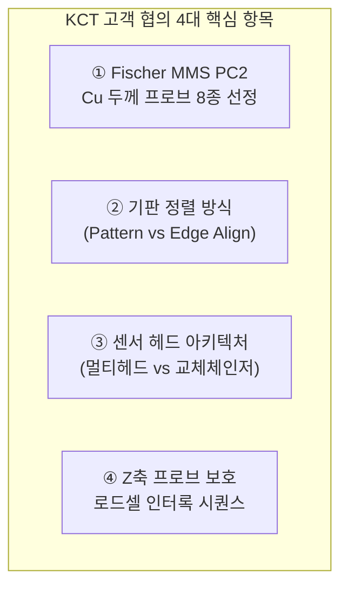
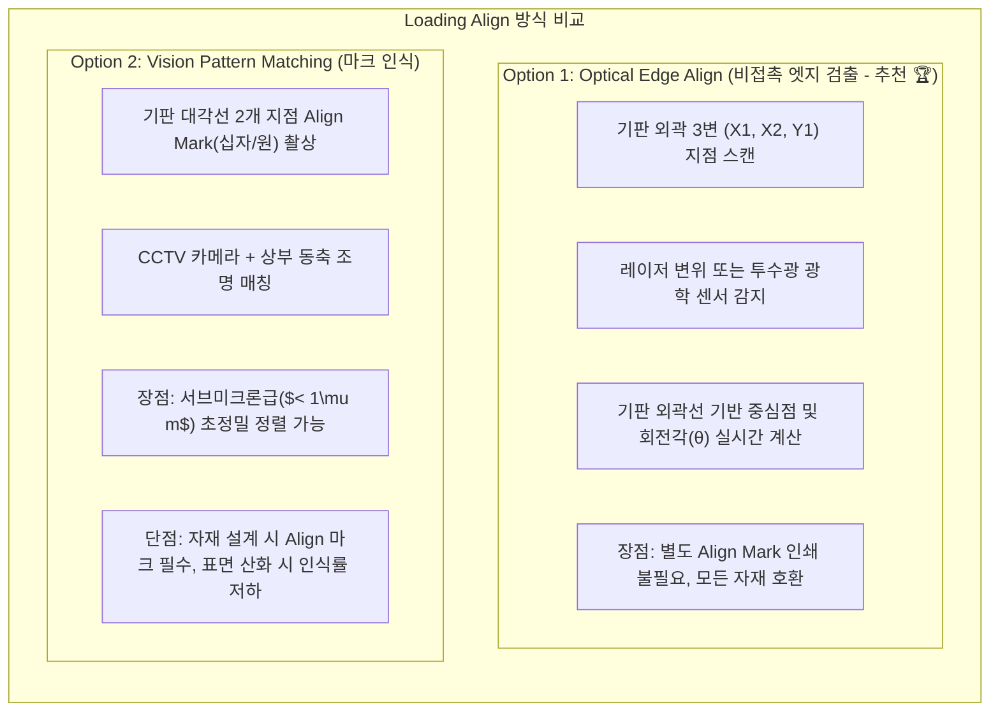
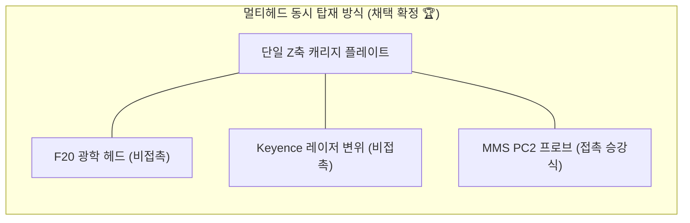
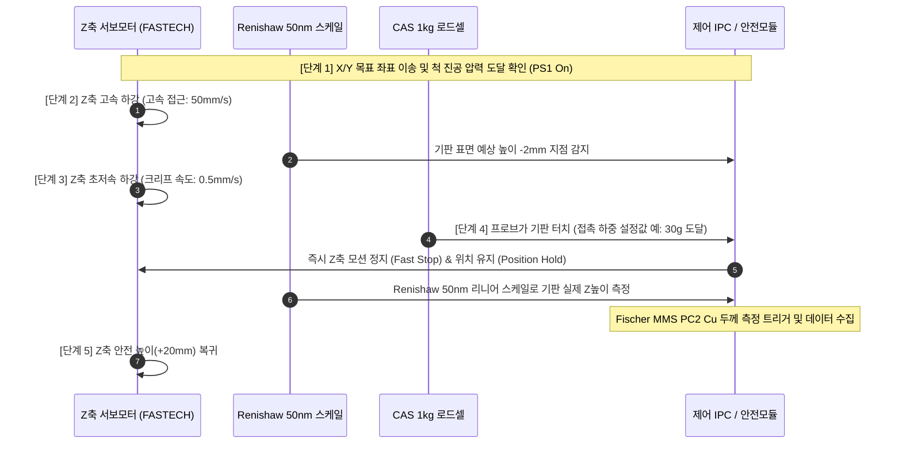

# KCT 고객사 기술 협의 및 센서 선정 검토서

* **문서 번호:** `261110-04`
* **작성 일자:** 2026-11-10
* **주관 부서:** TeMaat 기술연구소
* **관련 문서:** 
  * [`261110-01_K社_박막두께_자동계측_시스템_고객요구사항_분석서.md`](./261110-01_K社_박막두께_자동계측_시스템_고객요구사항_분석서.md)
  * [`261110-02_MultiSensor-Metrology_전장회로설계_및_시스템아키텍처_검토서.md`](./261110-02_MultiSensor-Metrology_전장회로설계_및_시스템아키텍처_검토서.md)

---

## 📋 문서 개정/수정 이력 (Revision History)

| 버전 (Rev) | 개정/수정 일자 | 작성자 / 부서 | 주요 변경 내역 (Change Description) |
| :---: | :--- :| :---: | :--- |
| **Rev 1.0** | 2026-11-10 | TeMaat 기술연구소 | • KCT向 고객사 기술 미팅 및 견적 확정을 위한 핵심 미결 과제 기술 검토서 작성 • Fischer MMS PC2 측정 프로브 8종 분석 및 선정 가이드 수록 • 기판 Loading Align 알고리즘(Pattern vs Edge) 비교 및 멀티헤드 통합 구동 시퀀스 수립 |

---

## 1. 검토 목적 및 배경

고객 요구사항(260810) 및 260819 회의록에 명시된 바와 같이, KCT向 자동계측기 견적 제출 및 기술 사양 확정을 위해 **고객사와 사전 협의 및 확정해야 할 4대 핵심 엔지니어링 항목**에 대한 기술 검토 결과를 정리하고 최적안을 제시합니다.

---

## 2. Fischer MMS PC2 프로브 8종 정밀 분석 및 선정 가이드

Fischerscope MMS PC2는 모듈 슬롯형 측정 시스템으로, 측정 원리(위상 감응 와전류, 진폭 감응 와전류, 자기유도 등)와 측정 대상 두께 범위에 따라 다양한 프로브가 제공됩니다. KCT向 박막두께 측정 공정에 대응하기 위한 프로브 후보군 8종의 특성을 분석합니다.

### (1) 주요 프로브 모델별 사양 및 특징 비교

| 구분 | 프로브 모델명 | 측정 원리 (Method) | 측정 범위 (Thickness) | 기판/소재 조건 | 적합성 및 특성 평가 |
| :---: | :--- | :--- | :--- | :--- | :--- |
| **1** | **ESD2.4** | 위상 감응 와전류 (Phase) | $0.1 \sim 100\,\mu\text{m}$ (Cu) | PCB, 절연체 위의 Cu 박막 | **[강력 추천 🏆]** 박막 Cu 전용. 하지 금속 영향 최소화 |
| **2** | **ESD20** | 위상 감응 와전류 (Phase) | $1 \sim 150\,\mu\text{m}$ (Cu) | PCB 절연층 위의 두꺼운 Cu | 후막 Cu 전용. $10\,\mu\text{m}$ 이상 후박 도금에 적합 |
| **3** | **ESD20 Cu** | 고주파 위상 와전류 | $2 \sim 200\,\mu\text{m}$ (Cu) | 후막 PCB / 동박 라미네이트 | 중대형 패널 후막 동박 계측에 적합 |
| **4** | **ENW3** | 자기유도 방식 (Magnetic) | $0 \sim 1,500\,\mu\text{m}$ | 자성체 상의 비자성 피막 | 절연체/비자성 기판에는 적용 불가 (부적합) |
| **5** | **ESG20** | 와전류 복합 방식 | $1 \sim 100\,\mu\text{m}$ | 비철금속 상의 박막 | 금속 베이스 기판의 Cu 도금에 적합 |
| **6** | **FSG3.4** | 위상 감응 소형 팁 | $0.2 \sim 50\,\mu\text{m}$ (Cu) | 미세 패턴 및 협소 영역 | 초소형 팁으로 미세 패턴 측정 가능하나 내구성 주의 |
| **7** | **SIGMASCOPE (전도도)** | 고주파 와전류 전도도법 | $1 \sim 110\% \text{ IACS}$ | 벌크 및 후막 금속층 | 두께 직접 측정보다는 Cu 전기전도도/물성 계측용 |
| **8** | **ETB1** | 진폭 감응 와전류 (Amp) | $0 \sim 800\,\mu\text{m}$ | 비철금속 상의 비전도성 막 | Cu 두께가 아닌 Cu 위의 절연 피막 측정용 |

### (2) 프로브 선정 권고안 (Recommendation)
* **KCT 대면적 기판 박막 두께 공정 표준 권고:**
  * **일반 Cu 박막 도금 ($0.1 \sim 50\,\mu\text{m}$):** **`ESD2.4` 프로브** 추천 (미세 박막부터 일반 패턴까지 최고 선형성 보장)
  * **파워/후막 Cu 공정 ($10 \sim 150\,\mu\text{m}$):** **`ESD20` 프로브** 추천
* **고객사 확인 질의 사항:**
  1. 기판 상의 Cu 층 두께 범위가 통상 몇 $\mu\text{m}$ 대역인가? (예: $1\sim 5\,\mu\text{m}$ vs $20\sim 70\,\mu\text{m}$)
  2. Cu 층 하부의 기재(Substrate) 재질이 절연체(FR4, Glass, PI)인가, 반도체 웨이퍼(Si)인가?

---

## 3. 기판 정렬(Loading Align) 방식 비교 (Pattern vs Edge)

$510 \times 515\text{ mm}$ 대형 기판이 진공 척에 안착될 때 발생하는 세팅 오차(기계적 위치/각도 틀어짐 $\theta$)를 보정하기 위한 알고리즘 방안을 비교합니다.

### QCD 비교 매트릭스 (Align 방식)

| 평가 항목 | Option 1: Optical Edge Align (추천 🏆) | Option 2: Vision Pattern Align | Option 3: Mechanical Stopper Pin |
| :--- | :---: | :---: | :---: |
| **Q (정밀도 / 반복성)** | $\pm 5\,\mu\text{m}$ (스캔 보정) | $\pm 1\,\mu\text{m}$ (비전 매칭) | $\pm 50\,\mu\text{m}$ (기구 접촉) |
| **C (구축 원가)** | **낮음 (기존 센서/스케일 활용)** | 높음 (카메라, 조명, 비전보드 추가) | 최저 (단순 핀) |
| **D (자재 호환성)** | **최상 (마크 없는 Blank 자재 가능)** | 보통 (전용 Align 마크 필수) | 낮음 (기판 치수 변경 시 조정 필요) |
| **신뢰성 / 유지보수** | 버(Burr) 영향 필터링 알고리즘 적용 | 조명/표면 반사도 민감 | **기판 파손/미세 크랙 위험 (비권장)** |

> **TeMaat 추천안:**  
> 우선 **Option 1 (Optical Edge Align)**을 표준 사양으로 제안하되, 고객사 기판에 이미 글로벌 얼라인 마크(Global Fiducial Mark)가 존재하고 $\pm 2\,\mu\text{m}$ 이하의 위치 정밀도가 필수적인 경우 **Option 2 (상부 동축 비전 카메라 모듈)**를 확장 옵션으로 채택할 것을 권고합니다.

---

## 4. 센서 헤드 아키텍처: 멀티헤드 동시 탑재 vs 교체 체인저

고객 질문("센서 3종 측정은 동시(멀티헤드)? 교체방식(단일센서)?")에 대한 공학적 검토 결과입니다.

* **채택안: 멀티헤드 동시 고정 탑재 방식 (Multi-Head Integrated Carrier)**
  * **선정 사유:**
    1. **사이클 타임 단축:** 센서 교체에 소요되는 비가동 시간(포인트당 10~20초 체인지 딜레이)을 제로화하여 30개 포인트 전체 계측 시간을 획기적으로 단축
    2. **기구 신뢰성 극대화:** 툴 체인저(Tool Changer)의 반복 탈착에 따른 체결 오차(Repeatability Loss) 및 전선/광케이블 반복 굴곡 피로 파손을 원천 제거
    3. **오프셋 보정 기술:** F20, MMS, Keyence 센서 간의 물리적 장착 거리(예: $\Delta X = 45\text{ mm}, \Delta Y = 30\text{ mm}$)를 제어 S/W에 **캘리브레이션 오프셋 테이블(Offset Matrix)**로 사전 등록하여, 단일 좌표 지령 시 해당 센서 위치로 자동 오프셋 이송 처리

---

## 5. Z축 프로브 보호 및 정밀 인터록 제어 시퀀스

MMS PC2 접촉식 프로브 하강 시 기판 및 센서 파손을 방지하기 위한 **4중 안전 시퀀스**를 설계하였습니다.

1. **진공 압력 인터록:** SMC 디지털 압력스위치(`PS1`)에서 기판 흡착 진공압이 정상 규격($\le -75\text{ kPa}$)에 도달하지 않으면 Z축 하강을 물리적으로 불허
2. **소프트웨어 2단 감속:** Renishaw 리니어 스케일 위치 피드백을 기반으로 표면 근접 시 50mm/s ➔ 0.5mm/s로 정밀 감속
3. **CAS 로드셀 정압 인터록:** 프로브가 기판 표면에 닿는 순간 발생하는 하중을 $1\text{g}$ 단위로 감지하여 규정 압력(예: $30 \pm 5\text{g}$) 도달 즉시 서보를 정지시키고 계측을 개시
4. **하드웨어 과하중 락:** $100\text{g}$ 이상의 이상 충격 발생 시 비상 정지 및 Z축 즉각 상승 인터록 동작

---

## 6. 고객사 미팅용 종합 질의/확인 체크리스트 (Summary Checklist)

| No | 구분 | 질문 및 확인 사항 | 당사 추천/검토 의견 | 고객사 확정 필요 |
| :---: | :--- | :--- | :--- | :---: |
| **1** | Cu 프로브 | 측정 대상 Cu 박막 두께 범위 및 기재 재질은? | $0.1 \sim 50\,\mu\text{m}$ 범위의 경우 **`ESD2.4` 프로브** 추천 | [ ] 확정 필요 |
| **2** | 기판 얼라인 | 기판에 글로벌 Align Mark가 존재하는가? | 마크 유무 무관한 **Optical Edge Align** 기본 추천 | [ ] 확정 필요 |
| **3** | 헤드 구조 | 3종 센서 탑재 방식 | 캘리브레이션 오프셋 기반 **멀티헤드 고정 탑재** | [v] 당사 권고 |
| **4** | TTV 센서 | Keyence 변위센서 모델 및 출력 사양은? | RS-422 디지털 또는 아날로그($0\sim 10\text{V}$) 사양 확인 | [ ] 확정 필요 |
| **5** | S/W 연동 | 계측 데이터 출력 형식 및 사급 노트북 연동은? | 당사 MultiScan-X Studio에서 CSV/TXT 자동 집계 저장 | [v] 당사 권고 |

