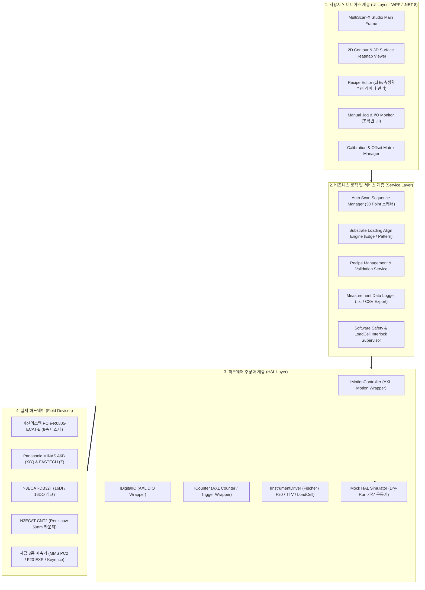
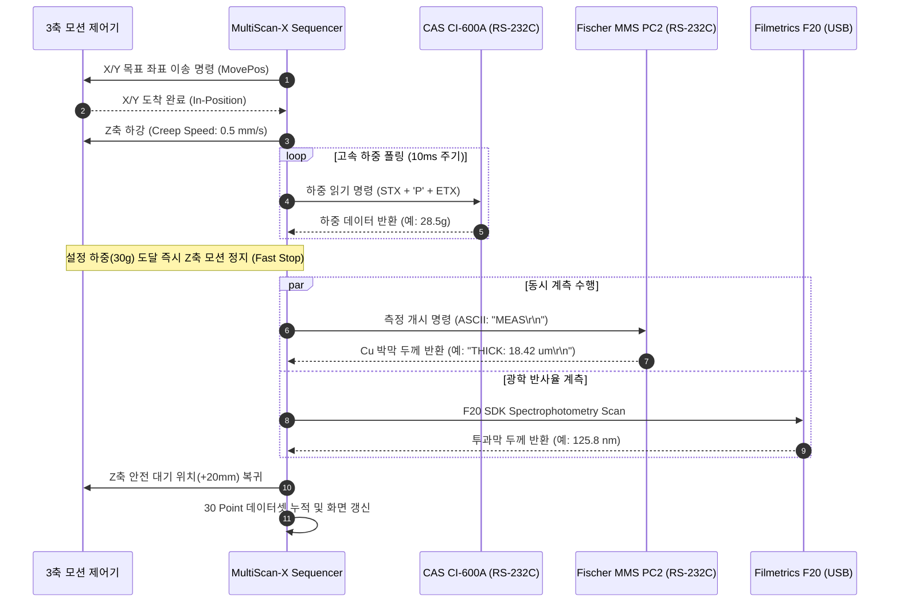

# 아진엑스텍 AXL 기반 MultiScan-X 통합 제어 소프트웨어 아키텍처 설계서

* **문서 번호:** `261110-05`
* **작성 일자:** 2026-11-10
* **주관 부서:** TeMaat 기술연구소
* **참조 규격:** 
  * `../02_데이터시트 및 관련자료/01-1_PCIe-R0805-ECAT-E_HW_KOR_V1.0_20181120.pdf`
  * `../docs/261110-02_MultiSensor-Metrology_전장회로설계_및_시스템아키텍처_검토서.md`
  * `../docs/261110-04_KCT고객사_기술협의_및_센서선정_검토서.md`

---

## 📋 문서 개정/수정 이력 (Revision History)

| 버전 (Rev) | 개정/수정 일자 | 작성자 / 부서 | 주요 변경 내역 (Change Description) |
| :---: | :---: | :---: | :--- |
| **Rev 1.0** | 2026-11-10 | TeMaat 기술연구소 | • 아진엑스텍 PCIe-R0805-ECAT-E 마스터 기반 MultiScan-X Studio 통합 제어 S/W 아키텍처 설계 완료<br/>• 3계층 구조(UI - Service - HAL), AXL 라이브러리 모션/DIO/카운터 API 명세 수록<br/>• 30 Point Recipe 좌표 등록 및 On-the-Fly 고속 매핑, Dry-Run 가상 시뮬레이터 설계 |

---

## 1. 소프트웨어 아키텍처 개요 및 3계층 구조 (Architecture Overview)

**MultiScan-X Studio**는 $510 \times 515\text{ mm}$ 대면적 기판의 박막 두께를 계측하기 위해 3축 EtherCAT 모션 제어, 디지털 I/O, 고속 카운터, 3종 계측기 통신, 실시간 2D/3D 매핑 뷰어를 단일 플랫폼으로 통합한 산업용 계측 제어 소프트웨어입니다.

하드웨어 종속성을 제거하고 유지보수성 및 단위 테스트 신뢰도를 극대화하기 위해 **UI Layer - Service Layer - HAL Layer (Hardware Abstraction Layer)**의 3계층 구조로 설계합니다.



---

## 2. 아진엑스텍 AXL(EzSoftwareUC) 라이브러리 연동 명세

### (1) AXL 라이브러리 초기화 및 라이프사이클 관리
Neousys Nuvo-9002E 산업용 IPC의 PCIe 슬롯에 실장된 `PCIe-R0805-ECAT-E` 카드를 구동하기 위해 아진엑스텍 표준 DLL(`AXL.dll`, `AXM.dll`, `AXD.dll`)을 C# P/Invoke 방식으로 연동합니다.

```csharp
// [AXL 초기화 및 EtherCAT 버스 스캔 시퀀스]
public class AjinMotionMaster : IMotionController
{
    public bool Initialize()
    {
        // 1. AXL 라이브러리 초기화 (0: 성공)
        int nRet = CAXL.AxlOpen(7); // 7: 모든 모듈 활성화
        if (nRet != (int)AXT_FUNC_RESULT.AXT_RT_SUCCESS)
            return false;

        // 2. EtherCAT 마스터 노드 및 슬레이브 온라인 감지
        int nAxisCount = 0;
        CAXM.AxmInfoGetAxisCount(ref nAxisCount);
        
        // 3. 축별 파라미터 초기화 (X:0, Y:1, Z:2)
        ConfigureAxis(0, unitPerPulse: 0.0001, maxVel: 200.0, accel: 1000.0); // X축 (1pulse=0.1um)
        ConfigureAxis(1, unitPerPulse: 0.0001, maxVel: 200.0, accel: 1000.0); // Y축
        ConfigureAxis(2, unitPerPulse: 0.00005, maxVel: 50.0, accel: 500.0);  // Z축 (1pulse=50nm)
        
        return true;
    }

    public void Shutdown()
    {
        // 서보 전축 감속 정지 및 라이브러리 해제
        CAXM.AxmMoveSStop(0);
        CAXM.AxmMoveSStop(1);
        CAXM.AxmMoveSStop(2);
        CAXL.AxlClose();
    }
}
```

### (2) 모션 제어 API 매핑 (3축 구동)
* **X축 (Axis 0 - Panasonic 400W)**: 기판 가로 이송 ($550\text{ mm}$ 스트로크)
* **Y축 (Axis 1 - Panasonic 400W)**: 기판 세로 이송 ($550\text{ mm}$ 스트로크)
* **Z축 (Axis 2 - FASTECH Ezi-SERVOⅡ)**: 프로브 독립 승강 ($100\text{ mm}$ 스트로크)

| 기능 항목 | 아진엑스텍 AXL API | 파라미터 및 주요 설정값 | 비고 |
| :--- | :--- | :--- | :--- |
| **서보 ON / OFF** | `AxmSignalServoOn(nAxis, bOn)` | `bOn = 1 (Servo On), 0 (Servo Off)` | 전장 STO 해제 후 투입 |
| **원점 복귀 (Homing)** | `AxmHomeSetMethod(nAxis, ...)`<br/>`AxmHomeSetStart(nAxis)` | 방식: Home 센서 + Z상 엔코더<br/>속도: 1차 30mm/s ➔ 2차 1mm/s | 리피터빌리티 $\pm 1\,\mu\text{m}$ 확보 |
| **절대 위치 이동** | `AxmMovePos(nAxis, dPos, dVel, dAccel, dDecel)` | 단위: mm, mm/s, $\text{mm/s}^2$ (S-Curve) | 부드러운 가감속 모션 |
| **모션 완료 감시** | `AxmStatusReadInMotion(nAxis, ref uInMotion)` | `uInMotion == 0` 감지 시 이동 완료 판정 | 비동기 타임아웃 감시 |
| **비상 급정지** | `AxmMoveEStop(nAxis)` | 하드웨어 STO 또는 비상 알람 시 즉시 정지 | 감속 없이 즉각 정지 |

### (3) 디지털 입출력 (DIO) API 매핑 (N3ECAT-DB32T)
`SLV2: N3ECAT-DB32T`의 16ch DI / 16ch DO를 다음과 같이 매핑하여 제어합니다:

| 채널 구분 | 비트 번호 | 심볼 태그 | 제어 대상 및 기능 | AXL API 함수 |
| :---: | :---: | :--- | :--- | :--- |
| **DO (출력)** | `Bit 0` | `DO_VAC_ZONE1` | 척 Zone 1 진공 솔레노이드 밸브 ON/OFF | `AxdoWriteOutportBit(0, 0, 1)` |
| | `Bit 1` | `DO_VAC_ZONE2` | 척 Zone 2 진공 솔레노이드 밸브 ON/OFF | `AxdoWriteOutportBit(0, 1, 1)` |
| | `Bit 2` | `DO_VAC_RELEASE` | 진공 파괴 에어 블로우 솔레노이드 밸브 | `AxdoWriteOutportBit(0, 2, 1)` |
| | `Bit 3` | `DO_CLAMP_FWD` | 기판 4-Edge 기계식 클램프 전진 솔밸브 | `AxdoWriteOutportBit(0, 3, 1)` |
| | `Bit 4~6`| `DO_TOWER_R/Y/G`| 3색 시그널 타워램프 점등 제어 | `AxdoWriteOutportBit(0, 4, 1)` |
| **DI (입력)** | `Bit 0` | `DI_VAC_OK` | SMC 디지털 진공센서 규정압(-75kPa) 도달 | `AxdiReadInportBit(0, 0, ref bVal)` |
| | `Bit 1` | `DI_ESTOP_STAT` | 비상정지 안전릴레이 정상 상태 피드백 | `AxdiReadInportBit(0, 1, ref bVal)` |
| | `Bit 2` | `DI_DOOR_INTERLOCK`| 챔버 도어 열림 감지 센서 신호 | `AxdiReadInportBit(0, 2, ref bVal)` |
| | `Bit 3` | `DI_START_PB` | 작업자 콘솔 자동 시작(Start) 버튼 | `AxdiReadInportBit(0, 3, ref bVal)` |

### (4) 고속 카운터 및 On-the-Fly 위치 비교 트리거 (N3ECAT-CNT2)
Renishaw $50\text{ nm}$ 리니어 스케일 신호는 `SLV1: N3ECAT-CNT2`의 2CH 고속 카운터 모듈로 수신되며, 고속 스캔 시 하드웨어 동기 트리거를 발생시킵니다:

```csharp
// [N3ECAT-CNT2 하드웨어 위치비교 트리거 설정 예시]
public void SetupOnTheFlyTrigger(double[] targetXPositions)
{
    int nChannel = 0; // Ch 0: Renishaw Linear Scale
    
    // 1. 카운터 분해능 설정 (1 pulse = 50nm)
    CAXC.AxcCounterSetMultiplier(nChannel, (int)AXT_COUNTER_INPUT_TYPE.MULTIPLY_4);
    
    // 2. 고속 위치 비교(Position Compare) 트리거 등록
    foreach (var posX in targetXPositions)
    {
        long nPulsePos = (long)(posX / 0.00005); // mm -> pulse 변환
        CAXC.AxcTriggerSetCompPosition(nChannel, nPulsePos);
    }
    
    // 3. 트리거 출력 활성화 (펄스 폭: 10us 고속 TTL 펄스 발생 -> F20/Keyence 센서 트리거)
    CAXC.AxcTriggerSetOutputMode(nChannel, (int)AXT_TRIGGER_OUT_TYPE.PULSE, 10);
    CAXC.AxcTriggerEnable(nChannel, 1);
}
```

---

## 3. 계측기 3종 및 로드셀 통신 드라이버 인터페이스



### (1) Fischerscope MMS PC2 통신 드라이버 (RS-232C)
* **포트 설정:** Baud Rate: 9600 bps, Data: 8 bit, Parity: None, Stop: 1 bit, Flow Control: None
* **프로토콜 명령셋:**
  * 계측 트리거: `CMD_MEASURE = "ST\r\n"` (Start Measurement)
  * 데이터 수신 포맷: ASCII 문자열 수신 (예: `D: 001, T: 18.45 um, OK\r\n`)
  * 정규표현식 파서: `Regex(@"T:\s*(?<thick>[\d\.]+)\s*um")`를 통해 두께 수치 추출

### (2) CAS CI-600A 로드셀 인디케이터 드라이버 (RS-232C)
* **포트 설정:** Baud Rate: 19200 bps, Data: 8 bit, Parity: None, Stop: 1 bit
* **프로토콜 명령셋:**
  * 스트리밍 모드(Continuous Transmission): $10\text{ms}$ 주기로 현재 하중(Current Weight) 실시간 패킷 전송
  * 패킷 구조: `[Header 2B][Data 7B][Unit 2B][CR][LF]` (총 13바이트)
  * 안전 감시: 프로브가 기판 표면에 접촉 시 $30\text{g}$ 도달 즉시 Z축을 인터럽트 정지시키고, $80\text{g}$ 초과 시 비상 정지(Alarm) 발생

### (3) Filmetrics F20-EXR 광학 박막 계측기 (USB SDK)
* **연동 방식:** Filmetrics C# .NET SDK (`FilmetricsAPI.dll`) 직접 참조
* **핵심 함수:**
  * `F20_Initialize()`: 분광기 하드웨어 초기화 및 램프 웜업 확인
  * `F20_BaselineCalibrate()`: 기준 반사판(Si 웨이퍼 / 거울) 캘리브레이션 수행
  * `F20_MeasureThickness(string recipeName, out double thickness, out double goodnessOfFit)`: 설정된 광학 모델(굴절률 $n$, 흡수계수 $k$)에 따른 박막 두께 및 적합도(GOF $\ge 0.95$) 산출

---

## 4. 레시피(Recipe) 데이터 구조 및 계측 결과 저장 포맷

### (1) 검사 레시피 JSON 스키마 (`recipes/default_510x515.json`)
사용자가 지정한 좌표(예: 30 point)와 각 포인트별 반복 계측 횟수(N), 계측기 선택 옵션을 JSON으로 완전 구조화합니다:

```json
{
  "RecipeName": "KCT_Substrate_510x515_30Pt",
  "Author": "TeMaat",
  "SubstrateSize": { "Width_mm": 510.0, "Height_mm": 515.0 },
  "AlignMode": "OpticalEdgeAlign",
  "VacuumSettings": { "UseZone1": true, "UseZone2": true, "TargetVacuum_kPa": -75.0 },
  "ZAxisSafety": { "CreepHeight_mm": 5.0, "ContactTargetWeight_g": 30.0, "MaxLimitWeight_g": 80.0 },
  "InspectionPoints": [
    {
      "PointId": 1,
      "CoordX_mm": 25.0,
      "CoordY_mm": 25.0,
      "RepeatCount": 3,
      "EnableMMS_Cu": true,
      "EnableF20_Film": true,
      "EnableTTV_Laser": true
    },
    {
      "PointId": 2,
      "CoordX_mm": 75.0,
      "CoordY_mm": 25.0,
      "RepeatCount": 3,
      "EnableMMS_Cu": true,
      "EnableF20_Film": true,
      "EnableTTV_Laser": true
    }
  ]
}
```

### (2) 계측 결과 데이터 파일 포맷 (`results/YYYYMMDD_HHMMSS_LotID.txt`)
고객 요구사항(PPTX 5번 슬라이드: "측정 data는 txt file로 저장되어 노트북으로 이동")을 100% 충족하도록 표준 탭 구분 텍스트 포맷을 제공합니다:

```text
# ==============================================================================
# KCT MultiSensor-Metrology Inspection Data Report
# ==============================================================================
# Lot ID       : LOT-20261110-001
# Substrate ID : SUB-510-001
# Recipe Name  : KCT_Substrate_510x515_30Pt
# Start Time   : 2026-11-10 14:30:15
# Operator     : TeMaat Engineer
# ==============================================================================
Pt_ID	Coord_X	Coord_Y	Cu_Thick(um)	Film_Thick(nm)	Film_GOF	TTV_Z(um)	Load(g)	Judgement
01	25.000	25.000	18.42	125.8	0.985	+2.15	29.8	PASS
02	75.000	25.000	18.39	126.1	0.987	+1.85	30.2	PASS
...
30	485.000	485.000	18.55	124.9	0.982	-3.10	30.1	PASS
# ==============================================================================
# Statistics Summary
# Cu Thickness  : Avg=18.45 um, Min=18.32 um, Max=18.58 um, StdDev=0.06 um, 3Sigma=0.18 um
# Film Thickness: Avg=125.6 nm, Min=124.2 nm, Max=126.8 nm, StdDev=0.7 nm
# Total TTV     : 5.25 um
# Total Status  : ALL PASS (30/30 Points Measured)
# ==============================================================================
```

---

## 5. 가상 시뮬레이션(Dry-Run Mode) 아키텍처 설계

실물 제어기 및 계측기가 아직 현장에 입고되지 않은 개발 단계에서도 상위 소프트웨어 로직(시퀀스, 레시피 파서, 데이터 로거, 3D 매핑 UI)을 100% 검증할 수 있도록 **하드웨어 가상 모의 시험 모드(Mock HAL)**를 내장합니다.

```csharp
// [가상 시뮬레이션 모드 지원 구조]
public class MockMotionController : IMotionController
{
    private double _curX = 0, _curY = 0, _curZ = 20;

    public async Task<bool> MovePosAsync(int nAxis, double targetPos, double vel)
    {
        // 실제 서보 이동 속도에 비례한 가상 딜레이(Delay) 시뮬레이션
        double distance = Math.Abs(targetPos - (nAxis == 0 ? _curX : _curY));
        int delayMs = (int)((distance / vel) * 1000);
        await Task.Delay(Math.Min(delayMs, 500)); // 최대 500ms 가상 이동
        
        if (nAxis == 0) _curX = targetPos;
        if (nAxis == 1) _curY = targetPos;
        if (nAxis == 2) _curZ = targetPos;
        return true;
    }
}
```

* **환경설정 플래그:** `appsettings.json` 내 `"OperationMode": "Simulation"` 설정 시 실제 DLL 호출 대신 가상 모의 엔진이 작동
* **가상 데이터 생성:** 기판 표면의 가상 휨(Warpage) 및 막두께 분포를 가우시안 곡면 수식으로 생성하여, 2D/3D 히트맵 UI 렌더링 검증 가능
