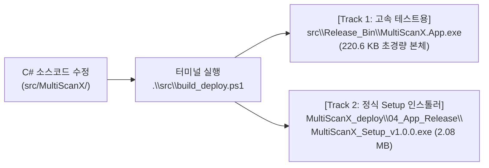

# 산업용 PC(Nuvo-9002E) 셋업 및 MultiScanX 빌드·배포 가이드

* **문서 번호:** `261110-06`
* **작성 일자:** 2026-11-11 (최초 2026-11-10)
* **주관 부서:** TeMaat 기술연구소
* **대상 기종:** Neousys Nuvo-9002E-BMI5 (산업용 제어 PC) & 개발 노트북
* **참조 도면/BOM:** [261110-03_MultiSensor-Metrology_부품발주검토_및_BOM_명세서.md](./261110-03_MultiSensor-Metrology_부품발주검토_및_BOM_명세서.md)

---

## 📋 문서 개정/수정 이력 (Revision History)

| 버전 (Rev) | 개정/수정 일자 | 작성자 / 부서 | 주요 변경 내역 (Change Description) |
| :---: | :---: | :---: | :--- |
| **Rev 1.5** | 2026-11-11 | TeMaat 기술연구소 | • **이원화(Dual-Track) 빌드·배포 체계 반영:** `src\build_deploy.ps1`을 이용한 정식 인스톨러(`MultiScanX_Setup_v1.0.0.exe`) 및 고속 패치용 220KB 본체 분리 가이드 신설<br/>• **개발 환경 최신화:** `Antigravity IDE + .NET 8 SDK + Inno Setup 6` 기준 정비<br/>• **1:1 화면 미러링:** TightVNC Server + RealVNC Viewer 구성 및 영문 표준 진단 반영 |
| **Rev 1.4** | 2026-11-10 | TeMaat 기술연구소 | • 실무 기준 셋업 순서 전면 재정비: [Step 1] SSH/WinSCP 개설 ➔ [Step 2] D:\TeMaat 업로드 ➔ [Step 3] 런타임/드라이버 설치 ➔ [Step 4] 앱 구동<br/>• 수동 디렉토리 생성 제거 ➔ C# .NET 앱 최초 실행 시 디렉토리 자체 자동 생성(Auto-Provisioning) 명세화 |
| **Rev 1.3** | 2026-11-10 | TeMaat 기술연구소 | • SSH 설치 후 필수 재부팅 및 가장 확실한 netsh 방화벽 개방 명령어 반영 |
| **Rev 1.2** | 2026-11-10 | TeMaat 기술연구소 | • Windows 내장 OpenSSH 서버 활성화 및 WinSCP(SFTP) 원격 배포 절차 추가 수록 |
| **Rev 1.1** | 2026-11-10 | TeMaat 기술연구소 | • .NET Desktop Runtime 인스톨러 파일명 정정 (`windowsdesktop-runtime-8.0.x-win-x64.exe`) |
| **Rev 1.0** | 2026-11-10 | TeMaat 기술연구소 | • 산업용 PC(Neousys Nuvo-9002E) 최초 셋업 절차 및 개발 노트북 간 역할 분리 가이드 수록 |

---

## 1. 개요 및 환경 분리 기본 철학

반도체/패키징 공정 장비의 산업용 PC(IPC)는 **안정성(24/7 무중단 구동)**과 **보안(소스코드 유출 방지 및 팹 폐쇄망 준수)**이 최우선입니다.  
따라서 개발 노트북과 IPC의 역할을 엄격히 분리하여 셋업합니다:

```text
┌─────────────────────────────────────────────────────────────────────────────┐
│                 개발 환경 vs 현장 산업용 PC 운영 환경 분리                  │
├──────────────────────────────────────┬──────────────────────────────────────┤
│       [개발 노트북 (Dev Machine)]     │       [산업용 제어 PC (Nuvo-9002E)]  │
├──────────────────────────────────────┼──────────────────────────────────────┤
│ ㆍAntigravity IDE + .NET 8 SDK       │ ㆍ컴파일러/IDE 미설치 (보안/경량화)  │
│ ㆍInno Setup 6 (정식 Setup 패키징)   │ ㆍ.NET 8 Desktop Runtime 설치(경량화)│
│ ㆍGit 소스코드 리포지토리 보유       │ ㆍTightVNC + OpenSSH (원격 유지보수) │
│ ㆍbuild_deploy.ps1 로 자동 빌드/생성 │ ㆍSetup 설치 및 데이터 폴더 자동생성 │
└──────────────────────────────────────┴──────────────────────────────────────┘
```

---

## 2. 개발 노트북: 소스 수정 후 `MultiScanX_deploy` 배포본 생성 방법

소스코드(`src\MultiScanX\`)를 수정한 후 **컴파일된 배포 파일을 직접 찾아 손으로 옮길 필요가 없습니다.**  
자동화 스크립트인 [src/build_deploy.ps1](../src/build_deploy.ps1)가 컴파일부터 배포 폴더 패키징까지 전 과정을 자동으로 수행합니다.

### (1) 이원화(Dual-Track) 빌드 및 생성 위치



### (2) 상황별 실행 명령어 (Antigravity IDE 터미널)

1. **신규 PC 셋업 / 최종 납품용 (정식 인스톨러 + 본체 모두 생성):**
   ```powershell
   .\src\build_deploy.ps1
   ```
   * **자동 결과:**
     * `src\Release_Bin\MultiScanX.App.exe` (220.6 KB) 생성
     * Inno Setup 6가 자동 컴파일되어 **`MultiScanX_deploy\04_App_Release\MultiScanX_Setup_v1.0.0.exe`** 가 배포 폴더 안에 자동 생성됩니다.
   * *(버전 번호 변경 배포 시: `.\src\build_deploy.ps1 -Version 1.0.1`)*

2. **시운전 중 코드 수정 후 빠른 테스트용 (본체만 2초 만에 생성):**
   ```powershell
   .\src\build_deploy.ps1 -PatchOnly
   ```
   * **자동 결과:** Setup 마법사를 다시 묶지 않고 **`src\Release_Bin\MultiScanX.App.exe` (220.6 KB)**만 즉시 갱신됩니다.

3. **런타임 미설치 외부 PC용 올인원 패키지 생성 시:**
   ```powershell
   .\src\build_deploy.ps1 -Standalone
   ```
   * `.NET 8 Runtime`을 내부에 포함한 약 154 MB 단독 실행 버전을 생성합니다.

---

## 3. 산업용 PC (Neousys Nuvo-9002E) 현장 표준 셋업 5단계

### Step 1. 원격 파일 전송(OpenSSH) 및 1:1 화면 공유(TightVNC) 통로 개설
Windows 기본 원격 데스크톱(RDP)은 실물 모니터와 화면이 분리되므로, **파일 전송은 OpenSSH(SFTP)**, **화면 제어는 VNC 미러링**으로 구축합니다:

1. **OpenSSH 서버 활성화 (IPC PowerShell [관리자 권한]):**
   ```powershell
   # 1. OpenSSH 서버 기능 활성화 및 서비스 등록을 위한 재부팅
   Add-WindowsCapability -Online -Name OpenSSH.Server~~~~0.0.1.0
   Restart-Computer
   ```
   ```powershell
   # 2. 재부팅 후 서비스 시작 및 22번 포트 방화벽 개방
   Start-Service sshd
   Set-Service -Name sshd -StartupType 'Automatic'
   netsh advfirewall firewall add rule name="OpenSSH" dir=in action=allow protocol=TCP localport=22
   ```

2. **TightVNC Server 설치 (실물 모니터 1:1 동일 화면 미러링):**
   * [TightVNC 64-bit MSI](https://www.tightvnc.com/download/2.8.84/tightvnc-2.8.84-gpl-setup-64bit.msi) 설치 시 `Custom` ➔ **`TightVNC Server`만 선택**, **`Register as a system service` 반드시 체크**, 접속 암호 설정
   * 방화벽 5900번 포트 개방:
     ```powershell
     netsh advfirewall firewall add rule name="TightVNC" dir=in action=allow protocol=TCP localport=5900
     ```
   * 개발 노트북에서 **`RealVNC Viewer`**로 `192.168.43.101` 접속하여 실물 모니터와 1:1 화면 공유 확인

---

### Step 2. 노트북에서 WinSCP로 배포 패키지 일괄 업로드 (`D:\TeMaat`)
1. **D: 드라이브 폴더 생성 및 바로가기 연결 (IPC PowerShell 2줄):**
   ```powershell
   New-Item -ItemType Directory -Path "D:\TeMaat" -Force
   New-Item -ItemType Junction -Path "C:\Users\USER\TeMaat" -Target "D:\TeMaat"
   ```
2. **개발 노트북에서 WinSCP(SFTP)로 업로드:**
   * 호스트: `192.168.43.101` / 포트: `22` / 계정: `USER`
   * 노트북의 **`MultiScanX_deploy` 폴더 전체**를 IPC의 **`TeMaat` (`D:\TeMaat`)**으로 드래그 앤 드롭 전송

---

### Step 3. 필수 런타임, 하드웨어 드라이버 설치 및 영문 진단
산업용 PC의 `D:\TeMaat\MultiScanX_deploy\` 폴더 안의 파일들로 설치를 진행합니다:

1. **.NET Desktop Runtime 8.0 (x64) 설치 (220KB 초경량 패치 대응):**
   * `01_Runtimes/windowsdesktop-runtime-8.0.33-win-x64.exe` 더블클릭 설치
   * 확인 명령어: `dotnet --list-runtimes` ➔ `Microsoft.WindowsDesktop.App 8.0.x` 확인
2. **아진엑스텍 EzSoftwareUC 드라이버 설치:**
   * `02_Drivers/` 내 `Setup.exe` 우클릭 ➔ **[관리자 권한으로 실행]** ➔ 설치 완료 후 **IPC 1회 재부팅**
3. **무설치 PowerShell 통합 진단 (100% 영문 표준 로그):**
   ```powershell
   powershell -ExecutionPolicy Bypass -File D:\TeMaat\MultiScanX_deploy\03_Diagnostics\ipc_diagnostics.ps1
   powershell -ExecutionPolicy Bypass -File D:\TeMaat\MultiScanX_deploy\03_Diagnostics\ethercat_bench_test.ps1
   ```
   * `AXL.dll` 로드 `[PASS]` 및 실물 `N3ECAT-DB32T` 모듈 전면 DO 0~7번 LED 순차 점멸 확인

---

### Step 4. 제어 프로그램 정식 설치 및 최초 실행 (`MultiScanX_Setup`)
1. **정식 인스톨러 설치:**
   * `D:\TeMaat\MultiScanX_deploy\04_App_Release\MultiScanX_Setup_v1.0.0.exe` 더블클릭
   * 기본 경로(`C:\MultiScanX\`) 및 **[바탕 화면에 바로 가기 아이콘 만들기]** 체크 후 설치
   * **자동 완료 사항:** `C:\MultiScanX\bin\MultiScanX.App.exe` 배치, 바탕화면 `MultiScan-X Studio` 바로가기 생성, 제어판 [프로그램 추가/제거(Uninstall)] 정식 등록
2. **최초 실행 시 자가 생성(Auto-Provisioning)되는 데이터 디렉토리:**
   * 바탕화면 아이콘 더블클릭 시 `D:\MultiScanX_Data\` 아래에 `Results/`, `Maps/`, `Logs/`, `Recipes/` 폴더가 1초 만에 자동 생성됩니다.

---

### Step 5. (일상 작업) 개발/시운전 중 빠른 실행 파일 복사 및 재실행 루프
최초 설치(`Step 4`)가 끝난 이후에는 코드를 고칠 때마다 Setup 마법사를 다시 돌릴 필요가 없습니다:

1. **노트북:** `.\src\build_deploy.ps1 -PatchOnly` 실행 (2초 소요 ➔ `src\Release_Bin\MultiScanX.App.exe` 갱신)
2. **IPC 앱 종료:** 실행 중인 `MultiScan-X Studio` 창 닫기
3. **고속 복사 (0.1초):** WinSCP로 노트북 `src\Release_Bin\MultiScanX.App.exe` (220 KB)만 IPC의 **`C:\MultiScanX\bin\`**에 덮어쓰기
4. **즉시 재실행:** IPC 바탕화면의 **`MultiScan-X Studio`** 아이콘 더블클릭!

---

## 4. 윈도우 OS 환경 최적화 (24/7 가동용)

* **전원 관리:** [제어판] - [전원 옵션] - **고성능(High Performance)** 선택, "화면 끄기" 및 "절전 모드" **해제(없음)**
* **Windows Update 자동 재부팅 방지:** `gpedit.msc` 실행 ➔ 컴퓨터 구성 ➔ 관리 템플릿 ➔ Windows 구성 요소 ➔ Windows 업데이트 ➔ "자동 업데이트 구성" **[사용 안 함]** 설정
* **네트워크 분리:**
  * **LAN 1:** 사내망/원격 지원용 (OpenSSH, TightVNC)
  * **LAN 2:** Keyence CL-3000 전용 센서 직결망 (`192.168.0.100 / 255.255.255.0`)

---

## 5. 사후 유지보수(A/S)를 위한 골든 이미지(Golden Image) 백업

장비 셋업과 드라이버 점검이 완료된 직후, 반드시 시스템 전체 백업을 수행합니다:
1. **Macrium Reflect Free** 또는 **Clonezilla** 도구 준비
2. C: 드라이브(500GB NVMe) 전체를 단일 이미지 파일(`MultiScanX_IPC_Golden_v1.0.mrimg`)로 백업
3. 백업 파일 저장 위치:
   * **`D:\MultiScanX_Data\System_Backup\`** (IPC 내부 복구용)
   * **사외 보관용 TeMaat 전용 USB** (긴급 출동 A/S용)
4. IPC 하드웨어 불량이나 Windows 손상 시, 15분 만에 초기 출하 상태로 100% 원복 가능
