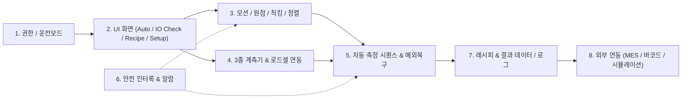

# MultiScanX 소프트웨어 기능 정의 체크리스트 (Feature Definition Checklist)

* **문서 번호:** `261111-02`
* **프로젝트:** MultiScanX (K社 KCT向 510×515mm 대면적 박막두께 자동계측 시스템)
* **작성 일자:** 2026-11-11
* **작성 목적:** MultiScan-X Studio 제어 소프트웨어의 상세 기능(UI, 모션, 센서, 시퀀스, 안전, 데이터, 확장성)을 누락 없이 정의하고, 설계자/개발자의 구상을 직접 기입하여 기능 명세(SRS)를 확정하기 위한 작업용 체크리스트
* **관련 문서:**
  * [프로젝트 종합 현황판](./project_status.md)
  * [고객요구사항 분석서](./261110-01_K社_박막두께_자동계측_시스템_고객요구사항_분석서.md)
  * [KCT 기술협의 및 센서선정 검토서](./261110-04_KCT고객사_기술협의_및_센서선정_검토서.md)
  * [통합제어 S/W 아키텍처 설계서](./261110-05_아진엑스텍_AXL기반_통합제어SW_아키텍처_설계서.md)

---

## 📋 문서 개정/수정 이력 (Revision History)

|    버전 (Rev)    | 개정/수정 일자 |   작성자 / 부서   | 주요 변경 내역 (Change Description)                                                       |
| :---------------: | :------------: | :---------------: | :---------------------------------------------------------------------------------------- |
| **Rev 1.1** |   2026-11-12   | TeMaat 기술연구소 | • 8대 영역 전체에 대한 설계자/사용자 구상 및 결정사항 기입 완료 (개발계획서 `261112-01` 반영) |
| **Rev 1.0** |   2026-11-11   | TeMaat 기술연구소 | • MultiScanX 제어 소프트웨어 8대 영역 기능 정의 체크리스트 및 구상 기입 템플릿 최초 생성 |

---

## 📌 작성 방법 및 소프트웨어 기능 전체 맵

1. 각 항목의 **[일반적 검토 정보 / 선택지]**를 참고하여, 하단 **`내 구상 / 결정사항`** 영역(`>` 인용문 블록)에 생각하신 방향을 자유롭게 적어 넣으세요.
2. 결정이 끝난 항목은 `- [x] 결정 완료`로 체크하고, 우선순위(`P0: 시운전/출하 필수`, `P1: 양산 편의 기능`, `P2: 추후 확장`)를 선택하세요.
3. 본 문서에 구상이 채워지면 **화면 설계 ➔ 코드 구현 ➔ I/O Check 및 시운전 테스트**의 기준으로 바로 활용됩니다.

---

## 📊 기능 정의 진행 현황 요약표

|       도메인       | 영역명                      | 주요 핵심 결정 포인트                                             | 진행 상태 |
| :----------------: | :-------------------------- | :---------------------------------------------------------------- | :-------: |
| **Domain 1** | 사용자 권한 및 운전 모드    | 계정/비밀번호 분리 여부, 4대 운전 모드 전환 규칙                  | [x] 구상 완료 |
| **Domain 2** | 화면 구성 및 UI 워크플로우  | Auto 화면, **I/O Check(CNT2/DIO/AI)**, Recipe/Setup/History | [x] 구상 완료 |
| **Domain 3** | 모션 제어 및 기구 시퀀스    | Z축 우선 홈잉, 다분할 진공/클램프, 정렬(Pin vs Edge)              | [x] 구상 완료 |
| **Domain 4** | 3종 계측기 & 로드셀 연동    | MMS 정압(30g), F20 Auto-Focus/GOF, CL-3000 휨 보정                | [x] 구상 완료 |
| **Domain 5** | 자동 측정 시퀀스 & 예외처리 | Lot/ID 입력, 헤드 오프셋 보상, Retry/Skip/Stop 복구               | [x] 구상 완료 |
| **Domain 6** | 안전 인터록 및 알람 체계    | EMO/도어락/진공/로드셀 감시, 타워램프, 알람 등급/코드             | [x] 구상 완료 |
| **Domain 7** | 레시피 및 데이터/로그 관리  | 기판 템플릿, TXT/CSV/맵 저장 포맷, 3σ 통계, 보관주기             | [x] 구상 완료 |
| **Domain 8** | 외부 연동 및 유지보수       | MES/CIM 연동 여부, 바코드 리더기, Dry-Run 범위                    | [x] 구상 완료 |

---

## Domain 1. 사용자 권한 및 시스템 운전 모드

### 1-1. 사용자 권한(User Role) 및 로그인 정책

* **일반적 검토 정보:** 생산 라인 장비는 작업자 실수로 레시피·티칭·인터록 파라미터가 변경되는 것을 막기 위해 보통 2~3단계 권한을 나눕니다.
  * **Operator(작업자):** Auto Run, Lot 입력, 알람 리셋, 결과 조회만 허용
  * **Engineer(공정/설비):** Recipe 편집, 포인트 티칭, 센서 조건 수정 허용
  * **Admin / Maker(개발/유지보수):** System Config, 모션 Limit/Gain, 인터록 설정, I/O 강제 출력 허용
* **일반적 선택지:** `(A) 프로그램 시작 시 로그인 필수` vs `(B) 기본 Operator 무로그인 진입 후 설정/편집 탭 진입 시에만 비밀번호 요구` + `일정 시간 미사용 시 자동 Operator 복귀`
* - [ ] **결정 완료** | **우선순위:** [ ] P0  [ ] P1  [ ] P2
* **내 구상 / 결정사항:**
  > 기본 Operator 로그인 없이 진입 후 설정/편집이 필요할 때만 비번 요구하고 설정이 끝나면 복귀버튼 + 설정/편집 창에서 일정시간 경과하면 자동 복귀
  > 파라미터 설정 관련된 버튼 클릭시에 비번 물어보는 창 팝업 확인 후 진입하는 단순한 방식 선호 (권한이나 보안 보다는 사고 방지 목적이 큼)
  >

### 1-2. 시스템 운전 모드(Operation Mode) 정의

* **일반적 검토 정보:** 장비 상태에 따라 허용되는 동작이 명확히 분리되어야 안전사고를 막을 수 있습니다.

  * **Auto Mode:** 자동 계측 시퀀스 실행 (수동 Jog, DO 강제 제어 잠금)
  * **Manual / Maintenance Mode:** 단축 이동(Jog), I/O Check, 센서 단발 테스트, 교정(Calibration)
  * **Simulation / Dry-Run Mode:** `system_config.json` 기반 Mock 드라이버 또는 모션만 움직이는 공운전(센서/터치 제외)
* **검토 포인트:** 실제 현장에서 "모션만 움직이고 계측기/프로브 터치는 빼고 돌리는 **기구 공운전(Dry-Run)**" 모드와 "하드웨어 없이 PC에서 UI만 테스트하는 **가상 시뮬레이션(Virtual Sim)**"을 구분할 필요가 있는지?
* - [ ] **결정 완료** | **우선순위:** [ ] P0  [ ] P1  [ ] P2
* **내 구상 / 결정사항:**

  > 실물 하드웨어 없이 개발 노트북에서 버그테스트를 위해 프로그램을 실행해 볼 수 있는 수준의 가상 시뮬레이션은 필요.
  > 실물하드웨어가 연결된 IPC에서는 추후 완전 자동모드가 추가될 수는 있겠으나 우선은 아래와 같은 단계의 모드가 필요할 것으로 판단됨.
  >
  > 1. 하드웨어 I/O 상태를 제어/모니터링 할 수 있는 Low Level의 테스트 화면과 X, Y, Z 축 단순 이동 테스트를 위한 JOG 기능 모드
  > 2. X, Y, Z 좌표를 입력해서 자동으로 이동만 시키고 3종의 센서는 수동으로 측정하는 모드
  > 3. 2항의 자동이동 후 3종의 센서 중 선택한 센서를 자동 측정하는 모드
  > 4. 3항의 자동측정을 미리 레시피로 작성해 둔 좌표 및 센서 선택에 의해서 자동 측정하는 모드
  > 5. 검토해 준 기구 공운전 모드 또한 반드시 필요함
  >

---

## Domain 2. 화면 구성 및 UI 워크플로우

### 2-1. 전체 화면 레이아웃 및 내비게이션 구조

* **일반적 검토 정보:** 현재 구현된 상단 고정 헤더(`버전`, `HW EMO 상태`, `운전 모드 배지`) + 하단 고정 상태바 구조를 유지하면서 중앙 영역을 어떻게 전환할지 정합니다.
* **일반적 선택지:**
  * `(A) 상단/좌측 메인 탭 방식:` `[Auto Run]` `[Recipe]` `[I/O & HW Check]` `[Setup / Teach]` `[History / Data]` `[Alarm]`
  * `(B) Auto 화면 중심 + 기능 버튼으로 모달/별도 창 오픈`
* - [ ] **결정 완료** | **우선순위:** [ ] P0  [ ] P1  [ ] P2
* **내 구상 / 결정사항:**
  > 우선 2~3개의 GUI 초안을 보여주면 장단점을 비교 검토 후 확정해 나가는 방식으로 진행 요망.
  > GUI 화면은 밝고 깔끔한 외관, 파스텔톤의 고급스러운 디자인 선호하지만 군더더기는 없어야 함.
  > 나중에 기능확장 가능성을 고려해야 함.
  >

### 2-2. ★ 하드웨어 점검 화면 (I/O Check & Hardware Diagnostics)

* **일반적 검토 정보:** 아진엑스텍 EtherCAT 마스터(`PCIe-R0805-ECAT-E`) 및 3종 슬레이브(`N3ECAT-CNT2`, `N3ECAT-DB32T`, `N3ECAT-AI16`), 서보 4축의 실물 배선·신호를 프로그램 종료 없이 실시간 점검하는 **시운전 최우선 필수 화면**입니다.
* **세부 구성 요소 (체크 및 구상 필요):**
  1. **EtherCAT 네트워크 & 슬레이브 상태:** 마스터 연결 상태, 슬레이브 0~N 링크 상태, 통신 에러 카운트, 재연결(Reset) 버튼
  2. **CNT2 (고속 카운터 / 리니어 스케일):** 채널별(X/Y/Z 등) 현재 펄스 카운트, 환산 위치(`mm` / `um`), Zero Clear(영점 리셋) 버튼, 스케일 이동 방향(±) 검증
  3. **DIO (N3ECAT-DB32T - DI 16ch / DO 16ch):**
     * **DI(입력) 모니터링:** 비상정지(EMO), 도어 센서, 진공압 스위치, 클램프 실린더 리드스위치, 리미트 센서 등의 실시간 LED 표시 및 한글 신호명 매핑
     * **DO(출력) 수동 제어:** 진공 솔밸브 ON/OFF, 클램프 전진/후진, 도어 락 해제, 타워램프(R/Y/G)·부저 강제 점멸 테스트
     * *(안전 고려)* Auto Run 중에는 DO 버튼 비활성화(Lock) 및 위험 출력(예: 클램프 풀림 전 확인) 경고 표시
  4. **AI (N3ECAT-AI16 - 아날로그 입력):**
     * 채널별 Raw ADC 값 / 전압(`0~10V` 또는 `-10~10V`) 및 물리량 환산값(로드셀 `g`, 진공 압력 `kPa` 등) 실시간 게이지/수치 표시
     * 로드셀 영점(Zero/Tare) 버튼 및 과부하 테스트 확인
  5. **서보 모션 단축 점검 (선택 - I/O 화면 통합 vs 별도 Manual 탭):** X/Y/Z 축별 Servo ON/OFF, Alarm Clear, Home, 현재 지령/엔코더 위치, 저속 Jog(±) 버튼
  6. **계측기 통신 Ping / 단발 리드 테스트 (선택):** MMS / F20 / CL-3000 연결 확인 및 1회 측정 값 읽어오기 버튼
* - [ ] **결정 완료** | **우선순위:** [ ] P0  [ ] P1  [ ] P2
* **내 구상 / 결정사항:**
  > 위의 일반적인 검토 정보를 포함하여 아래 내용도 함께 검토 되어야 함.
  >
  > 1. 서보는 X, Y, Z 3축이고 모터 3개로 구성되어 있음. X, Y축은 파나소닉 서보모터이고, Z축은 파스텍 Full Closed 스텝모터임 (회로도면 참조)
  > 2. CNT2는 Z축을 위한 리니어스케일 센서값을 읽기위한 용도임.
  > 3. DI는 현재 확정된 EMO, 진공(압력)센서, 로드셀 컨트롤러 출력 접점신호 이외에도 추가될 센서를 정의할 수 있어야 하고
  > 4. DO는 EMO 리셋스위치 램프 점등, 3색 타워램프 이외에도 향후 추가될 출력 접점을 정의할 수 있어야 함.
  > 5. AI는 아직 사용처가 미정인 상태이나 향후 센서 추가를 대비하기 위해 여분으로 장착되었으므로 향후 아날로그 센서가 추가되면 정의할 수 있어야 함.
  > 6. EtherCAT 통신을 위한 딥스위치로 세팅값을 입력받아 고유 주소로 사용할 수 있어야 함.
  > 7. 각 EtherCAT 통신 장비의 필수 파라미터를 읽고 변경하고 저장하는 기능이 있어야 함.
  > 8. 각 계측기와의 통신 파라미터를 설정하고 통신을 점검하는 기능도 필요하고 계측기 측정을 시작/종료하고 측정된 값을 가져오는 기능도 추후 구현되어야 함.
  > 9. 3축 겐트리 제어에 필요한 기능구현을 1단계로 진행하고, 계측기와 연동된 측정포함한 제어를 2단계로 구현해야 함.
  > 10. 계측기는 사급품으로 X/Y/Z축의 겐트리 제어 기능이 완성되고 나중에 연결해서 추가 기능구현하는 절차로 개발진행 되어야 함. (계측기 3종은 없는 상태로 개발착수)
  >

### 2-3. Auto Run (메인 생산) 화면 세부 기능

* **일반적 검토 정보:** 작업자가 가장 오래 보는 화면입니다. 현재 2D 스테이지 맵 + 실시간 계측 테이블 + 동작 로그가 배치되어 있습니다.
* **검토 포인트:**
  * 2D 맵에서 표현할 정보: 측정 포인트 번호/위치, 완료 색상 구분(대기/측정중/PASS 녹색/FAIL 적색), 포인트 클릭 시 상세 값 툴팁, Cu 두께/박막 두께 히트맵(컬러 그라데이션) 지원 여부
  * 실시간 요약 카드: 현재 Lot 진행률, 예상 잔여 시간(Cycle Time), 실시간 Pass/Fail 수량 및 평균/최소/최대/균일도
* - [ ] **결정 완료** | **우선순위:** [ ] P0  [ ] P1  [ ] P2
* **내 구상 / 결정사항:**
  > 위의 일반적인 검토 정보를 포함하여 아래 내용도 함께 검토 되어야 함.
  > 이 장비는 생산 설비가 아니고 실험실 품질평가용 장비임. 반도체 웨이퍼 패턴 두께 및 선폭 측정, 웨이퍼 식각 전후 두께 측정 장비라고 보면 됨. 이러한 장비의 정체성에 맞도록 소프트웨어 GUI 화면구성과 기능 배치가 필요함.
  > 키보드와 마우스를 사용할 수 있으므로 이에 맞게 화면 레이아웃과 상태 확인 라벨 및 명령 버튼 배치를 고려해야 함.
  > 우선은 지금 구상하는 내용으로 소프트웨어 초안을 작성해서 사용해 본 후 고객사의 의견을 수렴해 전면적인 수정이 필요할 수도 있음. 따라서 개발 초기부터 이에 대비한 확정성과 유연성있는 화면 레이아웃 구성 소프트웨어 개발 컨셉이 필요함
  >

### 2-4. Recipe 편집 / Setup(티칭·캘리브레이션) / History 화면

* **일반적 검토 정보:**
  * **Recipe 화면:** 포인트 추가/삭제, 행×열 격자 자동 생성, CAD/CSV 좌표 불러오기, 포인트별 사용할 센서 체크(Cu / F20 / TTV), 합격 기준(Min/Max Spec) 설정
  * **Setup / Calibration 화면:** Loading/Unloading 위치 티칭, 3개 센서 간 X/Y/Z 오프셋 티칭, 로드셀 스케일 계수/임계치(`30g`), 진공 안정화 대기시간 등 장비 상수 설정
  * **History / Data Viewer 화면:** 날짜·Lot ID 검색, 과거 측정 데이터 테이블/2D 맵 재조회, 재저장(Export)
* - [ ] **결정 완료** | **우선순위:** [ ] P0  [ ] P1  [ ] P2
* **내 구상 / 결정사항:**
  > 위의 일반적인 검토 정보를 포함하여 아래 내용도 함께 검토 되어야 함.
  > 측정시료의 크기가 약 510 x 510mm 정도인데 시료의 가로, 세로, 두께 정보 이외에도 시료의 고유 ID나, 재질 등 다른 정보 입력을 위해 필요시 확장할 수 있도록 고려 필요.
  > 측정 포인트를 행 x 열 격자 자동 생성 후 마우스로 각 행, 열 단위로 미세하게 조정할 수 있고 키보드로 정확한 값을 입력할 수 도 있어야 함.
  > 예상되는 최대 측정 포인트는 10 x 10 포인트이나 나중에 확장 요청이 있을 경우 간단히 조정할 수 있어야 함.
  > 하나의 특정한 행/열 만 미세 조정하거나 전체를 밀고 당기는 기능 등 직관적인 측정포인트 설정이 필요함.
  > 포러스 척에 시료가 놓이고 포러스 척이 이동하는 축이 Y축임, Z축에 3종 센서가 모듈로 결합되어 있고 Z축은 X축에 결합되어 기구적으로 정해진 오프셋 만큼의 간력으로 동시에 이동됨.
  > 따라서 하나의 측정포인트에는 센서별로 서로 다른 X/Y/Z 위치 오프셋 보정값이 필요함.
  > X, Y축 위치는 0.1mm, Z축은 0.001mm의 정밀도로 설정할 수 있어야 함.
  > X, Y축의 이동은 위치값을 기준으로 하고 Z축은 위치값 이외에 로드셀의 값으로도 측정위치가 결정될 수 있어야 함. (로드셀 우선)
  > Z축 측정위치 인식용 로드셀은 두개의 접점입력과 RS232C 통신에 의한 무게값 중 우선순위를 설정해서 선택할 수 있어야 함.
  > 개략적인 측정 시퀀스는 Z축이 원점으로 상승된 상태에서 레시피에서 입력된 X, Y축 좌표로 이동 후 Z축이 리니어스케일 위치 설정값을 향해 하강을 시작해서 그 전에 로드셀 접점입력이 있거나 로드셀 컨트롤러와의 통신에 의한 무게 설정값(임계치 설정 가능 해야 함)에 도달하면 멈추는 방식임 (우선순위에 의한 Z축 위치 확정 및 멈춤)
  > DI4(로드셀 입력1),  DI5(로드셀 입력2), RS232C Modbus RTU 통신으로 무게값과 접점비트도 읽어올 수 있어야 함.
  >

---

## Domain 3. 모션 제어 및 기구 시퀀스

### 3-1. 전원 투입 / 서보 ON / 원점 복귀(Homing) 시퀀스

* **일반적 검토 정보:** 3축 스테이지 및 프로브 간 기구 충돌 방지를 위해 원점 복귀 순서가 매우 중요합니다.
* **표준 안전 순서 예시:**
  1. HW EMO 정상 및 인터록 확인 ➔ 전 축 Servo ON
  2. **Z축 최우선 상승(+ Limit / Home 방향)**하여 모든 프로브/센서를 기판 위 안전 높이로 완전 대피
  3. Z축 원점 완료 확인 후 **X축 / Y축 동시 또는 순차 Home Search**
  4. 완료 후 대기(Ready/Loading) 위치로 이동
* **검토 포인트:** Renishaw 50nm 리니어 스케일(CNT2)과 모터 엔코더의 위치 편차 감시(Following Error) 및 원점 완료 후 스케일 기준 위치 동기화 방법
* - [ ] **결정 완료** | **우선순위:** [ ] P0  [ ] P1  [ ] P2
* **내 구상 / 결정사항:**
  > X, Y, Z축의 각 서보모터 드라이버에는 POT, NOT, HOME 센서가 서보모터 자체 인터페이스에 부착되어 있음
  > 위에서 검토한 표준 안전 순서대로 진행하면 OK
  > Z축 리니어스케일의 경우 HOME 센서와 Reference mark에 의한 위치 기계 원점 설정 필요 (모터 내장 엔코더 활용방법 추후 검토)
  > X, Y의 경우 모터는 Absolute 엔코더 모델이 적용되어 있으나 Incremental 방식으로 사용할 예정. HOME 센서에 의한 원점인식 표준루틴 적용 필요
  >

### 3-2. 기판 로딩/언로딩, 진공 척 & 4-Edge 클램프 제어

* **일반적 검토 정보:** 본 장비는 대형 기판(`510×515mm`, `415×510mm`)의 휨(Warpage)을 잡기 위해 **다분할 진공 척 + 4-Edge 기계식 클램프**를 사용합니다.
* **검토 포인트:**
  * 로딩 시 스테이지 이동 위치 및 작업자 안전(도어 열림 시 모션 차단)
  * 흡착/고정 순서: `기판 안착 ➔ 진공 흡착 ON (기판 크기에 따른 분할 존 선택) ➔ 진공압 정상 확인 ➔ 4-Edge 클램프 작동` (또는 클램프 선행 여부)
  * 측정 완료 후 언로딩 시 진공 OFF(Blow/퍼지 사용 여부) 및 클램프 해제 순서
* - [ ] **결정 완료** | **우선순위:** [ ] P0  [ ] P1  [ ] P2
* **내 구상 / 결정사항:**
  > 현재 실제 제품에는 다분할 진공척 + 4-Edge 기계식 클램프는 적용되어 있지 않음. 또한 별도 안전팬스나 도어도 없음.
  > 개략적인 기판 로딩 절차는 X, Y축이 원점 위치에 있고 진공펌프가 OFF된 상황에서 작업자가 측정시료를 X, Y축 고정 가이드에 밀착 후 바닥에 내려 놓고 GUI에서 진공펌프를 ON 한 후 압력센서에서 설정한 압력에 의한 신호가 수신되면 측정 준비가 완료된 로딩 완료 상황으로 판단하면 됨.
  > 측정준비 버튼 -> 진공 OFF & X, Y축 원점 OK -> 시료 로딩 --> 진공 ON -> 측정시작
  > 측정 완료 후 해제는 역순으로 수행하면 됨.
  > 측정완료 -> Z축 상승 -> X, Y축 원점 OK -> 진공 OFF -> 측정종료
  > 측정준비 버튼, 진공펌프 ON/OFF 버튼이 상태표시 창과 함께 GUI상에 순서대로 나란히 배치되는 것이 직관적임. 진공펌프 ON명령은 X, Y축 원점 위치와 인터락이 필요할 수도 있음.
  > 매뉴얼 강제 복귀 동작이나 Error 발생 상황에 따라 X/Y/Z축을 강제 이동해야 할 수도 있음
  >

### 3-3. 기판 정렬(Loading Alignment) 방식

* **일반적 검토 정보:** [고객협의 검토서](./261110-04_KCT고객사_기술협의_및_센서선정_검토서.md) 및 [현황판](./project_status.md)에 미결 항목으로 남아있는 핵심 사양입니다.
* **일반적 선택지:**
  * `(A) 기구적 가이드 핀 / 엣지 푸셔 기준 고정 위치(Zero Offset)` (S/W 보정 없음 또는 고정 좌표 오프셋)
  * `(B) Keyence CL-3000 또는 별도 센서로 기판 2~3개 모서리 엣지 스캔 후 X/Y/θ 회전 오프셋 계산 및 레시피 좌표 변환`
* - [ ] **결정 완료** | **우선순위:** [ ] P0  [ ] P1  [ ] P2
* **내 구상 / 결정사항:**
  > 현재까지 협의된 기판정렬 방식은 작업자가 수동으로 X, Y축 고정 가이드에 시료를 밀착해서 포러스 척 바닥에 내려 놓는 방식임.
  > 별도의 자동화 된 기판정렬 알고리즘은 협의되지 않은 상태 임. 현재는 기판이 잘 정렬되어 있다는 전제하에 진공 압력센서에 의해 기판이 놓여 있다는 상태 정도만 파악하면 됨.
  > F20-EXR(광학투과막)의 경우 0점 조정을 위한 표준시료 측정을 위해 특정 X, Y, Z 위치로 이동하는 Calibration 모드가 필요함 (Calibration 시료가 있는 위치로 이동하기 위한 버튼과 X, Y, Z 위치값 입력하는 설정창 필요)
  > PC2(Cu두께)와 CL-3000(현재 Z축위치와 시료 까지의 거리)은 EE-SX676 원점 센서에 의한 기계적 원점 위치를 기준으로 좌표를 사용함.
  >

### 3-4. 수동 Jog 및 Soft Limit / 간섭 방지 영역(Safety Zone)

* **일반적 검토 정보:**
  * Jog 모드: 연속 이동(`Slow` / `Mid` / `Fast`) 및 스텝 이동(`0.001 / 0.01 / 0.1 / 1.0 / 10 mm`)
  * 소프트웨어 리미트: X(`0~550mm`), Y(`0~550mm`), Z(`0~100mm`) 내 안전 여유 마진
  * 기구 충돌 방지: X/Y 이동 전 반드시 Z축이 `SafeRetractZ` 이상 상승해 있는지 모든 이동 명령 전 인터록 체크
* - [ ] **결정 완료** | **우선순위:** [ ] P0  [ ] P1  [ ] P2
* **내 구상 / 결정사항:**
  > 위의 일반적인  검토 정보 수준과 통상의 X/Y/Z 겐트리 제어에서 필요한 기능의 Jog기능을 갖춰야 함.
  >

---

## Domain 4. 3종 계측기 및 로드셀 연동 기능

### 4-1. Fischerscope MMS PC2 (Thick Cu 두께 측정) & 로드셀 정압 터치

* **일반적 검토 정보:** RS-232C 통신 기반이며, 접촉식 프로브 파손 방지를 위해 **CAS BCL 1kg 로드셀 + CI-600A(`N3ECAT-AI16`) 정압 제어**가 결합됩니다.
* **검토 포인트:**
  * 프로브 하강 프로파일: 고속 접근(기판 예상 높이 + 여유 `2~3mm` 지점까지) ➔ **저속 터치 탐색 하강** ➔ 로드셀 하중 목표 도달(예: `15~20g`) 시 즉시 정지 ➔ 안정화 대기(`ms`) 후 RS-232 측정 트리거
  * **과부하 보호 인터록:** 하강 중 또는 측정 중 로드셀이 상한(`30g`) 초과 시 모션 즉시 비상 정지(E-Stop/Sudden Stop) 및 Z축 즉시 안전 상승
  * 선정될 프로브 종류(8종 중 확정 시)에 따른 측정 범위/평균 횟수 설정
* - [ ] **결정 완료** | **우선순위:** [ ] P0  [ ] P1  [ ] P2
* **내 구상 / 결정사항:**
  > CI-600A에서 무게값을 읽어오는 방식이 아날로그 신호 입력 방식이 아님. RS232C 통신으로 무게값을 읽어와야 함. 또한 상하한 리미트 값을 컨트롤러에서 직접 설정한 후 두개의 접점신호를 입력받아 프로브 하강을 정지할 수 있어야 함.
  > 무게값과 두개의 접점 중 어떤 것을 기준으로 Z축 하강을 멈출 것인지 선택할 수 있어야 함. (Z축 위치 설정값/무게값/두개의 접점신호 중 하나 혹은 다수의 선택에 따라 알고리즘이 있거나 우선순위에 의한 정지 필요)
  > Z축 하강 정지 기능은 접촉식 센서인 PC2 측정시에만 국한되지 않고 Z축 동작 모두에 해당되어야 함.
  > 프로브 하강 프로파일의 파라미터 및 과부하 보호 인터록 설정값은  모두 설정창에서 기입할 수 있도록 변수처리 되어야 함.
  > 프로브는 선정완료되었고 MultiScanX 소프트웨어에서는 이를 3종 센서별 X, Y, Z 위치데이터와 로드셀 압력에 의한 위치로 판단하고 제어/관리하면 됨.
  > 측정범위, 측정횟수 등은 레시피에서 설정 가능하도록 함.
  >

### 4-2. Filmetrics F20-EXR (광학투과막 두께 측정)

* **일반적 검토 정보:** USB 통신 기반 비접촉 분광반사계로, 광학 초점(WD)에 따른 Z축 정밀 위치 제어가 중요합니다.
* **검토 포인트:**
  * 레시피별 Filmetrics 내부 모델/재료 스택(Recipe Name) 매핑 방식 (MultiScanX 레시피와 1:1 매칭)
  * Auto-Focus 기능 필요 여부: 고정 Z 오프셋 사용 vs 목표 Z 부근 `±ΔZ` 스캔 후 반사광 세기/GOF 최대 지점 탐색
  * GOF(Goodness of Fit) 합격 최소 기준(예: `GOF >= 0.90`) 미달 시 재측정 또는 NG 처리 규칙
* - [ ] **결정 완료** | **우선순위:** [ ] P0  [ ] P1  [ ] P2
* **내 구상 / 결정사항:**
  > F20-EXR의 경우 측정 동작전에 zero calibration 이 필요함 (버니어캘리퍼스 0점 조점과 같은 개념)
  > 따라서 Calibration 수행을 위한 X, Y, Z 위치값을 입력받을 수 있어야 하고, 캘리브레이션 시작 및 완료 버튼과 상태표시 창이 있어야 함.
  > 수동 혹은 자동 캘리브레이션 동작을 수행할 수 있도록 선택 기능이 있어야 하고 수동의 경우 캘리브레이션 위치로 이동했다가 사용자의 완료 명령에 의해 원점으로 복귀하는 동작을 수행하면 되고 자동의 경우 시작 명령에 의해 지정된 위치로 이동이 완료된 후 계측기에 신호를 전송해 캘리브레이션을 수행하고 완료 신호를 수신하면 복귀하는 절차로 진행되는 시퀀스이면 됨.
  > Auto-Focus 기능은 나중에 필요하면 구현할 수 있어야 하고 지정된 위치에 이동 완료 후 적절한 대기시간이 필요할 수도 있음.
  > 우선은 레시피에 입력된 X, Y, Z 좌표와 Z축 로드셀 센서 값에 의한 위치 확인 후 측정을 시작하면 됨.
  > 측정 값에 대한 판단 기능 및 재측정 여부는 필요시 나중에 구현 예정
  >

### 4-3. Keyence CL-3000 + CL-S015 (TTV 단차/휨 및 높이 측정)

* **일반적 검토 정보:** Ethernet TCP/IP 소켓 통신(`IP:Port`, 기본 `192.168.0.10:9004`) 기반 공초점 광학 변위센서(측정거리 15mm)입니다.
* **검토 포인트:**
  * **기판 휨(Warpage) 사전 보정 활용 여부:**
    * `(A) 독립 측정:` 다른 센서와 똑같이 지정 포인트에서 TTV 값만 계측
    * `(B) Z축 휨 보상(추천):` 시퀀스 초반에 Keyence로 기판 전체 휨(Z 높이 맵)을 먼저 빠르게 스캔한 뒤, 이후 F20 초점 Z 위치 및 MMS 고속 접근 높이(`TouchStartZ`)를 포인트별 실제 기판 높이에 맞게 자동 보정
  * 측정 모드: 포인트별 정지 측정 vs X축 등속 이동 중 Trigger/연속 프로파일 수집
* - [ ] **결정 완료** | **우선순위:** [ ] P0  [ ] P1  [ ] P2
* **내 구상 / 결정사항:**
  > 각 계측기는 통신설정 창이 별도로 존재해야 하고 마찬가지로 CL-3000의 경우도 IP주소와 포트번호를 설정하는 화면으로 진입하는 버튼이 있어야 함.
  > CL-3000 계측기는 동일한 시료를 동일한 위치에서 식각(연마) 전과 후에 거리를 측정해서 얼마만큼의 연마가 되었는지를 평가하기 위한 용도임
  > 우선은 레시피에서 입력한 위치에서 측정한 데이터를 파일로 저장하는 기능을 중점적으로 구현 필요.
  > 추후 측정한 데이터를 비교할 수 있도록 시료의 정보를 입력받아 이력관리가 가능한 방식으로 저장할 수 있어야 함. (측정시간, 시료ID, 측정시 환경, 등)
  > 측정 모드는 우선 포인트별 정지측정으로 구현하고 필요시 등속 이동중 연속 프로파일 기능 고도화 예정
  > 레시피에서 하나의 위치값에 3종 센서 모듈이 조립되어 있는 각각의 간격에 따라 실제로 X, Y, Z축이 움직이는 거리는 다를 수 있으나 이를 사용자가 굳이 인지할 필요가 없도록 기준 위치로 부터 각 센서가 부착되어 있는 위치의 차이를 한번만 입력해 넣으면 자동으로 기준 위치를 찾아가도록 해야 함 (필수핵심기능)
  >

---

## Domain 5. 자동 측정 시퀀스 & 예외 처리

### 5-1. 전체 Auto Scan 실행 흐름 및 센서 전환 전략

* **일반적 검토 정보:** 한 포인트당 3종 계측기 헤드의 물리적 X/Y 간격(Head Offset)이 존재합니다.
* **검토 포인트:**
  * **측정 순서 전략:**
    * `(A) 포인트 우선:` 1번 좌표에 대해 센서 1 ➔ 센서 2 ➔ 센서 3 모두 측정 후 2번 좌표로 이동
    * `(B) 센서 우선(추천):` Keyence로 30점 전체 스캔(휨 맵 생성) ➔ F20으로 30점 전체 스캔 ➔ MMS로 30점 전체 스캔 *(Z축 불필요한 승하강 최소화, Cycle Time 단축 및 정압 안정성 유리)*
  * 경로 최적화: Zigzag(Snake) 이동 적용 여부
  * Lot ID / Substrate ID 입력 방식 (자동 날짜+순번 생성, 작업자 직접 입력, 바코드 스캔)
* - [ ] **결정 완료** | **우선순위:** [ ] P0  [ ] P1  [ ] P2
* **내 구상 / 결정사항:**
  > 한 포인트당 3종 계측기 헤드의 물리적 X/Y 간격 뿐만 아니라 Z값도 다를 수 있음. (기준 위치는 하나이지만 센서에 따라 이동해야 하는 X/Y/Z축 값은 다를 수 있음)
  > 레시피에 기준좌표가 설정한 행 x 열 만큼이 있고 3종의 센서 중 선택 버튼으로 선택한 센서만 측정하는 방식 (최소 1개, 최대 3개 센서가 동시 동작 가능)
  > 레시피에 따라 최적의 측정루트를 자동으로 찾아가는 경로 최적화 알고리즘이 필요할 수 있음 (경쟁력)
  > 다른 레시피에 따라 측정한 데이터를 나중에 검증/평가가 용이하도록 어떤 포맷으로 저장할 것인지 구상 필요
  > 측정된 law 데이터는 적절히 분류 가능한 파일이름으로 반드시 저장해야 함.
  > 필요시 데이터베이스도 구현할 수 있어야 함
  >

### 5-2. 일시정지(Pause), 중지(Stop Scan), 재시도(Retry) 및 복구 시퀀스

* **일반적 검토 정보:** 30포인트 이상 장시간 측정 도중 이상 발생 시 기판과 데이터를 살릴 수 있는 복구 정책이 필요합니다.
* **검토 포인트:**
  * **Pause(일시정지):** 현재 진행 중인 1개 포인트 측정 완료 후 정지, Resume 시 다음 포인트부터 이어서 진행
  * **Stop Scan(측정 중지):** 즉시 감속 정지 ➔ Z축 안전 높이 복귀 ➔ 그때까지 측정된 부분 데이터 저장 여부 선택
  * **계측 실패(통신 타임아웃 / GOF 미달 / 데이터 이상) 시 처리:** `자동 재시도 N회(기본 2~3회)` 후에도 실패 시 `(1) 팝업 알람 후 작업자 선택(Retry/Skip/Abort)` vs `(2) 자동 FAIL 마킹 후 다음 포인트 진행`
* - [ ] **결정 완료** | **우선순위:** [ ] P0  [ ] P1  [ ] P2
* **내 구상 / 결정사항:**
  > 우선 여기에서 검토해 준 일시정지, 중지, 재시도, 복구 시퀀스에 따라서 적용하고 나중에 시운전에서 발생한 상황에 따라 보완할 수 있는 구조로 개발 진행
  >

---

## Domain 6. 안전 인터록 및 알람 관리

### 6-1. 상시 하드웨어/소프트웨어 인터록 감시 조건

* **일반적 검토 정보:** 백그라운드 스레드(예: 50~100ms 주기)에서 상시 감시해야 하는 안전 조건입니다.
  1. **HW EMO (OMRON G9SE-201):** 비상정지 버튼 눌림 / STO 작동 감지 시 S/W 시퀀스 즉시 Abort 및 상태 배지 적색 전환
  2. **장비 도어 락(Door Lock):** Auto Run 중 도어 잠금 강제 유지, 도어 열림 감지 시 모션 즉시 정지 (단, Maintenance 시 티칭용 저속 제한 또는 바이패스 권한 정책 확인 필요)
  3. **진공 압력(Vacuum):** Auto Run 중 진공압 기준치 미달 시 정지 (기판 이탈/비산 방지)
  4. **로드셀 과부하:** `> 30g` 감지 시 Z축 즉시 정지 및 상방 대피
  5. **서보 드라이버 알람 / 리미트 센서 감지:** 즉시 시퀀스 중단
* - [ ] **결정 완료** | **우선순위:** [ ] P0  [ ] P1  [ ] P2
* **내 구상 / 결정사항:**
  > EMO는 DI1 입력이 있음. 도어락 입력은 없으나 기능은 구현해 두고 나중에 입력을 추가할 수 있도록 구현
  > 진공압력은 DI2 와 DI3의 두 개의 입력이 있음. DI2는 흡착완료 신호,  DI3는 알람 신호로 활용 예정
  > 로드셀 과부하 리미트 값도 설정할 수 있도록 해야 함
  > 각 축 리미트센서는 서버드라이버에 POT, NOT, HOME으로 각각 직접 입력 받음. EtherCAT통신으로 서보드라이버의 상태를 확인해서 상태에 따라 적절한 동작을 수행해야 함.
  > 제공된 도면에는 DO1 비상정지 리셋버튼만 표시되어 있고 나머지 다른 출력은 표시가 누락되었는데 추후 추가 예정임. 비상정지 신호입력 DI1에 따라서 리셋버튼의 LED에 적절히 점등 혹은 점멸 될 수 있어야 함.
  > 3색 타워램프가 추가될 예정이고 각 색상별로 기능을 구현해야 함. DO 주소는 나중에 입력하거나 변경할 수 있어야 함. DI2(적색), DI3(황색), DI4(녹색), DI5(Buzzer)
  >

### 6-2. 알람 등급, 타워램프/부저 및 알람 이력 관리

* **일반적 검토 정보:**
  * **타워램프 / 부저 규칙:**
    * 운전 중(Run): `Green` 점등
    * 대기 중(Idle/Pause): `Yellow` 점등
    * 중알람(Heavy Alarm - 정지): `Red` 점멸 + `Buzzer ON` (화면 Buzz Off 버튼으로 소거)
    * 완료(Run Complete): `Green` 점멸 또는 `Yellow` + 완료 알림음 2초
  * **알람 이력:** 에러 코드(`E1001` 등), 발생 시각, 해제 시각, 원인 및 조치 가이드를 일별 로그 또는 CSV로 누적 저장
* - [ ] **결정 완료** | **우선순위:** [ ] P0  [ ] P1  [ ] P2
* **내 구상 / 결정사항:**
  > 타워램프 / 부저 동작 규칙은 검토해 준 내용으로 적요해 주고, 알람 이력 저장 파일이 불필요하게 커지는 것을 방지하기 위한 조치 및 1년 경과 데이터 삭제 필요
  >

---

## Domain 7. 레시피(Recipe) 및 데이터·로그 관리

### 7-1. 레시피 구조 및 관리 기능

* **일반적 검토 정보:** 현재 `RecipeService`는 JSON 포맷(`SubstrateWidth`, `SubstrateHeight`, `Points`)으로 구현되어 있습니다.
* **검토 포인트:**
  * 지원 기판 규격 프리셋: `510×515 mm`, `415×510 mm`, 사용자 임의 규격
  * 레시피 저장 위치(`D:\MultiScanX_Data\Recipes`) 및 파일 관리(신규/복사/다른이름으로저장/삭제), 삭제 방지 보호(현재 사용 중 레시피)
  * 레시피 내 측정 항목별 상·하한 Spec(Cu 두께 `um`, 박막 두께 `nm`, TTV `um`, GOF 하한) 포함
* - [ ] **결정 완료** | **우선순위:** [ ] P0  [ ] P1  [ ] P2
* **내 구상 / 결정사항:**
  > 레시피 작성은 여러번 시행착오를 거쳐 최종 완성해야 하므로 우선 여러 상황을 고려한 기본 제안 레시피로 제안 해주고 계속 고도화 해 나갈 수 있어야 함
  >

### 7-2. 계측 결과 파일 포맷, 통계 및 저장 정책

* **일반적 검토 정보:** 고객사(KCT)에서 분석 툴이나 엑셀, MES로 가져가기 좋은 데이터 포맷을 맞추는 것이 매우 중요합니다.
* **검토 포인트:**
  * 파일 형식: `TXT(탭 구분)` / `CSV(쉼표 구분)` / `2D 맵 캡처 이미지(.png)` 동시 저장 여부
  * 폴더 및 파일명 규칙: 예) `D:\MultiScanX_Data\Results\YYYY-MM-DD\{LotID}_{SubstrateID}_{yyyyMMdd_HHmmss}.csv`
  * 포함 통계 항목: 평균(Avg), 최소(Min), 최대(Max), 범위(Range = Max-Min), 표준편차(StdDev), 균일도(Uniformity % = `(Max-Min)/(2*Avg)*100` 또는 `3σ/Avg`)
  * 데이터 및 시스템 로그 보관 기간 (예: 90일 / 1년 후 자동 정리 또는 디스크 용량 80% 초과 시 경고)
* - [ ] **결정 완료** | **우선순위:** [ ] P0  [ ] P1  [ ] P2
* **내 구상 / 결정사항:**
  > 여기에서 검토해 준 내용과 위에서 언급한 내용을 바탕으로 우선 개발 착수 후 보완 예정
  >

---

## Domain 8. 외부 인터페이스 및 유지보수·확장성

### 8-1. 고객사 상위 시스템(MES / CIM) 및 주변기기 연동

* **일반적 검토 정보:** 납품 초기에는 Stand-alone(단독 구동)으로 쓰다가 향후 공장 전산 연동을 요구하는 경우가 많습니다.
* **검토 포인트:**
  * **상위 MES/CIM 연동:** `(A) 미적용(Stand-alone)` vs `(B) 공유폴더 결과 파일 업로드(File Interface)` vs `(C) TCP/IP 또는 SECS/GEM (추후 확장)`
  * **바코드 리더기:** 기판/카세트 Lot ID 자동 스캔용 USB(HID 키보드 입력) 또는 RS-232 바코드 스캐너 지원 여부
* - [ ] **결정 완료** | **우선순위:** [ ] P0  [ ] P1  [ ] P2
* **내 구상 / 결정사항:**
  > 상위 연동 및 바코드 리더기 현재는 미적용.
  > 바코드 리더기의 경우 고객의 뒤 늦은 요청으로 적용 가능성이 크므로 미리 반영해 두고 필요시 기능만 활성화 하는 전략 필요
  >

### 8-2. 원격 유지보수, 설정 백업 및 개발/시운전 편의 기능

* **일반적 검토 정보:**
  * **설정 백업/복원:** IPC 교체나 장애 시 `C:\MultiScanX\config\system_config.json`, 레시피 폴더, 캘리브레이션 데이터를 원클릭 ZIP으로 백업/복원하는 유틸리티 버튼 필요 여부
  * **장비 로그 뷰어:** 현장 트러블슈팅 시 최근 로그를 클립보드로 복사하거나 폴더 바로 열기(`결과 폴더 열기`, `설정 파일 열기`) 단축 버튼 제공 여부
* - [ ] **결정 완료** | **우선순위:** [ ] P0  [ ] P1  [ ] P2
* **내 구상 / 결정사항:**
  > 설정 백업/복원 및 장비 로그 뷰어 기능은 Windows OS 기능으로 수행할 수 있으면 됨.
  >

---

## 📝 추가 메모 / 자유 구상 영역 (Free Notes)

> 위 8개 영역 외에 MultiScanX 소프트웨어에 꼭 넣고 싶은 아이디어나 KCT 고객사 특이 요구사항이 있다면 여기에 자유롭게 정리해 주세요.
>
> 1. 밝고 깔끔한 GUI, 파스텔 톤의 색상 선호함.
