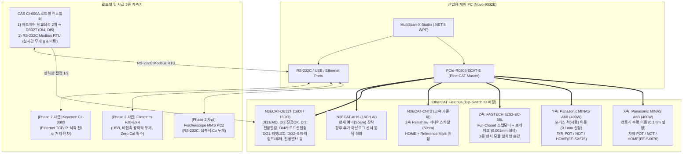
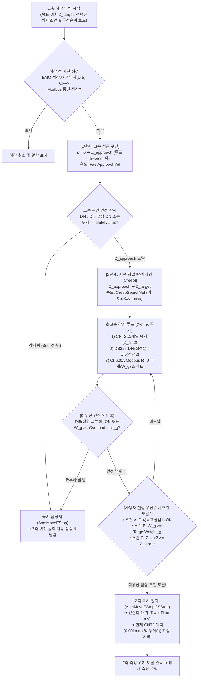
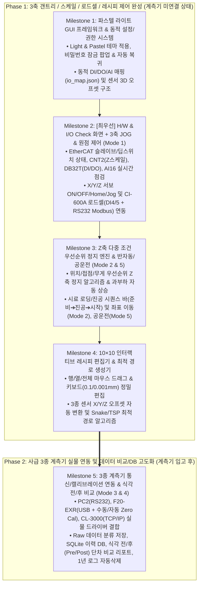

# MultiScanX 제어 소프트웨어(MultiScan-X Studio) 종합 개발 계획서 (초안)

* **문서 번호:** `261112-01`
* **프로젝트:** MultiScanX (K社 KCT向 대면적 박막두께 및 식각 단차 정밀 계측 시스템)
* **작성 일자:** 2026-11-12
* **주관 부서:** TeMaat 기술연구소
* **기반 문서 (SSOT):**
  * [소프트웨어 기능 정의 체크리스트 (사용자 구상 반영본)](./261111-02_MultiScanX_소프트웨어_기능정의_체크리스트.md)
  * [전장회로 설계 및 시스템 아키텍처 검토서](./261110-02_MultiSensor-Metrology_전장회로설계_및_시스템아키텍처_검토서.md)
  * [아진엑스텍 AXL 기반 통합제어 S/W 아키텍처 설계서](./261110-05_아진엑스텍_AXL기반_통합제어SW_아키텍처_설계서.md)
  * [프로젝트 종합 현황판](./project_status.md)

---

## 📋 문서 개정/수정 이력 (Revision History)

|    버전 (Rev)    | 개정/수정 일자 |   작성자 / 부서   | 주요 변경 내역 (Change Description)                                                                                                                                                                                                                                                                                                                                                                                                                                                                              |
| :---------------: | :------------: | :---------------: | :--------------------------------------------------------------------------------------------------------------------------------------------------------------------------------------------------------------------------------------------------------------------------------------------------------------------------------------------------------------------------------------------------------------------------------------------------------------------------------------------------------------- |
| **Rev 1.0** |   2026-11-12   | TeMaat 기술연구소 | • `261111-02` 체크리스트에 기입된 설계자 구상/결정사항 전수 반영하여 종합 개발 계획서 초안 수립• 실험실 품질평가 장비 정체성에 맞춘 **파스텔 라이트(Light & Pastel) GUI 3종 레이아웃 초안** 제시• **2단계 분리 개발 전략**(1단계: 3축 갠트리·스케일·로드셀 제어 / 2단계: 사급 3종 계측기 통합) 수립• **핵심 변수별 공학적 해결책**(3종 센서 3D 오프셋 자동 보상, Z축 다중 조건 우선순위 정지 알고리즘, 동적 I/O 매핑, 10×10 인터랙티브 레시피, 식각 전/후 비교 데이터 구조) 상세 정의 |

---

## 1. 개발 배경 및 핵심 설계 철학 (Executive Summary)

### 1.1 장비 정체성(Identity) 재정의에 따른 S/W 설계 방향

본 장비(**MultiScanX**)는 단순 반복 작업만 수행하는 인라인 양산 설비가 아니라, **반도체 웨이퍼·패널의 패턴 두께/선폭 측정 및 식각(연마) 전·후 두께/단차 변화를 정밀 평가하는 「실험실 품질평가 및 연구 분석용 계측 장비」**입니다.

따라서 소프트웨어 아키텍처와 UI/UX는 다음 4가지 핵심 원칙을 따릅니다:

1. **실험실 친화적 UI/UX (Light & Pastel Aesthetic + Keyboard/Mouse Optimized):**
   * 어둡고 투박한 공장형 작화 화면에서 탈피하여, **밝고 깔끔한 배경과 파스텔 톤 포인트 컬러**를 적용한 정밀 분석 장비 스타일로 디자인합니다.
   * 마우스 드래그(행·열·전체 그리드 미세 조정)와 키보드 정밀 수치 입력(`X/Y: 0.1 mm`, `Z: 0.001 mm`)을 동시에 지원합니다.
2. **고객 요구 변화에 대응하는 유연한 확장성 (Modularity & Configurable Map):**
   * 초안 사용 후 고객사(KCT) 의견 수렴에 따라 화면 배치나 기능이 대폭 수정될 수 있으므로, **비즈니스 로직(Service/ViewModel)과 화면 레이아웃(View)을 100% 분리**합니다.
   * DI, DO, AI 채널 번호, 타워램프 주소, EtherCAT 딥스위치 ID, 모션/로드셀 임계 파라미터를 코드에 하드코딩하지 않고 **설정창 및 JSON 설정 파일에서 동적으로 정의·변경**할 수 있도록 설계합니다.
3. **사급 계측기 입고 지연을 고려한 2단계(Two-Phase) 디커플링 개발:**
   * 3종 계측기(`MMS PC2`, `F20-EXR`, `CL-3000`)가 없는 현 상태에서 **1단계로 X/Y/Z 3축 갠트리, Z축 리니어스케일(`CNT2`), 로드셀(`CI-600A`), 디지털 I/O(`DB32T`) 제어를 먼저 100% 완성**하고, 추후 사급 계측기 입고 시 **2단계로 계측 통신 및 데이터 수집 모듈을 플러그인 결합**합니다.
4. **다중 방어선 기반의 Z축 프로브/시료 보호 (Multi-Trigger Z-Stop):**
   * 고가의 프로브와 시료를 보호하기 위해 Z축 모든 하강 동작에서 **`CNT2 리니어스케일 목표 위치` / `CI-600A 하드웨어 접점 2종(DI4, DI5)` / `RS-232C Modbus RTU 무게값`** 중 우선순위에 따라 즉각 정지하는 하이브리드 제어 엔진을 구축합니다.

---

## 2. 실제 하드웨어 구성 및 기구학 정의 (Hardware & Kinematics SSOT)

초기 개념 설계와 달리 **실제 제작된 장비 및 회로도면 기준의 물리적 사양**을 아래와 같이 확정하고 소프트웨어에 반영합니다.



### 2.1 기구학적 특징 요약

* **Y축 (Porous Chuck Axis):** 약 `510 × 510 mm` 시료가 놓이는 포러스(다공질) 진공 척이 Y축 방향으로 이동합니다. (다분할 척, 4-Edge 기계식 클램프, 안전 펜스/도어는 현 실물에 미적용)
* **X축 + Z축 (Gantry & Multi-Sensor Head):** Z축 어셈블리는 X축 캐리지에 결합되어 수평 이동하며, Z축 브래킷에 **3종 센서(MMS PC2, F20-EXR, CL-3000)가 기구적으로 고정된 간격(Offset)으로 한 몸체로 장착**되어 동시에 승강합니다.
* **좌표 설정 해상도:**
  * **X축, Y축:** `0.1 mm` 단위 입력 및 제어 (Absolute 엔코더 모터이나 Incremental 모드 + 드라이버 직결 `HOME` 센서 표준 원점 복귀 적용)
  * **Z축:** `0.001 mm` (`1 µm`) 단위 입력 및 제어 (`CNT2` 리니어 스케일 피드백 + `HOME` 센서 & Reference Mark 기반 기계 원점 설정)

---

## 3. 운전 모드(5+1 단계) 및 권한/보안 체계 설계

### 3.1 단계별 운전 모드 정의 (Step-by-Step Operation Modes)

실물 장비 시운전부터 최종 자동 측정까지 점진적으로 검증·사용할 수 있도록 **총 6가지 운전 모드**를 상태 머신(State Machine)으로 구현합니다.

|    모드 코드    | 운전 모드 명칭                                             | 모션(X/Y/Z) 동작                                                      | 로드셀(Z축 정지)                       | 3종 계측기 동작                                         | 주요 사용 목적 및 개발 단계                                                           |
| :--------------: | :--------------------------------------------------------- | :-------------------------------------------------------------------- | :------------------------------------- | :------------------------------------------------------ | :------------------------------------------------------------------------------------ |
| **Mode 0** | **가상 시뮬레이션***(Virtual Sim)*                 | 가상(Mock) 이동                                                       | 가상 하중 생성                         | 가상 데이터 생성                                        | 개발 노트북에서 하드웨어 없이 UI/시퀀스/버그 테스트 (**Phase 1**)               |
| **Mode 1** | **H/W I/O & 수동 JOG***(Low-Level Test)*           | 수동 연속/Step JOG,개별 원점 복귀                                     | 실시간 수치/접점 감시 및 하강 인터록   | 개별 통신 Ping 및단발 Read 테스트                       | 배선 점검, DI/DO 강제 출력, 축별 방향·리미트·스케일 검증 (**Phase 1 최우선**) |
| **Mode 2** | **좌표 자동이동 + 수동측정***(Semi-Auto Position)* | 목표 $(X,Y,Z)$ 입력 시자동 이동 (센서 오프셋 반영)                  | 설정된 우선순위 조건으로 Z축 자동 정지 | **작업자가 계측기 직접 수동 측정**                | 사급 계측기 연동 전 또는 단품 샘플 수동 평가 시 위치 결정 자동화 (**Phase 1**)  |
| **Mode 3** | **단일점 자동 측정***(Single-Point Auto)*          | 목표 $(X,Y,Z)$ 자동 이동(선택 센서 오프셋 자동 전환)                | 설정된 우선순위 조건으로 Z축 자동 정지 | **선택한 센서(1~3종) 자동 측정 & 값 수집**        | 특정 단일 좌표에 대해 1~3종 센서 자동 측정 검증 (**Phase 2**)                   |
| **Mode 4** | **레시피 자동 측정***(Recipe Auto Scan)*           | 레시피 그리드(최대 10×10+)최적 경로 자동 순회                        | 매 포인트마다 Z축 안전 정지 및 복귀    | **레시피에 선택된 센서 자동 측정 & 파일/DB 저장** | 시료 전체 다중 포인트 전자동 매핑 및 식각 전/후 평가 (**Phase 2**)              |
| **Mode 5** | **기구 공운전***(Mechanical Dry-Run)*              | 레시피 경로대로 실제 X/Y/Z 이동 (비접촉 안전 Z 또는 터치 테스트 선택) | 로드셀 안전 인터록 상시 작동           | 계측 통신 생략 (더미 값 또는 이동 시간만 체크)          | 사급 계측기 없이 레시피 전체 궤적, 간섭, 사이클 타임 실물 검증 (**Phase 1**)    |

### 3.2 사고 방지형 심플 권한 잠금 (Safety Lock Policy)

* **무로그인 즉시 진입:** 프로그램 실행 시 별도 로그인 창 없이 기본 **작업자(Operator) 보기 상태**로 바로 진입합니다.
* **파라미터 변경 시 비밀번호 팝업:** 레시피 편집 저장, 장비 파라미터(오프셋/속도/로드셀 임계치) 변경, EtherCAT 설정, I/O 매핑 수정 등 **사고 위험이 있는 설정 버튼 클릭 시에만 4~6자리 비밀번호 입력 팝업**을 띄웁니다.
* **복귀 버튼 & 자동 잠금 타이머:**
  * 한 번 비밀번호를 통과하면 상단 바에 `[🔓 설정 편집 허용 중 (남은 시간 10:00) | 🔒 잠금 복귀]` 버튼이 표시되어 작업 완료 즉시 수동으로 잠글 수 있습니다.
  * 설정/편집 창에서 마우스·키보드 입력 없이 **일정 시간(기본 10분, 설정 가능)이 경과하면 자동으로 잠금(Operator) 상태로 복귀**하여 방치로 인한 오조작을 원천 차단합니다.

---

## 4. GUI 화면 아키텍처 및 3종 레이아웃 초안 비교 (Light & Pastel Theme)

### 4.1 디자인 시스템: 밝고 깔끔한 파스텔 톤 (Clean Lab Pastel Palette)

실험실 품질평가 장비의 정체성에 맞추어 기존의 어두운 다크 테마를 걷어내고, 눈의 피로도가 적고 가독성이 뛰어난 **Warm Light & Soft Pastel 컬러 시스템**을 적용합니다.

| 요소 구분                     | 색상명 (컨셉)          |                HEX 코드                | 적용 위치 및 용도                                                                    |
| :---------------------------- | :--------------------- | :-------------------------------------: | :----------------------------------------------------------------------------------- |
| **배경 (Background)**   | Pure & Cloud White     |        `#F4F7FA` / `#FFFFFF`        | 전체 기본 배경(`#F4F7FA`) 및 개별 카드/패널 배경(`#FFFFFF`), 테두리(`#DCE4EC`) |
| **주조색 (Primary)**    | Soft Pastel Blue       |     `#4A90E2` (배경 `#EBF4FF`)     | 주요 실행 버튼, 활성화된 탭/모드, 선택된 측정 포인트                                 |
| **정상/완료 (Success)** | Pastel Mint / Sage     | `#2E9CCA` / `#38B2AC` (`#E6FFFA`) | 서보 정상, 진공 흡착 완료(`DI2`), HW EMO 정상, 측정 PASS                           |
| **준비/주의 (Warning)** | Pastel Apricot / Amber |     `#ED8936` (배경 `#FFFAF0`)     | 측정 준비, 캘리브레이션 진행 중, 일시정지(Pause), 측정 중지 버튼                     |
| **위험/알람 (Danger)**  | Soft Coral Red         |     `#E53E3E` (배경 `#FFF5F5`)     | 비상정지(EMO), 로드셀 과부하(`>Limit`), 진공 알람(`DI3`), 서보 Fault             |
| **텍스트 (Typography)** | Deep Slate & Charcoal  |        `#1E293B` / `#64748B`        | 본문 타이틀/수치(`#1E293B` 고대비 가독성 확보), 보조 라벨(`#64748B`)             |

### 4.2 화면 레이아웃 초안 3종 비교 (검토 및 선택 요청)

고객사 피드백에 따른 레이아웃 변경 가능성과 기능 확장성을 고려하여 **3가지 GUI 구조 초안**을 제시합니다.

#### 🔹 [초안 A] 상단 워크플로우 리본 탭 + 좌우 분할 워크스페이스형 (추천 🏆)

상단에 **장비 상태 헤더**와 **시료 로딩/진공/측정 제어 바(Action Bar)**를 항상 고정 배치하고, 중앙 작업 영역을 5개 대분류 탭으로 깔끔하게 전환하는 구조입니다.

```text
┌─────────────────────────────────────────────────────────────────────────────────────────┐
│ 🔬 MultiScan-X Studio [v1.1]   [🟢 EMO 정상] [🟢 진공 OK] [⚖ 로드셀: 0.2g]  [🔓 잠금해제] │
├─────────────────────────────────────────────────────────────────────────────────────────┤
│ [작업절차 바] ①[측정준비(원점/진공OFF)] ➔ ②[진공펌프 ON/OFF (상태:흡착완료)] ➔ ③[▶ 측정시작] [■ 중지] │
│ [빠른도구 바] [🎯 F20 영점 캘리브레이션]  [운전모드: ▾ Mode 4 (레시피 자동)]  [센서: ☑PC2 ☑F20 ☑CL3000]│
├───────────────┬───────────────┬────────────────────┬───────────────────┬────────────────┤
│ 1. 측정 운전   │ 2. 레시피 편집 │ 3. H/W & I/O 점검  │ 4. 장비/통신 설정  │ 5. 데이터/비교 │
├───────────────┴───────────────┴────────────────────┴───────────────────┴────────────────┤
│ ┌─ [좌측 패널: 시료 2D 맵 (510x510mm)] ────┐ ┌─ [우측 상단: 실시간 좌표 & 계측 데이터] ─┐ │
│ │  • 10x10 격자 포인트 & 현재 헤드 위치(+) │ │  • 현재 X: 120.5  Y: 210.0  Z: 12.345 mm│ │
│ │  • 마우스 클릭 시 해당 좌표 선택/이동    │ │  • CNT2 스케일: 12.345 mm | 하중: 14.8 g│ │
│ │  • 행/열/전체 드래그 미세조정 지원       │ │  • 포인트별 PC2 / F20 / CL-3000 결과 표 │ │
│ │                                          │ ├─ [우측 하단: 빠른 이동(Mode 2/3) & 로그]┤ │
│ │                                          │ │  • 목표 X/Y/Z 입력 ➔ [이동] [단발측정]   │ │
│ │                                          │ │  • 동작/알람 실시간 로그                 │ │
│ └──────────────────────────────────────────┘ └──────────────────────────────────────────┘ │
└─────────────────────────────────────────────────────────────────────────────────────────┘
```

#### 🔹 [초안 B] 좌측 사이드 내비게이션 + 중앙 2D 맵 고정 도킹형 (분석장비 스타일)

좌측에 세로 메뉴 바를 두고, **화면 중앙의 2D 시료 맵은 어떤 메뉴를 눌러도 항상 고정 표시**되며 우측 패널만 `[실시간 결과]` / `[레시피 그리드 설정]` / `[JOG & I/O 제어]`로 바뀌는 구조입니다.

```text
┌─────────────────────────────────────────────────────────────────────────────────────────┐
│ 🔬 MultiScan-X Studio          [🟢 EMO] [🟢 진공] [⚖ 0.2g]   ①[측정준비] ②[진공ON] ③[시작]│
├──────────┬────────────────────────────────────┬─────────────────────────────────────────┤
│ [메뉴바] │ [중앙 고정: 510x510mm 시료 2D 맵]  │ [우측 가변 도킹 패널 (메뉴별 전환)]     │
│          │                                    │                                         │
│ ▶ 운전   │   ┌────────────────────────────┐   │  • '운전' 선택 시: 측정 결과표 & 그래프 │
│ 📐 레시피 │   │  ●   ●   ●   ●   ●   ●     │   │  • '레시피' 선택 시: 10x10 행/열 조정기 │
│ 🔌 I/O점검│   │  ●   ●  [⊕]  ●   ●   ●     │   │  • 'I/O점검' 선택 시: JOG / DIO / CNT2  │
│ ⚙ 설정   │   │  ●   ●   ●   ●   ●   ●     │   │  • '설정' 선택 시: 센서 오프셋 / 통신   │
│ 📊 이력   │   └────────────────────────────┘   │                                         │
│          │   [하단: X/Y/Z 실시간 위치 & 로그] │                                         │
└──────────┴────────────────────────────────────┴─────────────────────────────────────────┘
```

#### 🔹 [초안 C] 메인 계측 화면 단일화 + 기능별 독립 팝업/플로팅 윈도우형

메인 창은 오직 측정(Mode 2/3/4)과 2D 맵만 보여주고, `[I/O Check]`, `[Recipe 편집]`, `[캘리브레이션]`, `[통신 설정]` 버튼을 누르면 각각 **별도의 독립 윈도우(Sub-Window)**가 뜨는 방식입니다.

#### 📊 3종 GUI 레이아웃 비교 매트릭스

| 평가 항목                 | 초안 A (상단 리본 탭 + 좌우 분할 🏆)                                                                                                                                  | 초안 B (좌측 메뉴 + 중앙 맵 고정)                                                                 | 초안 C (메인 고정 + 다중 팝업 창)                                 |
| :------------------------ | :-------------------------------------------------------------------------------------------------------------------------------------------------------------------- | :------------------------------------------------------------------------------------------------ | :---------------------------------------------------------------- |
| **장점**            | • 작업 순서(`준비➔진공➔시작`)가 상단에 일렬 배치되어 가장 직관적• `H/W & I/O 점검` 탭 진입 시 넓은 전체 화면(1400px)을 다 쓸 수 있어 DI/DO/AI/JOG 배치에 최적 | • 레시피 편집이나 JOG 이동 중에도 중앙 2D 맵을 항상 보면서 조작 가능• 실험실 계측 S/W 느낌 우수 | • 듀얼 모니터 확장 시 한쪽엔 메인, 한쪽엔 I/O 창을 띄워놓기 좋음 |
| **단점**            | • I/O 점검 탭을 볼 때는 2D 큰 맵이 가려짐 (단, 미니 좌표계로 보완 가능)                                                                                              | • 우측 패널 폭이 좁아져 I/O 32점+AI 16점+JOG를 한 번에 표시하기 답답함                           | • 단일 모니터에서 창이 여러 개 겹쳐 작업자가 혼란스러울 수 있음  |
| **확장성 / 수정성** | **매우 우수** (탭 단위로 UserControl만 추가/교체하면 됨)                                                                                                        | **우수** (우측 패널 교체 방식)                                                              | **보통** (창 간 상태 동기화 복잡)                           |

> **💡 개발팀 권장안:** **「초안 A」를 기본 골격으로 채택**하되, 각 탭 내부 화면을 독립된 `UserControl` 모듈로 제작하여 필요시 원하는 탭만 팝업 창으로 분리(Detach)할 수 있도록 구현하면 초안 A와 C의 장점을 모두 확보할 수 있습니다.

---

## 5. 핵심 엔지니어링 변수 및 상세 해결책 (Key Variables & Solutions)

요구사항에 포함된 복합적인 기술 변수들을 해결하기 위한 소프트웨어 상세 설계입니다.

### 5.1 [변수 1] 3종 센서 모듈의 3차원(X/Y/Z) 기구 오프셋 자동 보상

* **문제 상황:** Z축 브래킷에 3종 센서(PC2, F20, CL-3000)가 일정 간격을 두고 한 몸체로 조립되어 있어, 시료의 동일 포인트 $P(X_{ref}, Y_{ref}, Z_{ref})$를 측정하려 해도 **어떤 센서를 선택하느냐에 따라 실제 X, Y, Z 모터가 이동해야 할 물리적 좌표가 전부 다릅니다.**
* **해결 아키텍처 (`SensorOffsetMatrix`):**
  1. **기준점(Master Reference) 설정:** 기계적 기준 센서(예: `CL-3000` 광축 중심 또는 기준 포인터)의 오프셋을 $(0, 0, 0)$으로 두거나, 기계 원점 대비 각 센서 3종의 고유 오프셋 벡터를 `system_config.json`에 등록합니다.

     * $\text{Offset}_{\text{CL3000}} = (\Delta X_1, \Delta Y_1, \Delta Z_1)$
     * $\text{Offset}_{\text{F20}} = (\Delta X_2, \Delta Y_2, \Delta Z_2)$
     * $\text{Offset}_{\text{PC2}} = (\Delta X_3, \Delta Y_3, \Delta Z_3)$
  2. **자동 좌표 변환 공식:** 사용자가 레시피나 수동 이동(Mode 2/3/4)에서 시료 상의 좌표 $(X_{sample}, Y_{sample}, Z_{sample})$만 입력하고 대상 센서 $S$를 선택하면, 모션 컨트롤러는 아래 변환 좌표를 자동 계산하여 이동합니다:

     $$
     X_{\text{motor}} = X_{\text{origin\_base}} + X_{\text{sample}} + \Delta X_S
     $$

     $$
     Y_{\text{motor}} = Y_{\text{origin\_base}} + Y_{\text{sample}} + \Delta Y_S
     $$

     $$
     Z_{\text{target}} = Z_{\text{origin\_base}} + Z_{\text{sample}} + \Delta Z_S
     $$
  3. **예외 변수 방어 (Soft Limit 사전 검증):**

     * 시료 외곽(예: $X=505\text{ mm}$) 측정 시 특정 센서의 오프셋($\Delta X_S = +50\text{ mm}$)을 더하면 X축 최대 스트로크(`550 mm`)를 초과할 수 있습니다.
     * **해결책:** 레시피 생성 및 측정 시작 전 `ValidateRecipeOffsets()`를 실행하여, 선택된 센서 중 스트로크 한계를 벗어나는 포인트가 있으면 **사전에 2D 맵에서 해당 포인트를 주황색으로 하이라이트하고 작업자에게 경고(Skip 여부 선택)**합니다.

---

### 5.2 [변수 2] Z축 하강 위치 확정 및 다중 조건 우선순위 정지 알고리즘 (Multi-Source Z-Stop)

* **문제 상황:**
  * Z축 하강 정지는 PC2(접촉식)뿐만 아니라 **모든 Z축 하강 동작에 공통 적용**되어야 합니다.
  * 정지 기준은 **① `CNT2` 리니어스케일 목표 위치값**, **② `CI-600A` 로드셀 하드웨어 비교접점 2개(`DI4`, `DI5`)**, **③ `CI-600A` RS-232C Modbus RTU 통신 무게값(`g`)**의 4가지 신호가 존재하며, 사용자가 설정창에서 **사용 여부와 우선순위(로드셀 우선 등)**를 자유롭게 조합·선택할 수 있어야 합니다.
  * 특히 **변수(위험요소)**로, RS-232C 통신 주기(수십 ms) 동안 Z축이 빠른 속도로 내려가면 통신 무게값을 읽었을 때 이미 프로브가 과도하게 눌릴(Overshoot) 위험이 있습니다.



* **상세 해결책 (변수 완벽 대응):**
  1. **2단 속도 프로파일 (Fast Approach ➔ Slow Creep) 변수화:**
     * 설정창에서 `고속 접근 속도`, `감속 전환 여유 거리(예: 목표 Z로부터 3.000 mm 위)`, `저속 탐색 속도(예: 0.5 mm/s)`를 모두 변수로 설정할 수 있게 합니다. 저속 구간에서는 `0.5 mm/s`로 이동하므로 `10 ms` 동안 이동 거리가 불과 `0.005 mm (5 µm)`에 불과해 RS-232C Modbus나 DI 접점으로 오버슈트 없이 정밀 정지가 가능합니다.
  2. **정지 트리거 우선순위 매트릭스 (`ZStopPolicyConfig`):**
     * 설정 화면에서 아래 항목의 **[사용(Enable) 체크박스]**와 **[우선순위(1순위~3순위)]**를 지정할 수 있습니다.
       * `Trigger_LoadCell_DI4` (`DI4` 하드웨어 비교접점 1 감지 시 정지)
       * `Trigger_LoadCell_ModbusWeight` (Modbus 무게값이 `TargetStopWeightGram`, 예: `15.0 g` 이상 도달 시 정지)
       * `Trigger_LinearScale_Pos` (`CNT2` 리니어스케일 값이 목표 `Z_target`에 도달 시 정지)
     * **작동 원리 (OR-Priority Stop):** Z축이 `Z_target`을 향해 내려가는 도중, 활성화된 상위 우선순위 조건(예: 로드셀 접점 또는 무게값)이 `Z_target` 도달 전에 먼저 충족되면 **그 즉시 Z축 모션을 정지시키고, 멈춘 지점의 `CNT2` 리니어스케일 값을 최종 측정 Z 위치로 확정**합니다.
     * 만약 시료 단차로 인해 `Z_target`까지 다 내려갔는데도 로드셀 목표 무게에 도달하지 못한 경우: 사용자 옵션에 따라 `(옵션 1) Z_target에서 정지 후 측정 진행` 또는 `(옵션 2) 미접촉(Under-touch) 경고 발생 후 정지`를 선택할 수 있게 합니다.
  3. **하드웨어 과부하 방어선 (`DI5` & `OverloadLimitGram`):**
     * 어떤 모드에서든 하강 또는 정지 중에 `DI5`(상한 리미트 접점)가 들어오거나 Modbus 무게가 `OverloadLimitGram`(예: `30.0 g`, 설정 가능)을 초과하면 **모든 시퀀스를 무시하고 즉시 정지 후 Z축을 안전 높이로 자동 상승(Retract)**시켜 프로브 파손을 막습니다.
  4. **CI-600A RS-232C Modbus RTU 전용 드라이버 설계:**
     * 백그라운드 고속 폴링 스레드에서 CI-600A의 **현재 중량 레지스터(Float/Int32)**와 **상태/비교출력 비트 레지스터**를 동시에 읽어오며, 만약 하강 도중 RS-232C 통신이 끊기면 즉시 하강을 멈추고 하드웨어 직결 신호인 `DI4`/`DI5`가 백업 인터록으로 작동하도록 이중화합니다.

---

### 5.3 [변수 3] 동적 I/O 매핑 (`DI` / `DO` / `AI`) 및 EtherCAT 딥스위치·파라미터 관리

* **문제 상황:** 현재 확정된 입출력 외에 향후 센서와 타워램프 등이 추가·변경될 예정이며, 슬레이브 딥스위치 주소 및 EtherCAT 필수 파라미터를 S/W에서 읽고 수정·저장해야 합니다.
* **해결 아키텍처 (`HardwareMapConfig` & `DynamicIOService`):**
  1. **사용자 정의형 DI / DO / AI 매핑 테이블:**
     * 고정된 하드코딩 대신 설정창(Grid 표)에서 **채널 번호(Bit 0~15), 기능 코드(Role), 사용자 표시 이름, 접점 극성(A접점 Normal Open / B접점 Normal Close / Invert), 사용 여부(Enabled)**를 언제든 편집·저장할 수 있게 합니다.
     * **초기 기본 프리셋 (`io_map.json`):**

|     구분     |  기본 채널  | 시스템 기능 코드 (Role) | 화면 표시 명칭 (수정 가능)    | 극성 / 비고                                                                  |
| :----------: | :----------: | :---------------------- | :---------------------------- | :--------------------------------------------------------------------------- |
| **DI** |  `DI 01`  | `EMO_INPUT`           | 비상정지(EMO) 입력            | B접점/A접점 설정 가능 (`DO 01` 리셋 램프 연동)                             |
| **DI** |  `DI 02`  | `VACUUM_OK`           | 진공 압력 흡착완료 신호       | ON 시 시료 로딩 완료 판정                                                    |
| **DI** |  `DI 03`  | `VACUUM_ALARM`        | 진공 압력 알람 신호           | 측정 중 감지 시 인터록 정지                                                  |
| **DI** |  `DI 04`  | `LOADCELL_LIMIT1`     | 로드셀 접점 입력 1 (목표하중) | Z축 하강 정지 트리거 1                                                       |
| **DI** |  `DI 05`  | `LOADCELL_LIMIT2`     | 로드셀 접점 입력 2 (과부하)   | Z축 비상정지 및 상승 트리거                                                  |
| **DI** |  `DI 06`  | `DOOR_INTERLOCK`      | 도어 인터록 센서 (예비)       | 현재 `Enabled = false` (추후 배선 시 체크만 하면 즉시 동작)                |
| **DI** | `DI 07~16` | `USER_CUSTOM_DI`      | 예비 입력 7 ~ 16              | 사용자가 이름/용도 직접 기입 가능                                            |
| **DO** |  `DO 01`  | `EMO_RESET_LAMP`      | EMO 리셋 스위치 LED 램프      | `DI 01` 상태에 따라 점멸(안내) / 점등 / 소등 자동 제어                     |
| **DO** |  `DO 02`  | `TOWER_RED`           | 타워램프 - 적색 (Red)         | 주소 변경 가능 / 중알람 시 점멸                                              |
| **DO** |  `DO 03`  | `TOWER_YELLOW`        | 타워램프 - 황색 (Yellow)      | 주소 변경 가능 / 대기·준비 중 점등                                          |
| **DO** |  `DO 04`  | `TOWER_GREEN`         | 타워램프 - 녹색 (Green)       | 주소 변경 가능 / 자동 측정 중 점등                                           |
| **DO** |  `DO 05`  | `TOWER_BUZZER`        | 타워램프 - 부저 (Buzzer)      | 주소 변경 가능 / 알람음 및 완료 알림음(2초)                                  |
| **DO** |  `DO 06`  | `VACUUM_VALVE`        | 포러스 척 진공펌프/밸브 ON    | 주소 변경 가능 / `[진공 ON/OFF]` 버튼과 연동                               |
| **DO** | `DO 07~16` | `USER_CUSTOM_DO`      | 예비 출력 7 ~ 16              | 향후 솔밸브/조명 등 추가 시 즉시 매핑                                        |
| **AI** | `AI 01~16` | `USER_CUSTOM_AI`      | 예비 아날로그 센서 1 ~ 16     | 채널별 센서명, 전압범위, `Gain`, `Offset`, 단위(`kPa`, `℃` 등) 정의 |

2. **EtherCAT 딥스위치(Station Alias) 및 축 파라미터 읽기/쓰기/저장:**
   * 각 슬레이브(`CNT2`, `DB32T`, `X/Y/Z 드라이버`, `AI16`)의 하드웨어 딥스위치 설정값을 S/W 설정창에 입력·매핑하여 모듈 순서가 바뀌어도 고유 주소로 정확히 인식하도록 구성합니다.
   * AXL API(`AxmMotLoadParaAll` / `AxmMotSaveParaAll`, `AxmMotSetParaLoad`, `AxlECatReadSdo` / `WriteSdo`)를 래핑하여 **축별 1회전당 펄스/이동량(Unit/Pulse), 최대 속도, 가감속도, 원점 검색 방법(Home Method), Soft Limit**을 GUI 표에서 직접 읽고 수정한 뒤 파일(`.mot` 및 `system_config.json`)에 영구 저장하는 기능을 제공합니다.

---

### 5.4 [변수 4] 포러스 척 시료 로딩/언로딩 시퀀스 및 F20 영점 캘리브레이션

* **시료 로딩/언로딩 직관적 워크플로우 (클램프/도어 미적용 실물 반영):**

  * GUI 상단 바에 작업 순서 그대로 **3개의 대형 단계 버튼과 상태 LED**를 나란히 배치합니다:
    ```text
    [ ① 측정 준비 (원점/진공해제) ] ──▶ [ ② 진공 흡착 ON/OFF (DI2: 대기중) ] ──▶ [ ③ 측정 시작 (Start) ]
    ```
  * **① `[측정 준비]` 클릭 시:** Z축 최우선 원점 상승 ➔ X, Y축 원점 복귀 확인 ➔ 진공펌프(`DO6`) OFF 확인 ➔ 안내 메시지: *"시료를 X, Y 고정 가이드에 밀착하여 포러스 척에 올려놓은 후 [진공 흡착 ON]을 누르세요."*
  * **② `[진공 흡착 ON]` 클릭 시:** (설정에 따라 X, Y 원점 위치 인터록 확인 후) 진공펌프 출력 ON ➔ `DI2`(흡착완료 신호)가 들어오면 버튼 색상이 파스텔 민트색(`흡착 완료 OK`)으로 바뀌며 **`[③ 측정 시작]` 버튼이 활성화**됩니다. (만약 일정 시간 내 `DI2` 미감지 또는 `DI3` 진공 알람 감지 시 경고 표시)
  * **측정 종료(언로딩) 시:** 측정 완료 ➔ Z축 원점 상승 ➔ X, Y축 원점 복귀 완료 ➔ 진공펌프 OFF(또는 작업자 수동 OFF 선택 가능) ➔ 시료 수거.
  * **강제 복귀(Manual Recovery):** 에러 발생이나 비상 해제 후 언제든 안전 순서(`Z축 상승 ➔ X/Y 원점`)로 강제 이동시킬 수 있는 `[원점 강제 복귀]` 버튼을 제공합니다.
* **F20-EXR 영점 조정 (Zero Calibration) 전용 시퀀스:**

  * 설정창에 표준 시료(Reference Sample)가 부착된 **캘리브레이션 전용 좌표 $(X_{cal}, Y_{cal}, Z_{cal})$ 및 안정화 대기시간(`ms`)** 입력란을 둡니다.
  * **수동(Manual) Cal 모드:** `[캘리브레이션 시작]` 클릭 ➔ Z 안전 확인 후 $(X_{cal}, Y_{cal}, Z_{cal})$로 자동 이동 (Z축은 로드셀/스케일 우선순위 정지 적용) ➔ 상태창에 `"위치 도달 완료 - 수동 영점 조정 후 [캘리브레이션 완료] 버튼을 누르세요"` 표시 ➔ 사용자가 `[완료]` 클릭 시 Z축 상승 후 원점 복귀.
  * **자동(Auto) Cal 모드:** `[캘리브레이션 시작]` 클릭 ➔ Cal 위치 자동 이동 ➔ 대기시간 후 F20-EXR에 Zero Calibration 명령 송신 ➔ 완료 응답 수신 시 자동으로 Z축 상승 및 원점 복귀.

---

### 5.5 [변수 5] 10×10 인터랙티브 레시피 편집기 및 경로 최적화

* **시료 메타데이터 확장 구조:**
  * 기본 가로(`Width`, 약 `510.0 mm`), 세로(`Height`, 약 `510.0 mm`), 두께(`Thickness`, `0.001 mm` 단위) 외에 **시료 고유 ID(`SampleId`), 재질(`Material`), 공정 단계(`Pre-Etch` / `Post-Etch`), 작업자 메모 및 사용자 정의 추가 속성(`CustomTags` Dictionary)**을 입력할 수 있도록 설계합니다.
* **마우스 + 키보드 하이브리드 포인트 편집 (기본 10×10, N×M 제한 없음):**
  1. **자동 격자 생성기:** 행 수(`Rows`, 기본 1~10, 확장 가능), 열 수(`Cols`, 기본 1~10, 확장 가능), 상하좌우 여백(`Margin X/Y`) 또는 피치 간격(`Pitch X/Y`)을 입력하면 균일 격자 좌표를 즉시 생성합니다.
  2. **그룹 단위 미세 조정 (Group Manipulation):**
     * **전체 이동(Global Shift):** 전체 포인트를 $\Delta X, \Delta Y$만큼 한꺼번에 밀고 당기기 (마우스 드래그 또는 화살표 증감 버튼 `±0.1 mm`, `±1.0 mm`)
     * **특정 행(Row) / 열(Column) 단독 이동:** 2D 맵에서 특정 행 헤더(`Row 3`)나 열 헤더(`Col 5`)를 선택하여 **해당 줄 전체의 X 또는 Y 좌표만 일괄 미세 이동**하거나 간격을 벌리고 줄이는 기능
     * **개별 포인트 미세 조정:** 2D 맵에서 특정 포인트를 마우스로 드래그하거나 우측 수치 테이블에서 키보드로 직접 `X(0.1mm)`, `Y(0.1mm)`, `Z(0.001mm)` 값을 타이핑하여 즉시 반영
* **최적 측정 경로 자동 탐색 (Route Optimization Algorithm):**
  * **Snake (Zigzag) 경로:** 짝수 행은 좌➔우, 홀수 행은 우➔좌로 이동하여 불필요한 공중 복귀 거리를 제거합니다.
  * **비연속/임의 포인트 최단 경로 (Nearest-Neighbor + 2-Opt TSP):** 사용자가 격자 중 일부 포인트만 선택했거나 임의 좌표를 추가한 경우, 현재 위치에서 총 이동 거리($\sum \sqrt{\Delta X^2 + \Delta Y^2}$)가 최소가 되는 최적 순서를 0.1초 이내에 자동 정렬해 주는 `[⚡ 최적 경로 자동 정렬]` 버튼을 제공합니다.
  * **다중 센서 실행 순서 옵션:** 2개 이상의 센서 선택 시 `(옵션 A: 센서별 일괄 스캔 - 비접촉 CL3000/F20 먼저 전체 스캔 후 접촉식 PC2 스캔하여 Z축 승하강 및 시간 최소화)`와 `(옵션 B: 포인트별 연속 스캔)` 중 선택 가능하게 구현합니다.

---

### 5.6 [변수 6] 식각(연마) 전·후 비교 데이터 구조 및 DB/알람 이력 관리

* **CL-3000 식각(연마)량 비교 평가 기능:**
  * 동일 시료(`SampleId`)를 식각 전(`Pre`)과 식각 후(`Post`)에 동일 레시피로 측정하면, **[데이터/비교 이력] 탭**에서 두 측정 파일을 선택(또는 `SampleId`로 자동 매칭)하여 각 포인트 $i$의 연마량 $\Delta H_i = H_{\text{pre}, i} - H_{\text{post}, i}$와 전체 평균 연마량, 연마 균일도(Uniformity)를 자동 산출하고 CSV 리포트로 내보냅니다.
* **파일 명명 규칙 및 로컬 데이터베이스(SQLite) 병행 설계:**
  * **Raw 데이터 파일 자동 분류 저장:**
    * 경로: `D:\MultiScanX_Data\Results\{YYYY-MM}\{SampleID}\`
    * 파일명: `{YYYYMMDD_HHmmss}_{SampleID}_{Stage(Pre/Post)}_{RecipeName}_{Sensors}.csv` (직관적 분류 및 엑셀 호환)
  * **경량 내장형 DB (`SQLite` - 별도 서버 설치 불필요):**
    * 파일 저장과 동시에 로컬 `multiscanx_history.db` 파일에 시료 정보, 레시피, 포인트별 측정값을 자동 인덱싱하여, 수개월 뒤에도 시료 ID·날짜·재질·레시피별로 즉시 검색하고 Pre/Post 비교 그래프를 띄울 수 있도록 구축합니다.
* **알람 이력 파일 용량 관리 및 1년 경과 자동 삭제 (Data Retention Policy):**
  * 알람 및 시스템 로그는 월별/일별 파일(`AlarmLog_YYYYMM.csv`)로 분할(Rolling)하여 단일 파일이 비대해지는 것을 방지합니다.
  * 프로그램 기동 시 백그라운드 클리너(`DataRetentionService`)가 동작하여 **생성된 지 365일(1년, 설정에서 변경 가능)이 경과한 오래된 알람/시스템 로그를 자동으로 정리·삭제**합니다.
* **바코드 리더기 선반영 (Ready-to-Activate):**
  * 설정창에 `UseBarcodeScanner (true/false)` 및 입력 방식(`USB HID Keyboard Hook` / `RS-232 COM Port`)을 미리 구현해 두고 기본값은 `false(숨김)`로 두어, 추후 고객사 요청 시 체크박스 하나만 켜면 시료 ID 입력란에 바코드가 자동 입력되도록 대비합니다.

---

## 6. 단계별(Phase 1 ➔ Phase 2) 상세 개발 로드맵

현재 **사급 계측기 3종이 없는 상태**에서 즉시 개발과 IPC 실물 검증을 진행할 수 있도록 아래와 같이 5개 마일스톤으로 나누어 순차 개발합니다.



### 6.1 마일스톤별 핵심 산출물 및 검증 기준

|            단계            | 마일스톤 명칭                                           | 주요 개발 항목 (Deliverables)                                                                                                                                                                                                                   | IPC 실물 검증 기준                                                                                               |
| :------------------------: | :------------------------------------------------------ | :---------------------------------------------------------------------------------------------------------------------------------------------------------------------------------------------------------------------------------------------- | :--------------------------------------------------------------------------------------------------------------- |
|        **M1**        | **GUI 리뉴얼 & 동적 설정 기반**                   | • 파스텔 라이트 테마(XAML ResourceDictionary)• 상단 로딩/진공 워크플로우 바 & 탭 레이아웃• 비밀번호 팝업/자동잠금, `io_map.json` 동적 매핑 모델                                                                                            | • 개발 노트북 및 IPC에서 밝은 파스텔 GUI 구동 및 설정 잠금/해제 동작 확인                                       |
| **M2***(즉시착수)* | **H/W & I/O Check 및 3축 JOG (Mode 1)**           | • `CNT2` Z축 스케일(`0.001mm`) 리드 & 영점• `DB32T` DI/DO 실시간 모니터·수동 출력, EMO 리셋 램프/타워램프 연동• `CI-600A` 로드셀 Modbus RTU + `DI4/DI5` 모니터• X/Y/Z 서보 상태(`POT/NOT/HOME`), 안전 원점 복귀, 연속/Step JOG | • IPC에서 슬레이브 인식, DI/DO 점멸, Z축 스케일 카운트, 로드셀 무게/접점, 3축 JOG 및 원점 복귀 실물 완주        |
|        **M3**        | **Z축 하이브리드 정지 & Mode 2 / Mode 5**         | • Z축 2단 하강(고속➔저속) + `위치/DI4/Modbus무게` 우선순위 정지 엔진• 과부하(`DI5` / `>Limit g`) 즉시 정지 & 안전 상승• Mode 2(좌표 자동이동+수동측정) 및 Mode 5(기구 공운전)                                                         | • 로드셀에 힘을 가하거나 시료 모형 터치 시 설정된 우선순위(접점 vs 무게 vs 위치)대로 Z축이 정확히 멈추는지 실증 |
|        **M4**        | **10×10 레시피 편집기 & 센서 오프셋**            | • 시료 정보 + `10×10`(확장형) 격자 생성 및 행/열/전체 마우스·키보드 편집기• 3종 센서별 $\Delta X, \Delta Y, \Delta Z$ 오프셋 자동 보상 및 경로 최적화                                                                                   | • 레시피 작성 후 Mode 5(공운전) 실행 시 선택한 센서 오프셋만큼 정확히 보정되어 전 포인트 순회하는지 확인        |
| **M5***(Phase 2)* | **사급 3종 계측기 통합 & 데이터 비교 (Mode 3/4)** | • 계측기별 통신 설정/점검 UI 및 측정 시작/종료/값 수신• F20-EXR 수동/자동 Zero Calibration 시퀀스• CSV/SQLite 저장, CL-3000 식각 전/후 비교 뷰어, 알람 1년 자동 정리                                                                         | • 사급 계측기 연결 후 Mode 3(단일점) 및 Mode 4(레시피 전체) 자동 측정, 파일 생성 및 Pre/Post 비교 검증          |

---

## 7. 착수 전 최종 확인 및 의사결정 요청 사항

본 개발 계획서 초안을 바탕으로 바로 **Milestone 1 & Milestone 2 (파스텔 라이트 GUI 개편 + H/W & I/O Check 및 3축 JOG 화면 구현)** 코딩에 착수하고자 합니다. 아래 3가지 사항만 확인해 주시면 즉시 반영하겠습니다.

1. **GUI 레이아웃 선택:** 4.2절에 제시한 3가지 레이아웃 중 **[초안 A: 상단 워크플로우 리본 탭 + 좌우 분할 워크스페이스형]**으로 진행하면 될까요?
2. **CI-600A 로드셀 RS-232C 통신 기본 사양:** IPC와 연결된 COM 포트 번호(예: `COM1` 또는 `COM2`)와 기본 통신 속도(예: `9600` 또는 `115200 bps`, 8-N-1, Slave ID `1`)는 설정창에서 언제든 바꿀 수 있게 만들 예정인데, 초기 기본값으로 넣어둘 포트/보레이트가 있으신지 확인 부탁드립니다.
3. **추가/수정 의견:** 본 계획서의 변수별 해결책(Z축 우선순위 정지, 3종 센서 오프셋 보상, 5+1 운전 모드 등) 중 보완하거나 다르게 변경하고 싶은 부분이 있으시면 말씀해 주세요.
