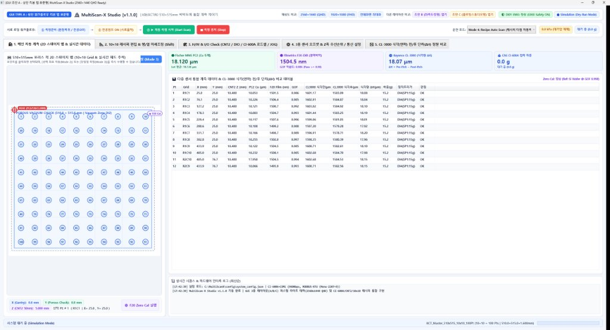
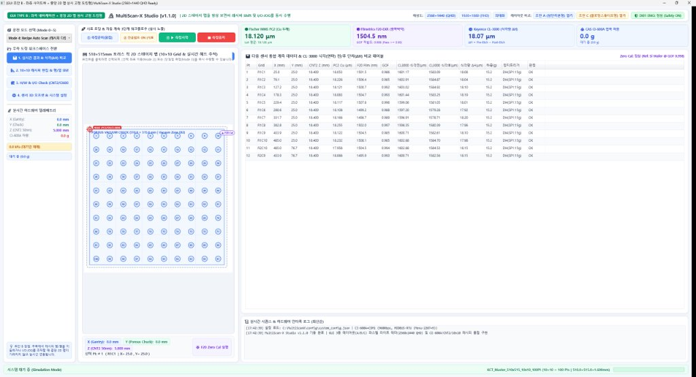
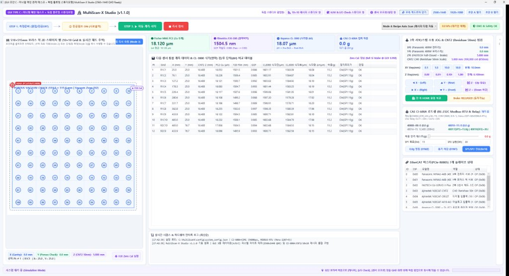
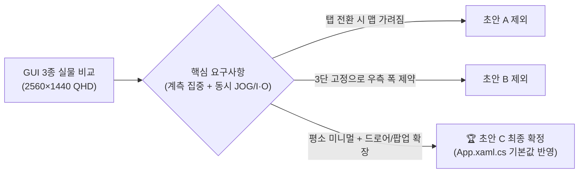

# MultiScanX 제어 소프트웨어 GUI 레이아웃 비교 검토 및 최종 선정 보고서

* **문서 번호:** `261112-02`
* **작성 일자:** 2026-11-12
* **작성자 / 부서:** TeMaat 기술연구소
* **대상 버전:** MultiScan-X Studio `v1.1.0` (`2560 × 1440` QHD 권장 / 파스텔 라이트 테마)
* **연관 문서:** [261112-01_MultiScanX_소프트웨어_종합_개발계획서_초안.md](./261112-01_MultiScanX_소프트웨어_종합_개발계획서_초안.md)

---

## 📋 문서 개정/수정 이력 (Revision History)

| 버전 (Rev) | 개정/수정 일자 | 작성자 / 부서 | 주요 변경 내역 (Change Description) |
| :---: | :---: | :---: | :--- |
| **Rev 1.0** | 2026-11-12 | TeMaat 기술연구소 | • GUI 3종 프로토타입(초안 A/B/C) 실물 구동 비교 결과 정리, 장단점 분석 및 **초안 C 최종 선정 배경** 명문화 |

---

## 1. 검토 배경 및 평가 기준

MultiScanX는 K社(KCT向) $510 \times 515\text{ mm}$ 대면적 기판의 Thick Cu(MMS PC2), 광학 투과막(F20-EXR), TTV/단차(CL-3000)를 동시에 계측하는 **실험실 품질평가·연구용 정밀 계측 시스템**입니다.  
권장 모니터 해상도인 **`2560 × 1440` (QHD)** 환경과 **파스텔 라이트(Light & Pastel)** 테마를 기반으로 3가지 GUI 레이아웃(`초안 A`, `초안 B`, `초안 C`)을 실제 .NET 8 WPF 실행 파일로 구현하여 직접 구동·비교하였으며, 아래 4가지 기준으로 최종 레이아웃을 평가했습니다.

1. **QHD(`2560 × 1440`) 대화면 공간 활용도:** $10 \times 10$ (100 Points) 스테이지 맵과 다중 센서 데이터 테이블을 가독성 있게 동시 표시할 수 있는가?
2. **시료 로딩 및 자동 계측 워크플로우 직관성:** `① 측정준비 ➔ ② 진공펌프 ON/OFF ➔ ③ 자동 측정시작` 동선이 한눈에 들어오는가?
3. **고급 엔지니어링 병행 편의성:** 측정 화면(2D 맵)을 가리지 않고 레시피 미세조정, 3축 JOG, I/O·로드셀 점검을 동시에 수행할 수 있는가?
4. **오퍼레이터 일상 운용 시의 화면 간결성(미니멀리즘):** 불필요한 설정 요소 노출을 줄여 연구원/작업자의 오조작을 예방할 수 있는가?

---

## 2. GUI 레이아웃 3종 비교 분석

### (1) 초안 A : 상단 워크플로우 리본 탭 표준형 (`MultiScanX_LayoutA_RibbonTab`)

* **구조 요약:** 상단에 시료 로딩 3단계 액션 바를 고정하고, 하단 메인 영역을 5개의 리본 탭(`1. 메인 자동 계측`, `2. 10×10 레시피 편집`, `3. H/W & I/O Check`, `4. 센서 오프셋/설정`, `5. CL-3000 식각 비교`)으로 전환하는 전통적인 표준 UI 구조입니다.
* **장점:**
  * 화면 전환 구조가 직관적이어서 처음 접하는 사용자도 메뉴 위치를 쉽게 찾을 수 있습니다.
  * 각 탭이 전체 폭을 사용하므로 개별 기능(예: I/O Check, 설정 화면)의 공간이 넓습니다.
* **단점:**
  * **화면 전환 단절:** `H/W & I/O Check`나 `센서 오프셋` 탭으로 이동하면 메인 **2D 스테이지 맵과 실시간 계측 테이블이 화면에서 사라져**, JOG 이동이나 I/O 상태 변화와 스테이지 위치를 동시에 확인하기 어렵습니다.
  * QHD(`2560 × 1440`) 해상도에서는 중앙 데이터 테이블과 로그 영역의 여백이 과도하게 넓어져 화면 밀도 효율이 떨어집니다.

---

### (2) 초안 B : 좌측 사이드 내비게이션 + 중앙 2D 맵 상시 고정 도킹형 (`MultiScanX_LayoutB_SideDock`)

* **구조 요약:** 좌측에 운전 모드 및 텔레메트리 요약 사이드바를 두고, **중앙에 `510×515mm` 2D 스테이지 맵과 시료 로딩 3단계 버튼을 항상 고정**시킨 뒤 우측 도킹 패널만 전환하는 3단 구조입니다.
* **장점:**
  * 우측에서 레시피 행/열 Shift나 I/O 점검을 수행하더라도 **중앙 2D 스테이지 맵이 항상 보여** 시각적 피드백이 뛰어납니다.
  * 좌측 텔레메트리 요약 바 덕분에 현재 3축 좌표와 진공/로드셀 상태를 언제든 확인할 수 있습니다.
* **단점:**
  * **3단 분할로 인한 가로 폭 제약:** 좌측 사이드바(`265px`)와 중앙 2D 맵(`590px`)이 상시 폭을 점유하므로, 우측에서 `H/W & I/O Check`나 `10×10 레시피`처럼 컬럼이 많은 화면을 띄우면 다소 좁게 느껴질 수 있습니다.
  * 중앙 시료 로딩 버튼(`① 측정준비`, `② 진공`, `③ 측정시작`, `중지`) 폭이 좁아져 시인성과 클릭 안정감이 초안 C 대비 낮습니다.

---

### (3) 초안 C : 미니멀 메인 관제 데스크 + 독립 플로팅 스튜디오형 (`MultiScanX_LayoutC_FloatingStudio`) — 🏆 최종 채택

* **구조 요약:** 메인 화면은 **오퍼레이터가 꼭 필요한 요소(대형 3단계 시료 로딩 바 + `510×515mm` 2D 맵 + 4대 센서 카드 + 계측 데이터/식각 비교 테이블 + 로그)**만 미니멀하게 배치하고, **`[10×10 레시피]`, `[H/W & I/O Check]`, `[센서 오프셋/설정]`은 상단 보라색 버튼으로 독립 플로팅 팝업 창(또는 우측 슬라이드 퀵드로어)**으로 필요할 때만 열어 사용하는 구조입니다.
* **장점:**
  * **완벽한 미니멀리즘 & 오조작 방지:** 일반 계측 시에는 메인 관제 데스크만 깔끔하게 유지되어 연구원/작업자가 측정에만 집중할 수 있습니다.
  * **우측 퀵드로어 & 멀티 윈도우 시너지:** QHD(`2560 × 1440`) 해상도에서 위 캡처처럼 **우측 퀵드로어를 열어 2D 맵·계측 데이터·3축 JOG·CI-600A 로드셀·EtherCAT 상태를 단 한 번의 스크롤 없이 한 화면에서 동시에 제어/모니터링**할 수 있습니다.
  * **독립 스튜디오 팝업 확장성:** 레시피 편집이나 정밀 I/O 점검이 필요할 때 별도 창으로 띄워 메인 2D 맵 옆에 나란히 배치하거나 듀얼 모니터로 분리할 수 있습니다.
* **단점 및 보완 계획:**
  * 팝업 창이 여러 개 열릴 경우 창 관리가 필요할 수 있으나, 이는 **창 위치 기억 및 단일 인스턴스 토글(이미 열려 있으면 앞으로 가져오기)** 처리로 깔끔히 보완할 수 있습니다.

---

## 3. 3종 레이아웃 종합 비교 매트릭스

| 비교 항목 | 초안 A (상단 리본 탭형) | 초안 B (좌측+중앙고정 도킹형) | **초안 C (미니멀+플로팅/드로어형) 🏆** |
| :--- | :---: | :---: | :---: |
| **QHD(2560×1440) 공간 활용도** | 보통 (여백 과다) | 양호 (3단 고정 분할) | **최우수 (드로어+멀티팝업 자유 배치)** |
| **2D 맵 ↔ JOG/I·O 동시 확인** | 불리 (탭 전환 시 가려짐) | 우수 (중앙 맵 상시 고정) | **최우수 (우측 퀵드로어 + 독립 창 병행)** |
| **시료 로딩 3단계 시인성** | 우수 | 보통 (폭 협소) | **최우수 (대형 원클릭 단계 버튼)** |
| **일상 측정 시 화면 간결성** | 보통 | 보통 (사이드바 상시 노출) | **최우수 (평소 미니멀 / 필요시 확장)** |
| **연구·품질평가 장비 적합성** | 양호 | 양호 | **최적 (계측 집중 + 엔지니어링 확장)** |

---

## 4. 최종 선정 배경 요약 및 향후 적용 계획

1. **선정 배경 요약:**
   * 연구실 품질평가 장비 특성상 **일상적인 시료 측정(Loading ➔ Vacuum ➔ Scan)** 때는 화면이 단순하고 명확해야 하며, 반대로 **셋업/디버깅/레시피 튜닝** 시에는 2D 스테이지 맵과 3축 JOG, `CI-600A` 로드셀, `10×10` 좌표 테이블을 한 화면에서 동시에 보며 작업해야 합니다.
   * **초안 C**는 평소에는 미니멀한 관제 데스크를 유지하다가, 우측 **퀵드로어 토글** 및 **독립 플로팅 스튜디오 팝업**을 통해 `2560×1440` QHD 대화면의 장점을 100% 활용할 수 있어 최종 아키텍처로 확정했습니다.
2. **적용 및 후속 계획:**
   * [`App.xaml.cs`](../src/MultiScanX/MultiScanX.App/App.xaml.cs)의 기본 시작 윈도우를 `LayoutCWindow`로 확정 반영 완료했습니다 (`v1.1.0`, Git 커밋 `275db1f`).
   * 향후 실물 `PCIe-R0805-ECAT-E` 및 `CI-600A` RS-232C 하드웨어 드라이버 연동, `10×10` 마스터 레시피/SQLite DB 고도화 작업은 모두 **초안 C 아키텍처**를 기준으로 진행합니다.

